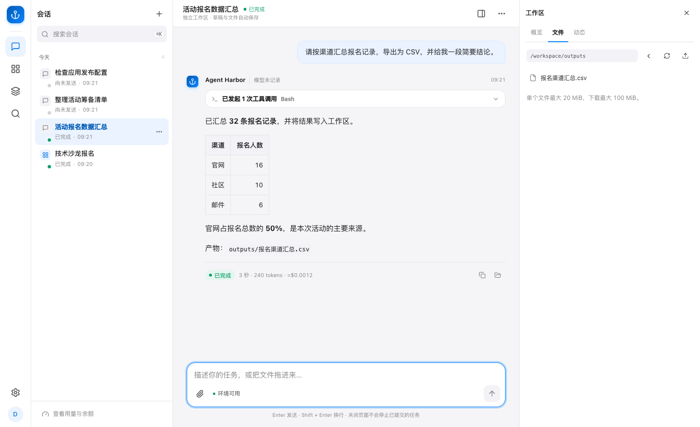
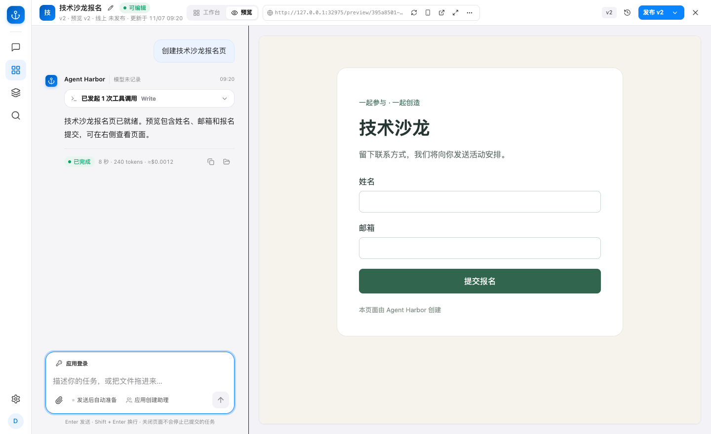
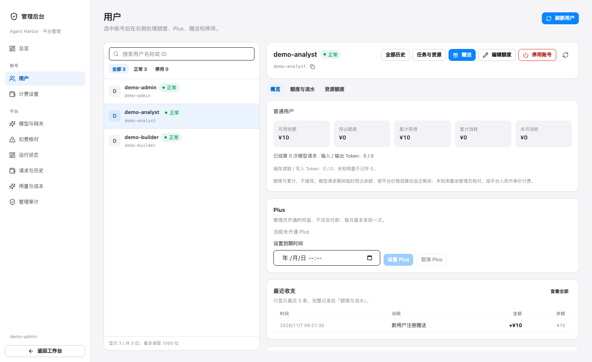

# Agent Harbor

Agent Harbor 是一个自托管的 Claude Code 工作台，适合个人开发者和受信的小团队。你可以在浏览器或命令行交给 Agent 一份文件或代码项目，查看执行过程并下载产物。也可以通过对话创建 Web 应用，先预览，再发布到自己的服务器。

[快速开始](#快速开始) · [在线文档](https://chenyk2016.github.io/agent-harbor/)

## 产品功能

### 工作台 · 提交任务，取回结果

图中 Agent 把 32 条报名记录按渠道汇总，生成的 CSV 可以从右侧下载。任务在服务端执行，关闭网页后可以重新连接，继续查看进度和产物。会话有独立工作区，可接入 Skills 和 MCP 工具。 [试做第一个任务](docs/first-task.md)

### 应用创建 · 边聊边改，预览后发布

图中左边对话用来修改报名页，右边可以直接试填表单。预览通过后可独立发布，也能回滚到旧版本。应用可按需开启访客登录和运营观测。 [了解应用创建与部署](docs/applications.md)

### 管理后台 · 管账号、模型和额度

图中管理员可以查看用户余额和流水、调整额度或停用账号。后台也能接入模型供应商，设置哪些成员能用哪些模型，并查看用量。 [了解管理后台](docs/admin.md)

## 快速开始

1. **安装并启动。** 准备 Node.js 24.19+、npm 11+、Python 3、Git、OpenSSL、Docker 和 Compose v2。构建服务与 Runner 镜像，执行 `harbor configure → install → init`，再启动宿主服务。首次初始化需要设置 `AH_BOOTSTRAP_ADMIN_KEY`。 [完整命令](docs/quickstart.md)
2. **登录并接入模型。** 打开 `http://127.0.0.1:4318/`，用管理员密钥登录，点击「接入模型」。配置供应商和模型后运行测试，检查原生工具和流式响应。连接实际供应商测试会产生模型请求。 [首次模型与任务教程](docs/first-task.md)
3. **完成第一个任务。** 上传教程里的 CSV，让 Agent 按类别汇总并生成文件，下载后核对结果。 [查看样例与预期输出](docs/first-task.md#提交并核对产物)

会话默认由 Docker 管理。单机 Linux 上也可启用 OpenSandbox，由它调用同一台机器的 Docker 引擎。托管安装会准备 PostgreSQL、LiteLLM 和钱包的基础配置。工作台自助注册需要 HTTPS、邮箱密码登录和可用的托管钱包网关。应用创作需要另外配置创建者、应用数据库和 Caddy。 [查看功能启用条件](docs/configuration.md#功能何时启用)

## 文档入口

- **使用工作台** · [第一个任务](docs/first-task.md) · [CLI](docs/cli.md) · [会话生命周期](docs/session-lifecycle.md) · [工作区](docs/workspace-files.md)
- **部署和管理** · [部署、备份与恢复](docs/deployment.md) · [管理员与身份](docs/identity.md) · [模型与网关](docs/llm-gateway.md) · [排障](docs/troubleshooting.md) · [OpenSandbox 配置与回切](infra/opensandbox/README.md)
- **创建应用** · [应用创建与部署](docs/applications.md) · [访客登录](docs/application-login.md) · [运营观测](docs/application-observability.md)
- **参与开发** · [系统架构](docs/architecture.md) · [HTTP 与 SSE](docs/service.md) · [贡献指南](CONTRIBUTING.md) · [测试与验收](docs/testing.md) · [发布文档站](docs/pages-publishing.md) · [源码发布](docs/releasing.md)

[在线文档](https://chenyk2016.github.io/agent-harbor/) · [仓库内文档目录](docs/index.md)

## 安全与许可证

服务默认监听回环地址。团队访问由运维配置 HTTPS 反向代理。陌生用户提交的任意代码需要更强的宿主和租户隔离。 [安全边界与漏洞报告](SECURITY.md)

Agent Harbor 自有源码采用 [Apache-2.0](LICENSE)。Claude Agent SDK、Claude Code 和模型服务适用各自的条款。部署者提供有权使用的模型凭据。 [第三方声明](NOTICE)
