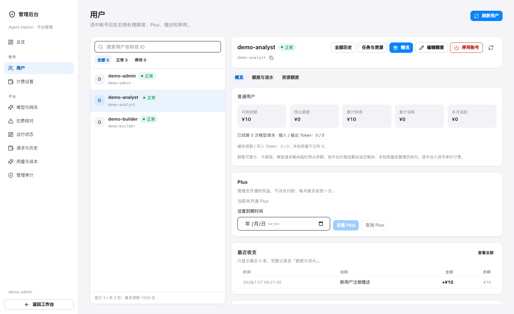

管理后台用于给团队分配资源、接入模型、查看用量和处理运行异常。管理员登录后，从工作台左下角账号菜单进入「管理后台」。

## 各页面能解决什么问题

| 页面 | 什么时候使用 |
| --- | --- |
| 总览 | 了解平台概况，找到需要处理的扣费或模型异常 |
| 用户 | 查找成员、赠送额度、设置资源限制、管理 Plus 和停用账号 |
| 计费设置 | 设置注册赠送、Plus 月赠，或向一批用户赠送额度 |
| 模型与网关 | 接入供应商，管理模型、价格和使用范围 |
| 扣费核对 | 处理用量不完整、金额尚未确认的模型请求 |
| 运行状态 | 查看服务与依赖是否正常，处理任务和资源异常 |
| 请求与历史 | 查看某次模型请求的状态、用量和相关记录 |
| 用量与成本 | 按时间、用户或模型查看已记录的用量与费用 |
| 管理审计 | 追查管理员做过的修改及其结果 |

## 管理用户和额度

1. 打开「用户」，按名称或 ID 查找成员。
2. 选中成员，在「概览」查看余额、预占和近期消耗，在「额度与流水」查看明细。
3. 需要补充余额时点「赠送」，核对收款人和金额后提交。
4. 需要限制使用量时，在「资源额度」调整会话数、并行任务数、保留环境数和工作文件软额度。

工作文件软额度用于发现超量，不能保证任务执行过程中绝不超过限制。批量赠送在「计费设置」中进行，提交前会显示人数、名单和合计金额。邮箱自助注册当前固定赠送 10 元，不随后台注册赠送金额调整；其他规则见 [额度与计费](wallet.md)。

停用账号前先阅读页面提示。不能停用自己的账号；重新启用也不会恢复已经撤销的密钥或登录，需要成员重新登录或创建密钥。

## 让团队使用一个模型

在「模型与网关」点「快速接入」，完成 [模型接入向导](llm-gateway.md)。测试通过后，打开模型详情的「使用范围」添加允许使用的成员。向导新接入的模型默认只供操作管理员使用；使用范围留空表示所有用户。

调整供应商地址、模型版本、价格或使用范围时，先核对页面展示的修改内容和影响，再提交。保存后可在管理审计中查看记录。

## 处理扣费待核对

请求因上游错误或服务异常而缺少完整用量时，金额可能暂时无法结算，相应额度会保持预占。

1. 打开「扣费核对」，选中请求。
2. 核对用户、模型、时间、预占及已有用量记录。
3. 根据可靠依据填写实际扣款和备注。扣款不能超过预占；确认无消费或决定由平台承担时可填 0。
4. 提交后检查请求状态和用户流水。

不能确定实际金额时，保留待核对状态。Harbor 的内部流水与供应商账单分别记录，不能把缺失用量当作免费调用。

## 查看运行异常和用量

「运行状态」提供服务、数据库和网关的免费存活检查，以及已记录的任务与资源信息。异常可以认领、备注，实际恢复后再确认。该页面不会为探测而调用付费模型。

「用量与成本」默认显示最近 7 天，可调整时间范围，并按用户或模型查看。人民币额度消耗与美元供应商成本分别展示；未知成本和不完整用量会单独标识。请求成功率表示接口响应情况，不能代表任务结果的质量。

请求、流水和审计支持筛选与 CSV 导出。每次最多导出 5000 条，超过时缩小时间或对象范围。

后台不提供聊天正文、用户工作文件和个人密钥浏览。模型与工具的进一步追踪需单独配置 [模型与任务观测](llm-observability.md)。

[返回配置与管理](manage.md)
