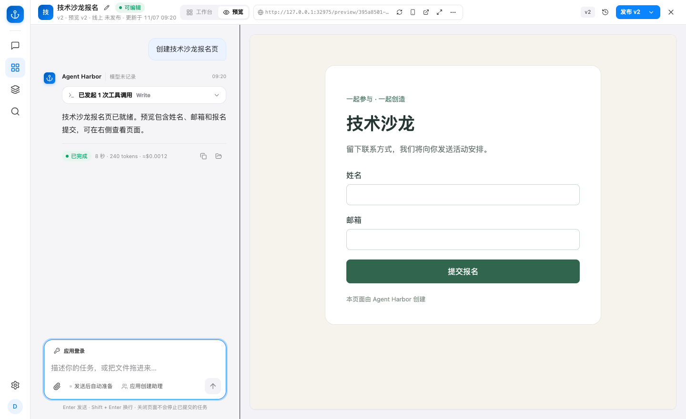

你可以在应用编辑器中持续描述需求，让 Agent 修改应用，先试用，再决定是否发布。

## 开始前

需要管理员开通应用功能、授予创作权限，并提供可用模型与额度。没有创建入口或页面提示不可用时，联系管理员查看 [应用功能配置](application-configuration.md)。

## 创建一个报名应用

打开「应用」的新建入口，描述用途、用户、字段和预期行为。例如：

> 创建一个技术沙龙报名应用。展示活动时间和地点，收集姓名、邮箱和报名渠道。提交前检查必填项，成功后显示确认信息并保存报名记录。页面适配手机。先做成公开应用。

生成完成后会保存源码版本并准备预览。左侧继续对话，右侧切到「预览」试用；也可以切到「工作台」查看数据、版本、文件和操作记录。

## 在预览中检查

1. 实际填写并提交一次，确认页面和成功提示。
2. 故意漏填或填错，检查校验是否清楚。
3. 切换手机宽度，检查布局和按钮。
4. 到「工作台 → 数据库」选择测试环境，核对保存的记录。
5. 把具体问题发给左侧对话，修改后重新试用。

预览未成功时，查看「操作记录」的失败原因，修复后使用「重试预览」。重试构建不等于重新生成应用。

离开编辑页 **30 分钟**后，空闲预览会被回收。再次构建预览可恢复访问，源码版本和测试数据保留。

## 发布给访客

1. 确认当前版本已经完成预览。
2. 点击「发布」，等待状态显示成功。
3. 从「工作台 → 发布与地址」打开正式地址。
4. 在正式地址再次检查关键流程和正式数据。

测试与正式环境的数据、访客账号分别管理，试填数据不会自动带入正式环境。正式应用发布后独立运行，离开编辑器或退出登录不会使它下线。

需要访客登录时，先按 [应用访客登录](application-login.md) 设置并检查，再发布。

## 修改、恢复与回滚

| 你要做的事 | 使用的操作 | 对正式应用的影响 |
| --- | --- | --- |
| 继续改页面或功能 | 在编辑对话中提出要求 | 发布前不替换正式版本 |
| 查看或下载源码 | 工作台中的版本记录与源码下载 | 不影响正式版本 |
| 基于旧源码继续修改 | 恢复旧源码，保存为新版本后预览 | 需要再次发布才生效 |
| 撤回一次发布 | 在发布记录中回滚到已有版本 | 切换正式运行的代码 |
| 暂时停止对外访问 | 下线正式应用 | 保留版本和业务数据 |

**代码回滚不会回滚业务数据。** 数据结构当前支持新增表和新增可空字段；删表、删字段、改名或改变字段类型会被阻止。修改应用时，应保留已有数据字段，并先检查预览。

## 发布后看什么

在「工作台 → 数据分析」查看访问、转化和错误；在数据库中核对业务记录。也可以用只读问数理解获准数据，再把确认的改进要求带回编辑对话。

[应用数据与分析](application-observability.md) · [删除与数据保留](deletion.md) · [返回使用指南](guide.md)
