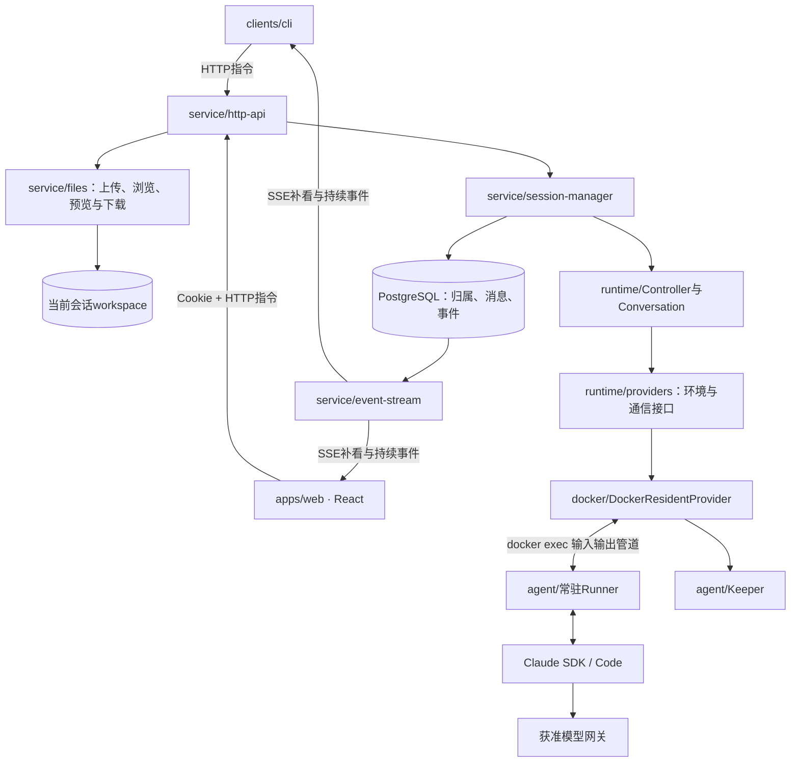

# 架构与职责

V3把客户端连接和执行生命周期分开：长期服务持有Conversation，网页和CLI只提交请求和查看事件。V4网页与HTTP接口同源部署；V5补文件，V6补身份、额度和用量，都复用V3执行链路。V7将正式网页迁移到apps/web（React/Chakra UI/Vite），复用原有状态逻辑与接口。控制面数据库已从SQLite迁移到PostgreSQL，表结构由受控迁移步骤建立，业务数据用单独导入脚本搬迁。

## 一条消息

1. 网页或CLI生成clientMessageId，向服务提交正文。重试使用同一个ID。
2. HTTP验证凭证及会话归属；SessionManager检查去重、忙状态和容量。
3. PostgreSQL事务保存accepted消息和事件，成功才返回202；同一会话的接收由行锁串行化。执行由服务自己的AbortController管理。
4. 服务打开或复用Conversation，将服务messageId作为执行attemptId。
5. Conversation通过同一条Docker输入管道发送JSON行。Runner的异步生成器逐条交给同一次SDK query。
6. Runner转换原生输出；执行层先记录诊断，再通知服务保存公开事件。
7. SSE读取已提交事件，客户端按eventId显示与重连。原生result之后还要等待执行层收尾，才保存message.finished。

## 模块边界

| 目录/文件 | 职责 |
| --- | --- |
| `service/server.ts` | 独立进程入口、全根锁、恢复及关机 |
| `service/http-api.ts`、`identity/`、`browser-sessions.ts` | 路由、OIDC/密钥/Cookie身份、账户管理及归属入口 |
| `service/admin/` | 管理员元数据查询、运行采样、持久异常、操作审计、变更预览与导出；不控制SDK循环 |
| `service/limits/`、`usage/` | 用户策略和原生累计用量观察，不控制SDK工具 |
| `service/session-manager.ts` | 活会话、消息执行、中断、关闭、容量与空闲回收 |
| `service/service-store.ts` | PostgreSQL事务、会话行锁、去重、消息状态和持久事件 |
| `service/db/` | pg连接池、Drizzle表定义、受控迁移与SQLite导入脚本 |
| `service/files/` | 文件传输和描述符访问边界，复用身份/归属，不经过SDK |
| `service/event-stream.ts` | 游标补发、保活及慢连接断开，不控制执行 |
| `service/recovery.ts` | 汇总目录/数据库/标签，确认停止旧容器，不重放任务 |
| `clients/` | CLI、共用HTTP/SSE客户端及正式网页 |
| `runtime/` | 会话锁、状态文件、原生恢复与Runner连接 |
| `runtime/providers/` | 环境生命周期和 Runner 通信接口。引擎状态无法确认时拒绝继续 |
| `docker/` | Docker 适配器、固定 CLI 参数、归属检查和停止确认 |
| `agent/` | 容器内输入队列、SDK调用、事件转换、Keeper和沙箱 |
| `shared/` | 协议、执行类型及容器路径约定 |

## 状态的归属

PostgreSQL保存服务对外的会话归属、用户消息、请求去重和事件。session.json保存执行层的容器、镜像、原生会话ID及最近一轮事实。原生上下文仍由Claude Code维护，不在数据库重做一套上下文。

clientMessageId解决重复提交；messageId同时是执行attemptId；generation排除旧轮次；runnerId标记一份常驻环境；原生sdkSessionId用于恢复。这些ID均不能代替访问授权。

## 停止与故障

用户停止只针对messageId。含本地MCP时强制清理整个会话环境，避免MCP继续在后台执行；其他任务原生中断后等待本轮result，检查环境仍可用，再接受下一条；中断超时、任务总超时、协议异常及明确关闭会确认整个容器停止。后台任务可能跨原生中断继续；关闭环境才停止容器内全部进程。

服务退出或崩溃后，首次恢复取得所有会话锁再清理旧容器。恢复沿用旧版会话文件和 Docker 归属标签。已断开的 exec 管道无法接管，未完成消息标记为 interrupted，不自动再执行。引擎未知保持reconciling，不允许新写入者。

## 当前取舍

单Node进程、PostgreSQL和Docker CLI降低部署与阅读成本；没有调度集群或消息队列。控制面查询是异步的。服务用一把短接收锁串行处理额度检查、消息接收、上传占位和关闭登记，跨过await仍保有同一个操作顺序；真正的模型执行、文件传输和容器清理在锁外运行，不同会话仍可并行。同一会话的消息去重、事件编号和状态提交另由数据库行锁保护。SSE每200ms批量读取新增事件，容易实现历史与实时交接，代价是连接多时增加查库；有性能证据后可以改成提交后唤醒。

V6通过identity模块接OIDC，复用Cookie和会话ownerId；登录/密钥哈希、用户策略与费用观察值存PostgreSQL。SessionManager在接收前检查个人任务/环境额度并占位，文件层执行空间软检查；默认全局4份环境、空闲15分钟回收。费用差额是估算，不是计费账本；仍没有磁盘硬配额、生产隔离结论或服务故障时计算无缝继续的保证。详见[管理员与身份](identity.md)。

## 异步接收的边界

- 创建会话先预约个人名额，模板复制不持有接收锁；复制失败会释放预约。
- 消息与上传共用接收锁登记占位，避免查询数据库期间另一方进入；额度检查与执行句柄登记在同一段受保护流程中完成。
- 消息事务拿到会话锁后，先查重复clientMessageId与正文，再判断忙；重试返回原消息。
- 取消保存原消息的AbortController，不在等待SQL后重新取下一轮的句柄；数据库对终态/重复取消不追加停止事件。
- 空闲回收登记关闭前重新检查是否已有新任务，实际容器停止不持有接收锁。

这依赖当前单执行服务，不能作为多实例调度锁使用；执行容器和工作区的原有锁及停止确认保持不变。

## V8：技能与会话如何连接

SkillService管理完整源包和不可变版本；SkillBuildManager管理准备请求和个人默认版本；Docker的SkillBuilder只负责固定源下载、断网安装、产物校验和停止确认。网页不直接拼Docker或SDK参数。

创建会话时，服务固定所选版本和镜像，只复制对应技能到会话目录。Runner通过SDK plugins参数暴露目录，保留原生默认技能与Skill工具。平台不审核技能正文、不检查技能调用名字、不做额外初始化门槛，不记录专用装载确认事件。Claude负责发现和调度，恢复继续使用原文件快照。

准备请求与构建分开：多个等待者可复用同一份产物；取消最后一个等待者才停止安装环境。停止不明时保留占用，重启先协调Docker，不自动重放安装。文件布局、Python/Node依赖格式、软磁盘限额和验证边界见[技能管理与运行](skills.md)。

## 基础 MCP

McpService只管理用户连接和凭据，Claude Code原生处理HTTP/stdio。新环境使用当前启用配置；摘要变化时重建环境，保留聊天和工作区。没有独立MCP网关、Grant或Binding。

本地程序由可信启动器先构造干净环境，再通过srt执行。规则从本环境最终Claude受管配置派生；源码原件留在宿主，按连接复制运行，依赖复用npm/uv/pip个人缓存。含本地MCP的任务取消时确认整个环境停止。完整接口、迁移和限制见[MCP指南](mcp.md)。

## 人民币额度

wallet模块负责注册/Plus/管理员赠送、账户预占、收支流水和平台价格结算。托管网关及钱包推理地址就绪后，Runner只持Harbor钱包Token，通过/inference调用计费转发；宿主替换为实际LiteLLM Key后请求网关。每次模型调用都检查余额，不以一条用户消息代表一次调用。完整usage确认后结算，未知保留预占；原消息次数限制已停用。

控制面钱包保存人民币平台消费，SDK美元估算与LiteLLM网关费用是不同观察口径。Plus首版为管理员授予，不接支付。首版全余额预占使同一用户模型调用串行；单次超额由平台承担，不能把它理解为供应商成本的绝对封顶。详细规则和验证边界见[钱包指南](wallet.md)。
