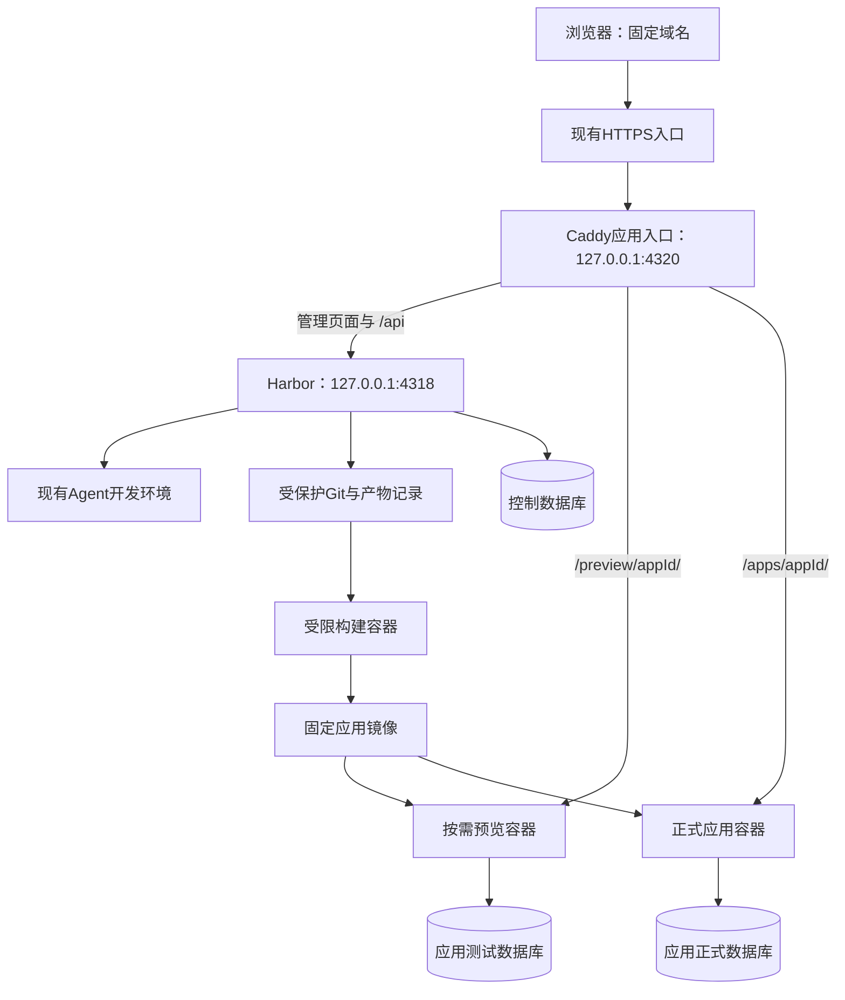
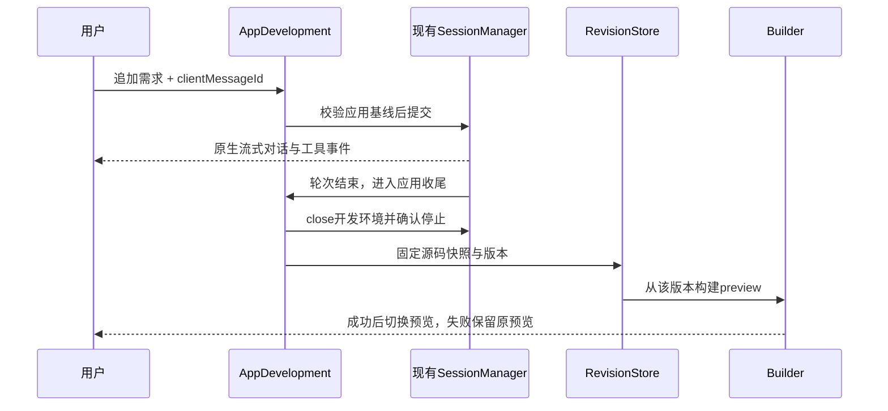

# Agent Harbor 应用创建第一版：完整技术方案

版本：0.3；日期：2026-10-26；状态：设计交付，待实施验证。本文为应用创建技术方案的唯一正式原件，替代此前简化设计中的未定选项。[产品范围](../specs/app-builder-v1.md)保留产品视角，不另维护技术状态。

## 1. 目标、约束与设计结论

### 1.1 用户已确认

1. 输入一句话创建简单业务应用，覆盖页面、表单、数据存储和基础接口。
2. 持续对话修改，右侧可操作预览，应用有版本和管理工作台。
3. 预览公开，不需要预览登录、邀请或私有预览授权模块。
4. 使用现有一个固定域名，通过URL路径区分应用，部署尽量简单。
5. 用户最终确认采用：固定版本源码 → 构建产物 → 打包应用镜像 → 启动容器 → 网关转发。此前讨论的静态资源加共享后端属于备选，不作为本方案实现路线。

实际域名、服务器系统、现有HTTPS入口、可用内存和数据库管理权限尚未提供或检查；本文用`PUBLIC_ORIGIN`表示部署后的固定来源，不虚构已有资源。

### 1.2 固定实现路线

| 决策 | 首版选择 | 原因与代价 |
| --- | --- | --- |
| 运行拓扑 | 单台Linux服务器，Harbor控制服务、Caddy入口、Docker、共享PG服务 | 部署对象少；宿主故障会影响整体，不承诺高可用 |
| 应用类型 | 固定React + TypeScript + Node模板，前后端合入一份应用镜像 | 一个应用服务端口，减少框架差异；不支持任意项目直接托管 |
| 地址 | 正式`/apps/<appId>/`，预览`/preview/<appId>/` | 复用现有域名与证书，不管理子域名或通配DNS |
| 源码版本 | 每App一个平台保护的Git仓库，线性Revision历史 | 用户不需要GitHub；Git不保存数据库、秘密或运行状态 |
| 源码一致性 | 应用开发轮次收尾后关闭开发环境并确认停止，再采集快照 | 直接复用已有关闭/resume能力；下一轮有重建环境开销 |
| 预览 | 每App最多一个当前预览容器，按需运行，使用固定产物 | 不依赖Agent后台进程；多一个按需容器，换来最近成功预览可保留 |
| 发布 | 固定production产物 → 候选容器 → 检查 → 路由切换 → 回收旧容器 | 发布短时需要新旧两份实例资源 |
| 数据 | 一套PG服务，每App的preview/production分别建database与受限账号 | 数据与容器分离；增加少量数据库和角色管理 |
| 异步任务 | PostgreSQL操作记录 + Harbor进程内执行器，首版单实例 | 不引入Redis、消息队列或部署微服务 |
| 首版开放边界 | 受信创作者试用，访客可公开访问页面与获准业务接口 | 单hostname路径不具备浏览器来源隔离，不作为陌生人任意代码托管平台 |

最后一项是当前技术方案的发布适用范围，尚不等于用户要求只做个人应用。若目标改成不受信创作者开放注册，需要先补浏览器和执行隔离设计，不能在同源页面下宣称租户隔离完整。

### 1.3 首版不做

Kubernetes、多机调度、多框架、Git分支合并、多人实时编辑、自定义域名、复杂终端用户账号体系、支付、后台定时业务任务、任意SQL迁移、完整数据库控制台、高级分析与压测。普通会话/Skill/专家/MCP的既有行为不因本功能默认变化。

## 2. 现有实现、复用点与缺口

以下为2026-10-26源码静态核对，不是新功能运行证据：

| 现有位置 | 可复用能力 | 本次需要补充 |
| --- | --- | --- |
| `src/service/http-api.ts` | Express装配、身份与Origin/CSRF检查 | 注册应用管理Router；公开应用流量不经过管理认证链 |
| `src/service/session-manager.ts` | 消息去重、持续会话、取消、容量与关闭 | 应用开发写入门、轮次完成钩子、快照收尾状态 |
| `src/runtime/conversation.ts` | 原生SDK输入、interrupt、关闭/resume | 保留原生loop；应用模式在轮次后显式关闭再快照 |
| `src/runtime/storage.ts` | 会话目录、状态与flock | Git和发布数据放独立受保护目录，不作为可写workspace挂载 |
| `src/service/service-store.ts` | PG事务、会话行锁、消息和事件 | 应用表、应用事件、幂等操作与版本基线约束 |
| `src/docker/docker.ts` | Docker CLI数组参数、实际inspect、停止确认 | 新AppDockerDriver；不能直接套用开发容器的Keeper和策略 |
| `src/service/recovery.ts` | 重启时清理旧开发环境 | 应用容器必须使用不同资源标签，另走“核验后接管”流程 |
| `src/service/server.ts` | 根锁、启动/关机协调 | 运行AppManager；关机只停止应用任务，不关闭已发布容器或入口代理 |
| `apps/web/src/app/App.tsx` | React Router、登录与统一外壳 | 新增应用列表和编辑器，复用现有对话状态与附件逻辑 |
| `src/service/web-assets.ts` | 管理页面白名单与CSP | 增加管理页面深链和iframe来源策略，不把任意应用文件挂成管理静态资源 |

现有`recover()`会把数据根下符合会话ID形状的目录视为会话。因此应用数据根默认使用`.applications/`，并且应用容器不使用`harbor.session`/开发`harbor.owner`标签。此处必须有回归，避免Harbor重启误删应用。

## 3. 物理部署与职责



- Caddy作为独立受信宿主进程运行，持久保存入口配置，独立于Harbor启停。已有HTTPS入口只需一次性把固定域名转发到4320，保留原始Host；如果入口不能配置，部署前先解决可转发条件。
- 4318继续是Harbor自身服务，4319继续是现有MCP网关；4320是新增建议端口，部署时检查占用。
- Caddy路由按应用精确登记，匹配`/apps/`和`/preview/`保留前缀；其他合法管理请求转发Harbor。未知应用返回404，不能回退成Harbor首页。
- AppManager/AppWorker在Harbor进程内，利用已有Docker CLI控制宿主容器；生成程序不能访问Docker socket、Caddy管理端或平台配置。
- 共享PG是“一套数据库服务”，不是所有应用共享一个管理账号。控制面和各业务数据使用不同database/角色。
- 本机Mac用于开发验证；正式基线选Linux Docker。不能以OrbStack结果替代Linux网络、重启或资源隔离验收。

部署前提：服务器能运行Docker和Git；现有域名HTTPS正常；操作者能配置入口转发、Caddy进程、数据备份和PG受控建库权限。未知值保留为部署配置，不从本机环境推断。

## 4. 模块设计与代码落点

拟新增模块如下，均未创建实现文件：

| 模块/拟定位置 | 职责 | 不承担的职责 |
| --- | --- | --- |
| `service/applications/service.ts` | App创建/归属/元数据/归档、聚合查询 | 不执行生成业务代码 |
| `service/applications/development.ts` | 开发会话绑定、写入门、轮次后快照、恢复 | 不替代Claude原生loop |
| `service/applications/revisions.ts` | 源码采集、Git引用、Revision、源码导出 | 不回滚业务数据库 |
| `service/applications/builds.ts` | Build排队、受限编译、产物登记 | 不在宿主执行npm脚本 |
| `docker/app-builder.ts` | 固定Builder容器规格、停止与输出校验 | 不接受用户Dockerfile或宿主命令 |
| `service/applications/deployments.ts` | 预览、发布、回退、下线与运行核对 | 不管理DNS或证书购买 |
| `docker/app-runtime.ts` | 固定容器创建/inspect/停止、镜像摘要与资源归属 | 不套用开发Runner生命周期 |
| `service/applications/edge.ts` | Caddy受控子路由、ETag、期望/实际核对 | 不允许任意IP/端口代理 |
| `service/applications/data.ts` | 数据库/角色供应、声明式迁移、记录管理 | 不暴露任意SQL控制台 |
| `service/applications/operations.ts` | 持久操作、执行器、取消和恢复 | 不自动重放不确定业务写入 |
| `service/applications/http.ts` | 管理API、参数与身份检查、SSE | 不承载生成应用的公开API |
| `service/db/schema/applications.ts` | 控制面表定义 | 不包含生成应用的实际业务表 |
| `shared/applications.ts` | DTO、状态和事件类型 | 不携带密钥明文 |
| `apps/web/src/features/applications/` | 列表、编辑器、预览、版本、数据/发布工作台 | 不拼Docker/Caddy命令 |
| `templates/application-v1/` | Agent可编辑的标准应用源码模板 | 不包含管理凭据 |
| `infra/app-runtime/` | 固定启动器、Builder和Runtime基线 | 不随每个应用任意改写 |

实现尽量按职责合并小文件；表格是边界，不要求一次创建所有空模块或抽象框架。

## 5. 标准应用契约

### 5.1 源码约定

```text
workspace/
  harbor-app.json          # 格式版本、数据声明、公开接口范围
  package.json
  package-lock.json
  index.html
  src/                    # React页面、样式、表单
  server/index.ts         # 导出register(router, context)，不自行listen
  public/                 # 创作者提供的静态资源
  tsconfig.json
```

平台固定Node主要版本、模板版本、受信运行基线及构建入口，实施时锁定镜像内容摘要和包锁；不使用漂移的latest。应用源码允许生成依赖和业务逻辑，但不声明宿主挂载、Docker参数、启动用户或端口。

示例声明（不是已实现API）：

```json
{
  "formatVersion": 1,
  "template": "react-node-v1",
  "tables": {
    "signups": {
      "fields": {
        "name": {"type": "text", "maxLength": 80},
        "email": {"type": "text", "maxLength": 160}
      },
      "publicCreate": true,
      "publicRead": false
    }
  }
}
```

首版数据字段限text/number/boolean/timestamp/json；固定UUID主键、创建/更新时间和记录版本字段由平台管理。关系建模器、触发器自定义、任意扩展和用户SQL迁移后置。

### 5.2 路径、页面与接口

- `BASE_PATH`在构建时固定为`/preview/<appId>/`或`/apps/<appId>/`，均以斜杠结尾。
- Vite使用相应`base`，BrowserRouter使用相应`basename`，所有应用API通过模板提供的`appApiUrl()`构造，不写根路径`/api`。
- 固定启动器监听容器`0.0.0.0:3000`，保留前缀挂载前端、资源及应用API；`server/index.ts`仅注册前缀内的业务路由。
- 深层页面GET返回对应应用index；`<base>/api/*`未知接口返回JSON 404；缺失资源返回404，不一律返回HTML。
- 无尾斜杠的应用根地址先308跳转到带斜杠地址。入口统一规范编码路径，拒绝App ID中的编码斜杠、反斜杠和路径穿越，不把字符串拼成代理地址。
- 预览与正式使用不同base，故是同Revision的两份Build，产物摘要可能不同。首版接受重复构建，避免运行时修改打包文件；不得宣称预览镜像原样晋升正式镜像。
- 生成页面不注册Service Worker，入口不允许扩大`Service-Worker-Allowed`范围；首版不支持离线PWA。

Vite的构建base与React Router basename都有官方支持，但仍须验证动态图片路径、重定向、嵌套路由及API。[Vite](https://vite.dev/guide/build.html#public-base-path)、[React Router 7.18.4](https://reactrouter.com/7.18.4/api/declarative-routers/BrowserRouter)。

### 5.3 受信Runtime

固定Runtime启动器先注册`<base>/__harbor/health`，返回平台注入的appId/revisionId/buildId/deploymentId和schema兼容检查；生成路由不能覆盖此入口。健康接口不返回配置、连接串或日志。

运行时按环境取得本应用数据访问能力，固定CRUD助手按声明校验输入和公开权限。名单管理、数据导出等创作者操作在Harbor工作台内完成，不向生成页面注入Harbor Cookie或管理Token。

首版不支持应用启动时迁移、自动写示例数据、邮件、定时任务或其他外部副作用；只有明确业务请求才触发业务写入。测试示例数据只能写preview数据库。该约束是受信模板契约，不被表述为恶意生成代码无法绕过的安全证明。

## 6. 控制面数据模型

沿用pg + Drizzle；通过受控SQL迁移新增表，不随服务启动建表。下列字段是实现契约，具体SQL文件编号在开发时按最新迁移顺序确定。

| 表 | 核心字段 | 约束/含义 |
| --- | --- | --- |
| `applications` | id、ownerId、title、status、developmentSessionId、headRevisionId、nextRevisionNumber、stateVersion、lastEventId、createdAt/updatedAt | 一个App一个当前可写开发会话；ID是UUID，显示名不是路由身份 |
| `app_revisions` | id、appId、number、parentId、restoredFromId、sourceSessionId、sourceMessageId、gitCommit、sourceHash、manifestHash、templateVersion、summary、createdAt | unique(appId,number)；内容不可变；无源码变化不自动增版 |
| `app_builds` | id、appId、revisionId、target、basePath、builderImageId、runtimeImageId、inputHash、artifactImageId、status、checkReportPath、logPath | target=preview/production；Build可失败、重试并保留原尝试 |
| `app_deployments` | id、appId、buildId、environment、dataEnvironmentId、configRevision、containerName/containerId、hostPort、desiredState、observedState、epoch、createdAt | 按确定名称和归属恢复；只有本App同环境Build可部署 |
| `app_endpoints` | appId、environment、pathPrefix、generation、desiredDeploymentId、appliedDeploymentId、observedRouteHash、checkedAt、state | primary(appId,environment)，pathPrefix唯一；期望不等于实际 |
| `app_data_environments` | id、appId、environment、databaseName、runtimeRole、migratorRole、credentialRef、schemaSpec、schemaHash、status | unique(appId,environment)；不保存明文连接串 |
| `app_operations` | id、appId、ownerId、kind、clientRequestId、requestHash、state、phase、resourceKey、epoch、messageId、payload/result、errorCode、timestamps | unique(ownerId,kind,clientRequestId)；资源键决定互斥范围 |
| `app_events` | appId、eventId、operationId、type、publicPayload、createdAt | primary(appId,eventId)；在更新状态同一事务递增App游标 |

表中的跨应用引用必须通过组合外键或持有App行锁的存储方法校验；不能只检查UUID存在。数据库默认保留历史，App归档不会级联删除版本/发布记录。

`sourceHash`覆盖规范化源文件集；`inputHash`另包含basePath、目标、包锁、模板/Builder/Runtime摘要和公开构建配置。镜像标签可辅助查找，运行和回退用`artifactImageId`，不靠可变tag。

App、Revision、Build、Deployment分别回答“哪一个应用、哪份源码、哪次构建、哪份运行实例”。SDK原生sessionId不承担应用版本职责。

## 7. 幂等、互斥、状态与调度

### 7.1 操作约定

- 异步管理请求带`clientRequestId`；同ID同正文返回原operation，同ID不同正文409。客户端超时先GET回查，不自动换ID重做。
- 生成消息沿用`clientMessageId`及现有消息去重，不建立第二套模型消息ID；AppOperation通过messageId关联。扩展接收事务，使消息登记与应用操作引用同时成立。
- 修改App元数据、恢复、发布/下线携带`expectedStateVersion`或`expectedEndpointGeneration`，过期请求409。
- 开发写入键`app:<id>:source`覆盖提交消息、上传源码、手工快照和恢复；发布键`app:<id>:production`覆盖publish/rollback/unpublish；预览切换有独立代次。
- 每App同类操作忙时409，明确返回活动operation；首版不隐式排队同一App的多个发布。不同应用的已登记Build可等待全局构建名额。
- 发布读取固定Revision，允许用户同时继续开发下一版。旧异步结果只有匹配当前预览意图代次时才更新预览，不能覆盖新意图。
- 必须在SessionManager及文件写入口识别应用绑定，普通`/sessions/:id/messages`和上传API也经过App写入门，不能从旧接口绕过。

### 7.2 状态

| 对象 | 状态 |
| --- | --- |
| App | provisioning / active / archived / deleting / deleted / reconciling |
| Operation | queued / running / cancelling / succeeded / failed / cancelled / reconciling |
| Build | queued / building / checking / succeeded / failed / cancelled / interrupted / reconciling |
| Deployment期望 | running / stopped |
| Deployment观察 | creating / starting / healthy / degraded / stopping / stopped / unknown |
| Endpoint | offline / switching / ready / degraded / reconciling |

UI把任务进度与线上状态分开展示；生成成功不代表Build成功，容器running不代表健康，期望路由写入不代表发布成功。

### 7.3 执行器

首版同数据根只有一个Harbor实例，复用服务根锁；PG保存任务事实，进程内AppWorker领取任务并执行，事务只覆盖接收/占位/状态提交，不跨越模型、构建或容器调用。

每次资源副作用之前保存operationId、确定资源名和epoch。操作丢失进程后进入核对流程，不因running记录超时就直接重做。默认全局并行Build=1；运行名额在启动前预留，停止未知继续占位。

取消在切路由之前可停止候选资源，迁移若已提交则记录保留的兼容结构变化；切路由开始后返回`OPERATION_FINALIZING`并完成核对，用户需要撤销时另发回退，不伪装取消已经生效的发布。

## 8. 一句话创建、持续对话与快照

### 8.1 创建

1. 验证创作者权限、配额、请求ID，事务登记App=provisioning和create操作。
2. 分配应用UUID、两个Endpoint路径及数据根，复制固定模板，调用现有SessionManager建立归属相同的开发会话。
3. 在已有应用构建能力的范围内提供内置app-builder专家说明；不重写原生工具循环。缺省不自动为生成会话添加MCP连接或外部副作用能力。
4. 建立受保护Git基线和preview数据环境；source基线/会话/数据均就绪后App=active，再提交用户原始需求。失败保留操作入口，可核对和重试供应步骤。
5. 用户立即得到应用编辑器地址，进度通过现有会话事件和新增App事件展示，创建请求不等待完整模型生成。

模型调用沿用现有额度、超时、取消及用量观察，不新增无限自动修复循环。首版默认一次需求执行后构建；失败将精简诊断与确定Revision带入“继续修复”入口，用户触发后作为新消息执行。网络断开、服务重启或未知外部结果不自动重放模型任务，SDK费用估算也不当作硬计费账本。

### 8.2 每轮结束



- 原生result后显示“生成结束，正在保存版本”；App写入门保持占用直至停止确认和快照完成。
- 轮次完成钩子只登记应用收尾，不在`SessionManager.execute()`内部同步等待`manager.close()`；收尾执行器先等待该message对应的执行Promise完成，再调用关闭。现有关闭会等待active.done，直接在execute内部关闭会形成自等待，必须避免并补回归。
- 原生中断可能保留后台进程，首版应用模式因此在所有轮次收尾时关闭开发环境；下一轮通过持久原生状态resume，持续对话历史和源码保留。普通会话仍使用原策略。
- 只有实际停止全部开发写入者后才采集源码；停止未知阻塞快照及后续写入。只读预览独立于开发容器，不受此关闭影响。
- 成功轮次有源变化自动创建Revision；无源变化返回“无代码变更”。取消/失败保留工作草稿，默认不创建成功版本，用户可继续修复或手动保存未验证快照。
- 每个Revision的检查状态来自Build记录，允许保存失败源码，但不能发布未通过production Build的版本。

### 8.3 源码安全采集

平台使用模板允许的源码目录和明确文件集；不直接`git add .`。排除`.git`、`.env*`实际秘密、Claude状态、模型连接文件、缓存、node_modules、日志、运行数据和上传暂存；允许受控`.env.example`。

采集固定目录描述符，拒绝源码软链接、特殊文件、逃逸路径、超文件数/体积；源复制进平台私有暂存后计算规范清单与摘要，再导入平台保护的Git仓库。Git元数据不挂载给Agent，不运行来源仓库hooks或自定义Git配置。

顺序为先保留commit引用，再提交Revision；数据库失败留下的孤立Git对象可核对清理，不能登记一个源码不存在的Revision。[Git commit机制](https://git-scm.com/docs/git-commit)。

### 8.4 恢复旧版本

恢复请求持有App写入门并核对head；确认开发环境和关联助手已停止，在会话同一文件系统准备旧源树，记录restore操作阶段，再替换工作源码目录。用户参考附件另存`inputs/`，不在源码覆盖范围内。

从当前head追加新Revision，源树来自旧版并记录restoredFrom；新旧目录交换、Git和数据库之间没有全局事务，恢复日志记录old/new sourceHash，重启按实际树核对，不完整时阻塞开发。旧目录在确认后清理。

恢复会显式重置底层原生对话状态：保留服务层消息时间线，把原Claude状态移到受保护归档，使用新原生上下文读取恢复后的源码和可信需求摘要。此为新增的应用专用重置方法，不假定现有resume会自动适配回退文件。原会话身份、消息历史和应用归属不变；失败状态可恢复，不能继续拿旧模型上下文误改。

## 9. 构建与镜像产物

### 9.1 两类Build

preview Build固定preview basePath；production Build固定apps basePath。两者引用同一Revision但独立检查、摘要和日志。相同inputHash的成功Build可以复用；失败重试创建新尝试，不覆盖旧报告。包锁缺失或模板契约不兼容时拒绝构建并反馈修复。

### 9.2 固定流水线

1. 从固定commit导出只读`/input`，解析并验证manifest，分配Builder确定名称与资源名额。
2. Builder容器将输入复制到可写`/work`，执行固定模板入口：`npm ci`、类型检查、前端/后端编译、移除开发依赖、输出产物清单。所有应用脚本都在受限容器内执行，不在Harbor宿主执行。
3. 构建不持有模型、MCP、平台管理或正式数据库凭据；只允许公共依赖源的下载路径，私有包和任意Git依赖不在首版承诺范围。网络策略必须在目标宿主验收。
4. 确认Builder停止，再校验输出边界、大小与摘要；依赖目录仅允许最终解析仍处于产物根的受控相对软链接，避免错误拒绝正常node_modules/.bin，也防止宿主读取外部路径。
5. 宿主从校验后的产物使用平台固定Dockerfile打包Runtime镜像：固定FROM摘要、COPY产物、固定USER/ENTRYPOINT，不接受来源Dockerfile，不在打包阶段再执行生成脚本。
6. 将镜像启动到临时检查实例，使用测试数据能力，检查health、页面/资源和公共表单读写。production产物在正式base路径下使用测试数据验证，避免测试写入正式库。
7. 记录实际镜像ID和报告，确认临时实例停止后释放构建名额。unknown保留reconciling。

首版不建镜像仓库；保留本机Docker镜像和对应构建记录。正式应用产物需另有`docker save`归档或可恢复交付包，不能把宿主镜像缓存当唯一备份。构建秘密不通过ARG/ENV烘焙进镜像；secret mount也不是恶意脚本持有秘密后的防泄漏保证。[Docker构建秘密](https://docs.docker.com/build/building/secrets/)。

## 10. 预览、应用容器与路由

### 10.1 生命周期与资源

| 类别 | 启停策略 | 是否随Harbor停止 |
| --- | --- | --- |
| Agent开发容器 | 复用现有Controller，每轮收尾关闭、下轮resume | 保留既有清理语义 |
| Builder/检查实例 | 完成或取消后确认停止并删除 | 关机时清理，未知占位 |
| 当前预览容器 | 需要时启动，闲置15分钟后撤路由并回收 | 可清理；下次显式恢复 |
| 正式运行容器 | 发布后持续运行，active后设置unless-stopped | 不关闭，重启时核验接管 |
| 候选正式容器 | 检查/切流期间短时存在 | 启动恢复先核对发布阶段，再保留或清理 |

预览URL公开，但GET不触发昂贵的自动构建/启动。休眠访问返回明确503占位，创作者在编辑器点击恢复。匿名访问不延长预览TTL，避免爬虫永久保活；编辑器活跃时定时发送已认证保活。新预览失败保留旧成功预览，切换前检查意图代次。

AppRuntime只读根、非root、cap-drop ALL、no-new-privileges、默认seccomp、固定启动器、限制CPU/内存/PID；不用开发Runner为bwrap放开的systempaths策略。只挂载本App环境的私有配置和必要持久目录，不挂载workspace、Claude状态、宿主根、Git或Docker socket。

每实例容器3000映射到宿主127.0.0.1随机端口，由Docker分配后inspect取得，避免“先找空闲端口再绑定”竞争。Caddy仅接受Driver核实过的loopback目标；其他来源不能指定代理端口。

运行标签使用独立命名空间：`harbor.app.store`、`harbor.app.id`、`harbor.app.deployment`、`harbor.app.environment`、`harbor.app.epoch`。容器名由deploymentId确定；核对完整ID、镜像ID、标签、挂载和端口后才操作。

运行网络仅连接受控应用数据网；不发放host网络、host.docker.internal或额外host-gateway映射。共享bridge允许同网络容器互达，因此不据此声称应用网络彼此隔离；PG角色边界仍需验证。出站到宿主/控制服务和外网的限制需要部署层实际检查，首版不提供外部网络集成。[Docker bridge](https://docs.docker.com/engine/network/drivers/bridge/)。

### 10.2 入口配置

Caddy宿主进程监听4320，管理端使用权限受限Unix socket。应用容器不能读取socket或其目录；Harbor只修改带固定`@id`的应用子路由，不更改既有TLS或全局管理路由。

路由更新全局串行化，读取ETag后提交单次完整子路由替换并使用If-Match；412回读后重新计算，有限重试。禁止把多次并发PATCH假设为一个事务。Caddy配置持久化并在进程启动时恢复最近有效配置；这是Harbor离线时仍可转发应用的前提。[Caddy API](https://caddyserver.com/docs/api)。

公开应用转发时剥离Harbor Cookie、Authorization和内部身份头，不把浏览器平台凭据送进应用后端；响应过滤Set-Cookie及扩大Service Worker作用域的头。此措施保护转发路径，不解决同源生成JavaScript主动请求管理API的问题。

页面HTML no-cache，静态资源带内容hash。为避免切流后旧页面引用缺失JS，在同应用同环境的active/candidate/保留回退产物之间保留hash资源；固定Runtime在“缺失assets请求”时从只读保留资源目录查找，或返回明确版本更新页，不回退业务API到旧实例。资源访问边界和保留目录要验收。

模板业务写请求携带构建时固定的`X-App-Revision`；正式Runtime发现客户端版本不匹配时返回409 `APP_VERSION_CHANGED`，页面提示刷新且不自动重发未知写入。这样保留旧静态资源也不会让旧表单静默调用新版本写接口。该标识用于版本协调，不是访问授权；首版不承诺跨版本公共API长期兼容。

## 11. 发布、更新、回退与下线

### 11.1 发布协议

1. 接受`revisionId + expectedEndpointGeneration + clientRequestId`，锁App发布键，登记operation和部署代次。
2. 复用/构建对应production产物，验证模板/路径/运行配置和数据兼容性。预留候选实例资源；资源不足时返回明确错误，旧应用继续运行。
3. 若首次发布则供应production数据环境；生成迁移计划并保存hash。已有正式数据时，先确认可恢复备份和向后兼容计划，再执行受控迁移。
4. 记录确定deploymentId/容器名，创建候选，检查镜像/标签/挂载/端口，启动固定Runtime。正式检查使用health和只读数据查询，不自动提交业务表单。模板禁止启动时业务写入和后台副作用。
5. 候选健康后，在控制事务中记录Endpoint期望目标和新的generation；再次核对当前operation仍拥有该代次。
6. Edge读取实际配置，按代次提交路由变更；确认代理中目标一致，并通过公开入口health核对deploymentId，再更新appliedDeploymentId与发布成功事件。
7. 旧容器保留短暂排空窗口后，先关闭其自动重启，再stop/inspect确认并删除容器。旧镜像和历史记录保留；清理不明单独显示警告并继续占用名额，不回写成“已清理”。

正常排空初始建议10秒，不承诺长请求零中断；首版无WebSocket业务，未来增加时需设计长连接排空。新版本健康不等于所有业务语义正确，仍需真实任务验收。

### 11.2 故障窗口

| 故障点 | 实际可能状态 | 恢复规则 |
| --- | --- | --- |
| Builder中断 | 部分输出或仍有容器 | 核对后停止，Build=interrupted，不把半份产物登记成功 |
| 迁移连接断开 | 事务已提交或未提交 | 查数据环境内迁移checksum记录，不盲目重复执行 |
| 创建候选超时 | 容器可能存在 | 按确定名称/epoch inspect，不换名再创建 |
| 切路由前失败 | 旧路由有效，候选可能存在 | 核对并清理候选，保留旧线上应用 |
| 切路由响应丢失 | 新旧都有可能 | Endpoint=reconciling，读取Caddy实际配置与入口版本，再提交观察结果 |
| 路由已新、数据库提交失败 | 实际线上为新、界面状态可能旧 | 重启先观察，确认归属后补齐状态，不先把路由改回旧 |
| 新发布之后旧任务返回 | 旧任务携带过期generation | 不得再次切路由，清理其非active候选 |
| 已切流但旧容器停止失败 | 新路由有效、旧实例占资源 | 发布生效与清理未确认分别记录；禁用旧实例重启，保留占位并重试核对 |

发布不能用一次PG事务包住Docker和Caddy。成功必须来自实际入口观察；状态unknown时禁止第二个冲突发布，不能靠重发业务请求判断。

### 11.3 回退与下线

回退指定历史成功production Deployment/Build及兼容运行配置；检查当前schema仍满足旧代码契约，用新deploymentId启动保留产物并走相同切换协议。镜像被GC时先明确提示需重建并重新验证，不声称直接恢复了原二进制。数据和历史不倒退。

回退可以复用历史非秘密配置，但凭据引用必须解析到本数据环境当前有效授权，不恢复已经撤销或轮换的旧密码。需要依赖已失效配置才能运行的历史版本应拒绝直接回退并说明。

下线先以代次撤销公开路由，再确认正式容器停止；下线后503/410行为固定为410页面，数据、镜像和版本保留，可重新发布。归档执行下线及停止预览，阻止新写入，普通列表隐藏但可查看归档。永久删除单列操作：展示具体数据范围、确认备份、停全部相关实例、核对引用后删除；任何清理未知保留deleting/reconciling，不提前删除台账。

## 12. 业务数据与数据管理

### 12.1 数据供应和角色

每App拥有preview和production两个database，可以在同一PG服务内；由平台生成名称，不使用用户标题。database由迁移角色持有，运行角色只拥有对应表的必要DML权限，无SUPERUSER/CREATEDB/CREATEROLE/DDL能力，不能访问控制库或其他应用库。

显式处理数据库CONNECT、PUBLIC默认权限、schema权限、函数EXECUTE、默认对象权限和PG连接策略；不能只改search_path。平台控制库先确保已有合法角色获授权，再撤销对应用运行角色的无关访问，避免迁移误伤既有服务。运行连接池初值每实例2条，按已允许实例数计算PG总连接预算。[PG GRANT](https://www.postgresql.org/docs/current/sql-grant.html)。

建库和建角色前登记确定资源名及operationId，逐步核对供应。CREATE DATABASE不能放在PG事务块内，因此不能把创建App记录和创建业务库伪装成全有或全无；中断后检查目录表/角色归属，再继续或清理本操作拥有的资源。[CREATE DATABASE](https://www.postgresql.org/docs/current/sql-createdatabase.html)。

私有凭据在平台保护区加密保存，运行时生成仅本实例可读的配置文件挂载到`/run/harbor-app/`；不进源码、镜像、公开事件或页面。挂载文件的宿主owner/group/权限需在Linux验收；该应用程序可以读取自身获授数据库凭据，这是能力边界，不是平台主密钥。

### 12.2 声明式迁移

首次从manifest生成业务表；后续仅自动接受新表和可空的新字段。删表、删/改名字段、字段类型变化、任意SQL、全表清空、历史数据批量重写和新唯一约束首版拒绝自动发布，并保留源码供用户修订。

固定平台迁移器在数据环境级持锁，计算“当前schemaSpec → 目标”的变更与兼容性，再在同一业务库事务执行DDL并记入`_harbor_schema_migrations(operation_id, plan_hash, target_hash, applied_at)`。断线后先查询此记录；同operation不同plan拒绝。迁移成功后即使后续发布失败，也保留兼容扩展，不自动做反向DDL。

旧新应用切换时共用production数据库，只有兼容变更才允许并存；旧版本回退检查所需表/字段/类型仍成立。预览历史版本使用当前preview数据，页面明确“历史代码＋当前测试数据”，不伪造历史业务状态快照。

### 12.3 公开业务与创作者管理

首版固定CRUD助手按manifest提供基础公开接口：允许公开创建的表可以POST；publicRead=false的表不提供匿名名单读取。文本长度、字段类型、JSON体积和频率有平台模板保护；访客输入以文本渲染，禁止把表单内容直接拼HTML/SQL。

创作者通过Harbor管理API查看/搜索/分页、单条编辑/删除、CSV导出。服务先ownedApp，再选择该App/环境的数据连接；表名列名来自已应用schema声明，查询值参数化。记录更新/删除带expectedRecordVersion，冲突409，避免工作台覆盖应用刚写入的内容。

preview数据与production分开，无自动示例数据复制。公开预览意味着展示内容和获准接口可被访问，真实私密资料不作为预览样例。首版不支持访客文件上传或完整访客账号体系；现有创作者参考附件继续沿用已有文件入口。

公共写接口限制JSON大小、字段长度、每应用与来源频率；只有已登记代理链提供的来源信息可用于限流，不信任任意客户端转发头。日志不记录表单正文、凭据或数据库连接串；浏览器错误只采集截断后的消息、受控应用路径和版本，由用户选择插入修复对话，不把任意异常对象全文上报。

## 13. 管理API与事件契约

管理前缀统一`/api/applications`，继续使用现有身份、归属、Cookie/Bearer及撤销检查。以下为拟定接口，不代表现有服务已提供。

| 方法/相对路径 | 核心输入 | 响应/行为 |
| --- | --- | --- |
| GET `/api/applications` | cursor、status、q | 本人应用分页列表，聚合线上/预览事实 |
| POST `/api/applications` | prompt、title?、clientRequestId | 202 appId、operationId、编辑器地址 |
| GET `/api/applications/:id` | — | App、head、active操作、预览/线上目标及更新时间 |
| PATCH `/api/applications/:id` | title、expectedStateVersion | 修改元数据，路径ID不变 |
| POST `/api/applications/:id/messages` | text、clientMessageId、expectedHeadRevisionId | 沿用原消息去重，202 messageId与generation操作关联 |
| POST `/api/applications/:id/messages/:messageId/cancel` | — | 只取消该轮；收尾仍需确认停止 |
| GET `/api/applications/:id/revisions` | cursor | 历史版本、检查摘要、来源与恢复关系 |
| POST `/api/applications/:id/revisions` | clientRequestId、expectedHeadRevisionId | 手工保存固定草稿，需停止确认 |
| POST `/api/applications/:id/revisions/:revisionId/restore` | expectedHeadRevisionId、clientRequestId | 202恢复操作，产生新Revision |
| POST `/api/applications/:id/preview` | revisionId、expectedEndpointGeneration、clientRequestId | 202构建/恢复/切换公开预览 |
| POST `/api/applications/:id/preview/keepalive` | observedGeneration | 已认证编辑器延长预览使用期限 |
| POST `/api/applications/:id/publish` | revisionId、expectedEndpointGeneration、clientRequestId | 202发布操作 |
| POST `/api/applications/:id/rollback` | historicalDeploymentId、expectedEndpointGeneration、clientRequestId | 202回退操作 |
| POST `/api/applications/:id/unpublish` | expectedEndpointGeneration、clientRequestId | 202下线操作 |
| GET `/api/applications/:id/deployments` | cursor、environment | 发布与预览实例历史 |
| GET `/api/applications/:id/operations/:operationId` | — | 精确phase、state、errorCode与结果 |
| POST `/api/applications/:id/operations/:operationId/cancel` | — | 可取消阶段停止；finalizing返回409 |
| GET `/api/applications/:id/events` | afterEventId | SSE历史补看与后续事件 |
| GET `/api/applications/:id/data/tables` | environment | 已应用的表/字段声明 |
| GET `/api/applications/:id/data/:table/rows` | environment、cursor、filter | 安全分页及记录版本 |
| PATCH/DELETE `/api/applications/:id/data/:table/rows/:rowId` | environment、expectedRecordVersion、patch? | 受归属控制的数据编辑/删除 |
| GET `/api/applications/:id/data/:table/export` | environment | 限量CSV导出，公式单元格转义 |
| GET `/api/applications/:id/source` | revisionId | 固定源码ZIP，排除秘密和运行数据 |
| POST `/api/applications/:id/archive` | expectedStateVersion、clientRequestId | 下线并归档，保留数据 |
| DELETE `/api/applications/:id` | confirmAppId、expectedStateVersion、clientRequestId | 单列永久删除操作，列明备份与删除范围 |

取消、删除等写接口不使用GET。未知/他人App、Revision或Operation统一404；参数错误400，基线冲突409，容量不足429，Docker/路由状态待核503。错误响应包含error.code、可读message、operationId?、retryable，不输出内部凭据/宿主路径。

永久删除完成后保留最小App/operation墓碑供原所有者回查删除结果，详情返回410，其源码/数据/运行接口不可再用；其他用户继续404。墓碑不保留业务记录或已经删除的文件，保留期限按运维策略执行。

事件包括`app.created`、`generation.finalizing`、`revision.created`、`build.started/failed/succeeded`、`preview.ready/sleeping`、`deployment.phase`、`endpoint.applied`、`operation.reconciling`和`app.archived`。事件不携带完整日志、数据库连接串、业务记录或模型私有诊断。

客户端先拉App快照取得eventId，再补看该游标之后的事件；按App/generation隔离异步结果，切应用时取消旧请求。既有会话SSE继续显示对话，应用SSE只显示应用状态，不把两种游标混为一个。

## 14. 前端页面与用户状态

| 页面/区域 | 内容与行为 |
| --- | --- |
| `/applications` | 我的应用列表、创建、搜索、发布状态、归档入口 |
| `/applications/:id` | 应用编辑器，左侧对话，右侧预览/工作台，顶栏head/线上版本/发布 |
| 预览区 | iframe、路径、刷新、桌面/手机、新窗口、明确版本、失败与休眠 |
| 版本区 | 不可变时间线、摘要/检查、历史预览、恢复；旧源码只读 |
| 发布区 | 目标版本、完整路径网址、当前线上版本、发布历史、下线/回退 |
| 数据区 | preview/production显式切换、表/记录/筛选/单条操作/导出 |
| 日志区 | 按operation/build/deployment查看，错误可插入下一条修复消息 |
| 设置 | 名称、图标/描述、源码导出、归档/删除；不新增域名绑定中心 |

管理页面使用`/applications`，公开应用使用`/apps`，避免路由冲突。切换右侧标签不停止生成；关页面不停止已登记任务；暂停预览不停止正式应用。

编辑器必须分别显示“当前源码版本”“当前预览版本”“当前线上版本”，不只显示一个v2。生成中、保存版本中、构建中、预览启动中、就绪、失败、休眠、待核均有真实状态入口。错误时保留对话、草稿和最近成功版本。

iframe只装载服务端返回的本站合法应用路径，不使用任意模型URL；健康检查通过也不能代表视觉或业务验收通过。Hash资源、移动视口、表单真实写入与深链刷新在浏览器单独检查。

## 15. 安全边界与可开放范围

首版可以公开应用网址和预览，但管理接口仍需登录。创作权限通过管理员配置的受信账号名单开放，不自动向所有新登录用户开放托管能力；这属于方案的受信试用部署默认值，不更改现有普通会话准入。

身份生命周期明确为：退出浏览器或撤销某个访问密钥只影响对应管理请求，不自动下线应用；平台账号停用则拒绝其新操作、取消可取消的应用任务，并按归属撤销公开入口/停止相关预览及正式实例。停用失败保留账号禁用和资源占位，返回清理待核，不删除业务数据。实现时把AppManager接到现有账号停用协调链，不能只清理开发会话。归档/删除后的旧会话ID仍关联App墓碑状态，旧会话接口不得绕过停用或删除继续写入。

同scheme/host/port的不同路径属于同源。当前Harbor浏览器Cookie为Path=/、HttpOnly、SameSite=Strict；生成页面的同源JavaScript仍可能主动调用管理API，现有Origin/CSRF检查也不会把它识别为另一来源。剥离代理Cookie、Cookie Path、iframe或容器均不能单独解决这个问题。[MDN同源策略](https://developer.mozilla.org/en-US/docs/Web/Security/Defenses/Same-origin_policy)。

因此本方案不宣称支持不受信创作者的完整多租户安全。受信模板仍要求输入转义、保守CSP、禁止Service Worker、公开数据最小化、日志脱敏和依赖检查，但这些不作为恶意代码隔离证明。若必须开放陌生人创作，在实施公开注册前改用不同来源或另行验证强制受限页面/身份协议；私有预览授权并不是该问题的替代解法。

构建和运行是两条代码执行路径，均不取得平台管理秘密；平台Docker/Caddy管理能力属于可信控制面。共享宿主内核、共享bridge、磁盘软额度和模型自报均有局限，Docker基础参数检查不能替代攻击/逃逸评估。

## 16. 存储、备份、资源与回收

### 16.1 正式目录

```text
AH_APP_DATA_DIR（默认 AH_DATA_DIR/.applications）/
  repositories/<appId>.git/          # 只由平台写
  revisions/<appId>/<revisionId>/    # 固定源码导出清单/按需缓存
  builds/<buildId>/                  # 输入、日志、校验报告、产物清单
  deployments/<deploymentId>/        # 私有运行配置和操作清单
  secrets/                          # 加密资料及主密钥，权限隔离
  inputs/<appId>/                    # 创作者参考附件，非源码版本
  backups/<backupId>/                # 备份清单，不当作唯一异机备份
  staging/<operationId>/             # 临时材料，完成/核对后回收
```

业务数据库使用PG自身数据卷；所有持久路径不随`docker rm`删除。用户上传静态图片作为应用源码资源时明确进入public，参考文档保留inputs，不自动公开。

### 16.2 初始资源建议

以下是可配置保护值，尚非实测容量承诺：Builder全局并行1、超时5分钟、2CPU/2GiB；预览0.5CPU/256MiB；正式1CPU/512MiB、128 PID；应用源码20MiB/2000文件、日志单操作10MiB；默认全局预览2份、正式4份，并为一次发布预留额外候选实例。

部署时按宿主实际内存、已有Agent环境4GiB规格和PG连接数设置容量，不能直接认为这些默认值可以同时满足。固定容器资源限制之外，对磁盘只提供软检查与保留策略；未实施文件系统硬配额就明确其限制。[Docker资源限制](https://docs.docker.com/engine/containers/resource_constraints/)。

### 16.3 保留与备份

- Git源码历史不因镜像GC删除；每App至少保留当前和前两份成功production产物、当前预览及最近一次成功预览产物。active/candidate/reconciling或操作引用的镜像永不按年龄回收。
- 回收只处理本AppDriver的资源标签，先核对引用再删；不用全局docker prune。
- 日志保留建议7天或按体积轮转，事件保留与历史展示策略配置化，不把诊断全部塞进SSE。
- 小规模试用提供每日控制库和业务库逻辑备份、源码仓库、运行配置引用、加密资料及产物清单，并复制到独立于宿主故障的存储；具体目标和执行方式在部署清单登记。
- `pg_dump`只覆盖单个数据库，不包含集群角色等全局对象。用供应清单/受保护角色备份补齐；数据库、源码和文件不是同一时点全局快照，要求一致备份时先下线/停止业务写入。[PG备份工具](https://www.postgresql.org/docs/current/app-pgdump.html)。
- 首版数据恢复是运维操作：停止目标应用、保留当前库、在隔离库恢复验证，再切数据连接并重启兼容应用。不是对话里一句“回退版本”就恢复数据库；RPO/RTO待实际演练后记录。

## 17. 启动、关机和故障恢复

### 17.1 启动顺序

取得现有服务根锁 → 校验控制库迁移和配置 → 运行原开发会话恢复 → 初始化AppStore → 核对应用操作/资源/数据环境 → 读取Caddy实际配置 → 核对Endpoint → 开启应用写接口和后台执行器。

App状态待核只阻止对应App冲突操作；入口和健康的其他应用可继续服务。Docker或数据库完全不可达时不释放未知资源名额。

### 17.2 恢复分类

- Builder/检查实例：无法接回旧执行管道，核对后停止、Build=interrupted，用户明确重试。
- 健康active正式容器：标签、完整ID、镜像、挂载、端口及路由一致后接管，不套用“重启全部清理”。
- 已停止但期望running：先确认非下线/删除中的实例，允许明确启动同一受控实例；健康失败标degraded，重试有上限，不进入无限重建循环。
- 候选：按发布phase、generation和实际路由判断是否已生效；已生效补齐记录，未生效可清理，不自动重放迁移或业务写入。
- 预览：重启可统一清理非active候选，当前预览允许回收为sleeping，创作者请求再恢复。
- 不属于本数据根或归属冲突的容器：不操作，记录错误并阻止接管。
- 原生状态重置/源码恢复中断：根据restore清单核对源树和旧状态归档，完成或恢复到明确基线前禁止新消息。

正式容器active后使用`unless-stopped`，但该策略只处理容器退出/引擎重启等情况，并不保证应用业务健康或宿主高可用。[Docker重启策略](https://docs.docker.com/engine/containers/start-containers-automatically/)。

### 17.3 正常关机

Harbor先拒绝新应用写操作，终止/核对生成和Builder任务，等待正在提交的路由操作收尾或写reconciling，清理临时候选/预览，再按原流程关闭开发环境和控制库。active正式容器、共享PG及Caddy不在Harbor进程关机清理范围。下线App是单独操作，不能靠退出管理进程实现。

## 18. 配置与上线清单

| 配置 | 建议用途 |
| --- | --- |
| `AH_APP_ENABLED` | 默认false，部署验证后开启应用功能 |
| `AH_APP_CREATOR_IDS` | 受信创作者内部ID清单 |
| `AH_APP_DATA_DIR` | 独立持久应用数据根 |
| `AH_APP_EDGE_ADMIN_SOCKET` | Caddy受保护管理socket |
| `AH_APP_EDGE_CONFIG_ID` | 唯一可管理应用路由子树ID |
| `AH_APP_BUILDER_IMAGE` / `AH_APP_RUNTIME_IMAGE` | 安装时解析并锁定基线摘要 |
| `AH_APP_DATA_ADMIN_URL` | 可信数据供应/迁移连接，不进应用容器 |
| `AH_APP_BUILD_CONCURRENCY` / `AH_APP_RUNTIME_CAPACITY` | 分开计算构建与长期运行容量 |
| `AH_APP_PREVIEW_IDLE_MS` | 预览休眠，不影响正式应用 |

公开来源继续使用`AH_PUBLIC_ORIGIN`，不从客户端Host/转发头猜测；各公开路径由服务计算，不允许API传入任意域名或端口。配置样例只有占位值，不将本机实际密钥放进方案。

上线步骤：备份现有数据/配置 → 部署PG角色与应用表迁移 → 安装锁定Builder/Runtime/Caddy → 配置入口和私有socket → 运行下面的验证 → 开启受信创作者 → 以示例应用发布 → 核对原会话/Skill/专家/MCP回归。第一阶段不触碰原会话及原4318服务数据。

若应用功能回退，先禁用新创建/发布，保留Caddy和现有正式容器继续服务；退到完全不认识应用表的旧Harbor前备份控制库并停止AppWorker，不要求反向删除业务库。数据库已执行迁移不自动回滚。

## 19. 分阶段实施与验收矩阵

### 19.1 顺序

| 阶段 | 交付 | 进入下一阶段的条件 |
| --- | --- | --- |
| A 技术样板 | 手写标准报名应用、路径构建、公开预览、正式容器、PG数据、更新/回退 | P01–P08基础链路通过，明确同源受信边界 |
| B 生成与版本 | App管理、开发会话写入门、快照、Git、Build、源码恢复和模型上下文重置 | P09–P15及真实模型小样本记录通过 |
| C 产品闭环 | 编辑器/工作台、发布任务、事件、数据管理、源码导出 | P16–P22浏览器及业务验收通过 |
| D 恢复与交付 | 取消、崩溃、容量、GC、备份恢复、Linux部署 | P23–P30通过，保留已知限制，受信试用上线 |

### 19.2 必做检查

| ID | 检查场景 | 通过标准/证据 |
| --- | --- | --- |
| P01 | 两App同时公开访问 | JS/CSS/图片/API不串应用，路径和Host异常不代理任意目标 |
| P02 | 深层页面刷新、表单与跳转 | 正式/预览base均可运行，未知API/资源不返回伪HTML |
| P03 | 无登录公开预览 | 页面/获准接口可用，管理接口仍鉴权，记录同源风险边界 |
| P04 | 预览休眠/恢复与失败 | 匿名访问不启动资源，创作者恢复成功，失败保留旧成功版本 |
| P05 | 独立运行 | 关闭Agent、关Harbor和恢复管理服务后正式地址仍可访问 |
| P06 | PG权限 | App A/B、preview/production、控制库访问负例及角色权限清单 |
| P07 | 正式更新/代码回退 | 同一路径切到准确Build，容器替换保留正式记录 |
| P08 | 数据兼容性 | 新表/可空字段安全扩展，破坏性/不兼容回退被拒 |
| P09 | 轮次结束后后台写入 | 未确认停止不能快照；snapshot源码与实际Build输入摘要一致 |
| P10 | 原生取消与失败草稿 | 不伪造成功版本，可继续修复或保存未验证快照 |
| P11 | 并发提交/上传/恢复 | 新旧API都不能绕过App写入门，冲突可解释 |
| P12 | 构建时继续下一轮 | 旧Build输入不变，旧结果不覆盖新的预览意图 |
| P13 | 恢复旧版后继续对话 | 新版本保留历史，SDK上下文确实基于恢复源码，数据不回退 |
| P14 | 快照/恢复中断 | Git、源树与DB不一致时阻塞并可核对，不静默覆盖 |
| P15 | 真实模型三类任务 | 新建展示页/报名/清单并各续改，保留请求/成本/人工修复记录，不推算成功率 |
| P16 | 浏览器全流程 | 创建→生成→预览→版本→发布→数据管理→续改→更新→回退 |
| P17 | 发布确认与持久任务 | 关页任务继续，刷新可回查operation，线上/预览/head分别显示 |
| P18 | 越权管理和账号撤销 | 他人App/Revision/日志/导出404，停用账号阻止新操作并按策略下线 |
| P19 | 数据管理并发/导出 | 记录版本冲突409，表/列注入拒绝，CSV公式转义 |
| P20 | 源码与日志输出 | 源码包无平台秘密，日志和事件脱敏且体积有界 |
| P21 | 移动预览和历史预览 | 视口交互可用，明确历史代码使用当前测试数据 |
| P22 | UI故障状态 | queued/failed/sleeping/reconciling有实际入口，不把模拟数据标成运行事实 |
| P23 | 发布各阶段注入崩溃 | 建库/迁移/建容器/切路由/写状态前后中断，能核对真实线上目标 |
| P24 | 重复发布与迟到任务 | 相同请求复用操作，旧epoch/generation不能覆盖新发布 |
| P25 | 停止/清理故障 | 清理两侧都尝试，停止不明保留资源占位与重试入口 |
| P26 | 容量与磁盘不足 | 启动前占位，候选资源不足保留旧版；只删本模块无引用资源 |
| P27 | 数据库/代理/引擎失联 | 不猜测成功或停止，已运行应用受实际依赖状态约束，恢复可对账 |
| P28 | 备份恢复演练 | 在隔离环境恢复数据、角色、源码、配置及产物并实际访问 |
| P29 | Linux容器/网络/重启 | 资源限制、挂载、端口、PG权限、Caddysocket及unless-stopped实测 |
| P30 | 原功能回归 | 会话/文件/Skill/专家/MCP及旧数据不被新应用恢复和清理逻辑误操作 |

分层记录：源码/类型/单元与PG契约 → 实际Docker/Caddy/PG → 浏览器 → 真实模型 → Linux部署 → 用户业务验收。任何一层不能替代下一层；设计完成不等于上述检查通过。

## 20. 已知限制、部署待填项与当前核实

已知限制：单机故障域、受信创作、同源浏览器边界、公开测试数据、固定框架、无任意迁移、无后台业务任务、下一轮开发环境重建开销、preview/production两份Build、软磁盘额度、回退镜像保留窗口、无多机调度/零停机保证。

部署前必须填写：实际PUBLIC_ORIGIN、入口转发能力、Linux系统/架构、CPU/内存/磁盘、PG版本和连接预算、Caddy版本与socket路径、基线镜像摘要、数据备份目标及实测恢复时间。它们是部署参数，不是继续设计所需的许可请求。

当前核实：已阅读现有源码及官方Git、Vite、React Router、Caddy、Docker、PostgreSQL、MDN资料并核对设计一致性。没有创建功能实现、运行探针、付费资源、模型请求、域名配置或服务部署。本文P01–P30均为待执行验收，不是通过记录。


## 实施对照（2026-10-26）

本文为完整目标设计。当前已实现核心源码/构建/容器/网关链路、应用台账与编辑工作台，具体目录与已开放接口以[实施指南](../applications.md)为准。数据编辑/筛选/CSV、应用归档/删除、自动历史产物清理、创建/部分源码恢复的全自动修复和完整P01–P30故障矩阵尚未交付；不得把已通过的核心闭环标为全部设计验收。
