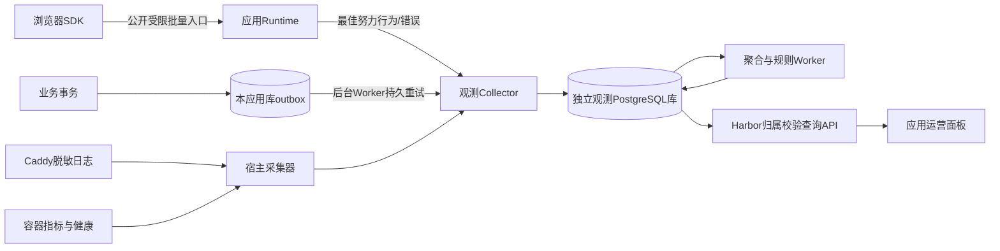

# 应用观测与运营分析技术方案

版本：0.1；核实日期：2026-10-26；状态：设计交付，尚未实现。

## 1. 目标与决策

为每个发布应用提供默认可用的流量、业务转化、运行质量和版本对比。采用「通用采集/存储/查询/看板 + 应用独立事件契约和运营目标」。平台解释技术事实，应用解释业务价值。

第一版面向当前受信创作者、单机、React/Node、PostgreSQL和Caddy路径发布，不扩大为不受信多租户安全承诺。业务结果、行为信号、技术请求、发布操作分别保存，不能相互冒充。数据用于辅助判断，不自动改代码、发布、回滚或发送外部通知。

核心成功标准：创作者可以回答「哪个渠道带来多少成功结果、在哪一步流失、是否因为某个版本出错或变慢」，并能看到统计范围、数据延迟和采集缺口。

## 2. 现有实现与缺口

本次直接检查以下文件；这些是已实现的接入基础，不是观测能力已完成的证据：

| 现有位置 | 当前职责 | 本方案接入 |
| --- | --- | --- |
| `templates/application-v1/src/main.tsx` | React报名页和公共CRUD调用 | 浏览器SDK、业务行为事件、请求关联 |
| `infra/app-runtime/build.mjs` | 固定Vite构建，注入源码revision，复制manifest | 打包平台SDK、固定观测契约和SDK版本 |
| `infra/app-runtime/server.mjs` | Express、健康、限流、CRUD、静态与业务路由 | 请求中间件、受限浏览器采集入口、事务outbox、错误事件 |
| `src/service/applications/manifest.ts` | 解析表和公共读写声明，计算数据契约hash | 新增可选analytics声明；独立计算analytics hash |
| `src/service/applications/docker.ts` | 创建部署并挂载私有运行配置 | 注入部署级观测写凭据、明确publicIdentity白名单 |
| `src/service/applications/edge.ts` | Caddy路径转发、入口核对，删除Cookie/Authorization等 | 接入边缘日志；保持身份剥离策略 |
| `src/service/db/schema/applications.ts` | 应用归属、版本、部署和操作事件 | 查询复用ownedApp；不把访问日志放入app_events/SSE |

当前没有访客登录。匿名ID只能估计同一浏览器，不能视为人数或跨设备账号。网关当前删除Cookie与Authorization，不能为了分析而转发Harbor管理身份。Runtime当前通过解构databaseUrl后展开其他配置生成publicIdentity；加入任何新私有字段前，必须改为明确白名单，避免健康接口和register上下文泄漏观测凭据。

## 3. 核心能力与范围

| 能力 | 第一版交付 | 后续 |
| --- | --- | --- |
| 基础流量 | PV、匿名UV、访问次数、入口页、渠道、设备；SPA路由 | 更复杂归因、跨设备身份 |
| 业务观测 | 事件字典、白名单属性、服务端结果、单个核心目标、可配置漏斗 | 多目标、业务收入/退款建模 |
| 使用质量 | JS错误、HTTP失败/耗时、Web Vitals、健康检查、CPU/内存 | 完整分布式trace、私有source map还原 |
| 版本关联 | 页面源码版本、实际服务端部署版本、发布标记、前后对比 | 受控A/B实验 |
| 数据治理 | 应用/环境隔离、限流/配额、保留、删除、内部流量标记 | 更复杂团队角色 |
| 数据可信度 | 重试去重、可靠业务outbox、延迟/丢弃计数、来源等级 | 高吞吐独立消息队列 |
| 运营呈现 | 概览、漏斗、质量、版本四个页签；站内规则告警 | 留存矩阵、反馈管理、外部通知 |

首版不做全量点击录制、会话录像、热力图、任意SQL/任意事件属性查询、自动改版、自动收集个人资料。已有应用必须重建并发布才获得新Runtime/SDK；旧镜像保持可运行，但面板标记「未接入/部分接入」，不能显示为零访问或零错误。

## 4. 架构与职责



逻辑模块集中管理，首版Collector与Worker作为Harbor内模块运行，通过独立内部监听端口接收Runtime写入；不对公网开放内部端口。它与控制面仍共享进程故障域，不是进程级安全隔离。边缘日志采集与容器指标采集由宿主模块负责，应用容器不获得Docker socket或观测数据库密码。

复用现有PG部署但创建独立观测database和角色：Collector只执行受限插入，查询/聚合/清理使用分别授权的角色；应用没有观测库直连权限。角色权限、连接数和磁盘预算必须在启用前配置。观测库故障不能拖垮控制面：独立小连接池、短超时、有限并发、后台查询超时和业务优先的背压。

为什么不每个应用自建：重复实现丢失/去重/查询/权限，维护困难。为什么不用Kafka/ClickHouse起步：当前无吞吐证据支持这项运维成本。若实际写入量、保留容量或查询延迟持续超过压测基线，再拆Collector进程、引入专用队列/分析库；保持采集协议兼容。

## 5. 事件契约与业务接入

在harbor-app.json加入可选analytics字段，老manifest保持兼容。解析器必须保留并校验该字段；现有解析器会丢弃未认识字段，不能只修改模板JSON。

```json
{
  "analytics": {
    "schemaVersion": 1,
    "events": {
      "signup_started": {
        "version": 1,
        "source": "browser",
        "properties": { "form": { "enum": ["main"] } }
      },
      "signup_succeeded": {
        "version": 1,
        "source": "server",
        "properties": {},
        "binding": { "kind": "table_created", "table": "signups" }
      }
    },
    "primaryGoal": "signup_succeeded",
    "funnels": [{
      "id": "signup",
      "unit": "session",
      "windowMinutes": 30,
      "steps": ["page_view", "signup_started", "signup_succeeded"]
    }]
  }
}
```

analytics是新增顶级字段的示例片段，需与现有formatVersion/template/tables并存。事件名/属性名长度、事件数量、属性类型/枚举和漏斗步数受限；禁止任意嵌套对象、自由文本和任意属性全索引。平台事件使用保留命名空间。不存在的事件、browser冒充server、同版本改含义或属性类型在构建时拒绝。业务定义语义变化必须增加事件版本，不能混算历史。

上述table_created只表示「本次新增记录成功」；仅当该表确实代表报名时才绑定signup_succeeded，不自动给任意表命名业务结果。一个manifest被固定到revision/build，部署时登记不可变definition hash；漏斗调整另存分析配置版本，配置中的每步固定eventName + eventVersion，历史报表注明使用哪个版本。数据DDL hash与analytics hash独立，分析配置不触发业务表破坏性迁移。

浏览器使用平台SDK：`track('signup_started', { form: 'main' })`。模板首次交互发送一次，不自动采集输入值或所有点击。业务注册API后续增加受限context.analytics接口；自定义事务结果通过同一连接的transaction helper显式emit，原register(router, publicIdentity)兼容。

Agent创建应用时生成事件声明和相应埋点，说明目标含义；创作者在发布前查看目标与漏斗。平台只能验证格式和执行边界，不能自动证明业务定义正确。

## 6. 数据协议、归属与身份

通用包络：eventId、eventName、eventVersion、occurredAt、receivedAt、appId、environment、source、trustLevel、definitionHash、clientRevisionId、servingRevisionId、deploymentId、anonymousId、sessionId、requestId、allowedProperties。

- source=browser/runtime/edge/host；server事件仅接受部署私有写凭据对应通道。appId/environment/deploymentId由部署凭据绑定，客户端同名字段覆盖或拒绝，绝不用于授权。host/edge通道单独认证。
- browser声称的源码版本是clientRevisionId；Runtime当下版本是servingRevisionId。发布切换后旧页面可能仍上报旧版本，两者同时保留；不把旧页面行为错误归到新前端。
- requestId由可信入口生成并回传，浏览器提交的是关联提示；校验长度/格式，不能授权或改变结果。现有CRUD响应增加可选requestId，不破坏原id字段。
- anonymousId使用本地随机ID，存储键包含appId；sessionId使用30分钟无活动阈值，跨标签规则固定为同应用共享的访问会话并处理并发。禁用持久存储时使用内存ID，面板说明覆盖不足。
- 同域按键名前缀只防止正常代码误串，不阻止同源恶意应用读取；沿用受信创作者边界。将来独立来源后再加强。
- public浏览器入口可伪造，Origin/Referer检查只作过滤，不作身份验证；匿名UV、渠道和漏斗标记为观测估计。Runtime凭据仅证明来自该部署，受信应用仍可能错误emit，不是外部审计账本。
- 当前无访客身份，不增加跨应用ID、不使用Harbor管理账号作访客ID，不做设备指纹。未来接访客账号时另设计应用内身份和匿名关联。

## 7. 三条采集链路

### 7.1 浏览器行为、错误与性能

SDK在模板入口初始化：首次页面与客户端路由变化各产生一个pageViewId；React开发StrictMode/重复初始化不重复计数。默认只发route模板或规范化页面key，不发送原始查询串和动态路径ID。来源保存外站host；UTM只接受限长白名单标签，无来源记unknown/direct并解释受Referrer-Policy影响，不能保证完整归因。

当前Runtime设置no-referrer；通过实际浏览器导航验证入口document.referrer可用范围，不假设一定有值。渠道使用本次session首次有效UTM/来源，不跨会话做多触点归因；错误或异常渠道归other，限制维度基数。

每5秒或20条批量发送，单批不超过32KiB，属性不超过1KiB；队列最多200条，重试指数退避不超过2分钟，pagehide尽力sendBeacon。关闭页面、拦截器、离线可能丢失，不承诺浏览器可靠投递。不将未发送队列写入含个人信息的长期缓存。

公开路径：`/apps/:id/__harbor/observe/browser`（preview对应独立前缀）。该路径需独立JSON解析/限流，在SPA回退之前挂载，不能直接走当前/api的X-App-Revision写入门；旧页面允许上报限定窗口内已知源码版本。兼容beacon的content-type并限制大小，不发送管理Cookie或Authorization。Collector不可用时Runtime直接丢弃低优先级批次，记丢弃计数，不无限缓冲。

window.error/unhandledrejection仅收集截断且脱敏的消息、规范化位置和错误指纹；原始异常可能含个人内容，服务端再次过滤，不直接全量采集console。Web Vitals用平台固定版本库，按pageViewId/metricId更新最终值，避免重复回报算多份。未支持指标显示无数据而非0；首版未生成source map，不承诺源码行级定位。

### 7.2 Runtime接口与可靠业务结果

请求中间件在CRUD/业务路由前记录单调时钟耗时，finish为完成，close且未完成为aborted；记录method、route模板、status、errorCode和部署信息，不记录body、参数、SQL或连接串。健康探针、采集接口和静态资源独立分类，默认不进入业务API失败率；没有匹配路由的404规范化为unknown_route。

关键成功结果用应用业务库内平台保留表`_harbor_observation_outbox`：事务内INSERT业务行 + INSERT事件，提交后返回成功。事件ID和业务记录ID在同一操作内固定，重试传输沿用eventId；业务提交幂等需由业务接口单独实现，观测去重不能防止重复报名。

平台供应器创建outbox，不开放给公共tables接口；Runtime事务helper只能按已声明server事件写入。自定义业务可明确选择强一致失败策略；默认降级时的采集缺口不能声称精确账本。Harbor管理的后台转发器定期在每个活跃或停止应用环境中以专用受限凭据取待发事件，Collector持久化确认后再标记sent；应用停止时仍可排空，账号停用后按策略暂停并标记缺口。初期单Worker，取行租约/过期恢复，ACK丢失后重发由Collector去重。

outbox与业务数据同库，观测库不可达不影响短期提交。设待发条数/字节和最老等待时间阈值：达到软阈值告警；硬额度时不再承诺可靠事件，选择保业务成功、记录独立缺口计数并显示降级。业务事务中的事件写入使用SAVEPOINT，空间/观测错误回滚到SAVEPOINT后继续业务提交；业务库整体故障仍会导致业务失败。降级是明确可见的可靠性例外，不宣称任何故障下都不丢。

一般请求完成日志与浏览器事件为最佳努力；只有成功进入outbox的业务事件具有持久重试语义。业务库备份恢复可能重现已sent或pending行，Collector eventId去重；业务数据删除不自动抹去聚合，需要单独删除/重算策略。

### 7.3 边缘与宿主

Caddy输出专用JSON访问日志，写出前过滤Cookie/Authorization、原始查询参数、IP和任意header。补充app/environment/deployment路由标记，不能只按当前路由反查历史部署。Collector宕机期间不阻断代理服务。采集器保存inode/offset/checkpoint，处理轮转/截断；读后ACK前崩溃可重放，eventId用文件身份+offset派生。超过磁盘保留窗口的日志损失记缺口。

边缘请求量含资源/机器人/探针，绝不等同PV/UV。边缘延时包含代理链路，Runtime延时是应用处理，两者独立展示；绝不相加为总请求数。已下线无路由请求可归到app/environment但deployment=unknown，不能猜测部署。

宿主按归属核验的harbor.app标签每30秒采集容器CPU、内存、重启、健康；进程指标只做应用运行观察，不把共享PG和服务器总成本伪分摊为精确账单。应用AI/API成本暂仅保留标准数值事件扩展点；没有实际计价/账单接入时显示未配置。

## 8. 存储、去重与聚合

| 表/集合（拟定） | 所在库 | 职责 |
| --- | --- | --- |
| app_observation_definitions | 控制库 | app/revision/definition hash和不可变事件字典 |
| app_analysis_configs | 控制库 | 目标/漏斗配置版本、时区、过滤规则 |
| app_observation_bindings | 控制库 | deployment写能力的hash、状态与范围，不保存明文秘密 |
| observation_events | 观测库 | 白名单行为/业务事件及来源/版本 |
| observation_dedup | 观测库 | app/environment/source/eventId去重键与payload hash |
| observation_errors | 观测库 | 脱敏错误样本/指纹/计数 |
| observation_requests | 观测库 | 有限期请求细节/耗时，独立edge/runtime来源 |
| observation_metric_buckets | 观测库 | 小时计数、延时直方图、容器样本 |
| observation_job_state | 观测库 | 游标、水位、聚合版本和租约 |
| observation_alerts | 观测库 | 规则状态、证据、确认/恢复 |
| _harbor_observation_outbox | 每应用环境业务库 | 待转发业务事件；与业务事务同提交 |

raw按receivedAt日分区，时间统一UTC；面板默认Asia/Shanghai且可选时区。跨库不做外键，Collector验证控制库缓存的归属绑定，短期缓存有失效/撤销时限。控制库迁移沿用Drizzle受控SQL；观测库和业务outbox分别受控供应，不让应用运行时自动执行DDL。

去重使用独立小表避免跨日分区唯一键失效：insert dedup + raw在同一观测库事务；相同ID相同payload返回已接收，不同payload返回冲突计数并拒绝覆盖。初始原始数据保留30天，聚合180天，去重键保留37天；生产/preview可分别配置。只接受发生时间最多30天的持久重发，重试窗口不超过去重保留；浏览器最多接受过去24小时/未来5分钟的时间，否则标记无效。上述为起始策略，均未压测。

Worker每分钟批量处理，记录游标；按小时重算受影响桶并覆盖，不用重复累加。迟到事件回补历史桶，页面展示更新水位。吞吐/存储配额达到上限时先保留业务事件与错误计数，再采样技术明细；关键转化事件正常不采样。采样率随数据保存，不能用采样行为直接计算精确人数漏斗。

计数和总时长可以相加，UV不能相加。第一版跨天UV、漏斗和版本比较使用限时raw范围内精确distinct查询，设置时间范围/查询超时/步数上限；超出30天显示仅有汇总且不能重建精确UV或漏斗。P95来自原始耗时或可合并直方图，不能平均各小时P95。

## 9. 指标口径与可解释性

- PV：去重后的page_view；UV：范围内distinct(app, anonymousId)，未知身份单独计数，不用IP补齐。
- Session：同一app内30分钟无活动切分；浏览器时间不可信，保留receivedAt并限制时间偏差。跨浏览器/清存储视为新访客。
- 渠道：本次session首次有效来源，不以最后一次事件重写；内部测试基于明确测试会话/preview标记，客户端自行声明仅作过滤提示。
- 漏斗：第一版同session、严格顺序、30分钟窗口，同session每步只计一次。按occurredAt和同源sequence排序，迟到容许5分钟后稳定；跨源同毫秒无法确认顺序则不猜测，标记未关联。服务端成功没有合法session关联时计入业务总量，不强行塞入漏斗。
- 成功数：去重后的服务端业务事件；有效报名/付费等语义由应用定义。取消、退款是新业务事件，不删除成功历史来伪造变化。
- API失败率：5xx与中止分别展示；4xx按校验/限流/版本409拆分。页面错误率按受影响pageView比例，不把错误条数直接除访客数。
- 版本对比：同长度窗口、同渠道/设备分组，显示样本量、版本及指标定义。前后变化只能提出关联线索，不能声称因果或自动回滚。
- 留存后置：按首次有效核心事件分组，再看后续核心事件；观察窗口未结束的队列不计为未回访。

每个卡片带来源、统计口径、更新时间和覆盖状态：complete/partial/not_instrumented/stale。零、没接入、上报失败、样本不足分别显示。

## 10. API与界面

管理接口沿用Cookie/访问密钥和ownedApp校验，默认production；所有参数白名单，不提供任意SQL或任意JSON路径查询。

| 路径（拟定） | 职责 |
| --- | --- |
| GET /api/applications/:id/observability/summary | 概览、覆盖状态、水位 |
| GET .../traffic | 趋势和来源/设备拆分 |
| GET .../funnel?configVersion= | 明确口径的漏斗 |
| GET .../quality | 错误组、API耗时/失败、Vitals、资源 |
| GET .../versions | 发布标记、版本样本、对比 |
| GET/PUT .../analysis-config | 版本化配置，PUT带expectedVersion |
| GET .../alerts | 站内异常与确认状态 |
| POST .../data-deletions | 确认范围的异步删除任务，所有者授权与操作记录 |

内部POST /internal/observations/batch只接受部署级Bearer能力或宿主能力；凭据不给浏览器，挂载配置权限受控，日志不记录token。可独立撤销，停止部署前先排空outbox或交接受限后台凭据；不同来源不同能力，browser不能调用server通道。

编辑工作台新增「运营」入口：概览、转化、质量、版本。默认最近7天，明确测试/正式切换；图表下可查看有限脱敏样本。无数据给接入诊断：SDK版本/最近接收/契约/丢弃原因。错误可由用户选中后插入修复对话，包含规范化错误、版本、requestId与时间范围，不自动执行修复。

规则首版只做站内：连续三次健康失败；最小100个API请求且5xx超过5%；outbox最老等待超过5分钟。阈值均可配置、待压测；状态pending/firing/acknowledged/resolved，去抖、冷却且有证据窗口。样本不足不触发转化下降告警，不自动创建外部通知任务。

## 11. 隐私、权限与成本控制

业务表是业务原件，观测库只存分析所需的最少派生属性。默认不收集姓名/邮箱/输入框、原始IP、完整URL/Referer、header、业务正文、账号token或数据库信息。SDK持久匿名ID支持关闭/重置；需要同意的部署通过显式开关延后初始化，具体适用要求由部署另核定。

Collector按app/deployment/source限流，单批20条/32KiB；internal outbox可使用另一个受限较大批次，失败逐项返回，不让坏事件阻塞整批。source和eventName可作有限维度，匿名ID、requestId和自由文本不能成为metrics标签，避免维度爆炸。原始事件访问、配置变更、删除操作留最小审计。

删除范围覆盖raw、去重、错误样本、待发outbox、受影响聚合重算和缓存；不能只删事件让旧聚合继续显示已删除人的数据。备份按既定窗口过期，恢复后重放删除墓碑，说明离线备份并非立即物理擦除。应用下线不自动删除统计；永久删除应用时级联删除观测，账号停用时拒绝查询写配置并按保留策略处理。

初始保护值：浏览器200条内存队列、Collector独立连接池2、查询超时5秒、每app可查询漏斗2步至8步/最多30天。事件容量和总磁盘预算在真实样本测得平均事件体积后设置，不将这些初值视为容量承诺。

## 12. 实施阶段与验收

### A：基础观测

交付Runtime身份白名单、SDK、采集协议、独立库、去重/保留、流量与请求/错误面板。先报名模板，再第二个不同应用证明通用。既有应用不接入时明确标记；禁用功能不改变既有业务行为。

### B：业务转化

交付analytics声明、不可变契约、事务outbox、后台可靠转发、核心目标与漏斗。完整覆盖业务成功/失败/网络结果不明，重复业务写入与重复投递区别。

### C：运营诊断

交付Caddy/容器采集、Vitals、发布对比、数据覆盖状态、规则告警与选中错误发起修复对话；不自动修改或部署。

### D：真实运行验收

在固定域名HTTPS上用真实浏览器访问与受控业务结果核对；采集端失联、进程崩溃、PG失联、页面关闭、旧版本页面、日志轮转、数据删除恢复及容量演练。无真实访客时不编造运营效果。

| 编号 | 必须验证的行为 |
| --- | --- |
| O01 | 两应用两环境、匿名ID存储键与查询归属不串；越权404 |
| O02 | 公开客户端伪造server事件、deployment和属性被拒绝或降级 |
| O03 | 正常/StrictMode/SPA前进后退每个页面访问不误重复 |
| O04 | 数据库写入+outbox同提交；业务回滚无成功事件 |
| O05 | Collector写后ACK丢失重发、跨日重试与PG恢复不重复计数 |
| O06 | Collector不可达业务继续，outbox可重试；到硬额度显式降级 |
| O07 | 应用下线后待发事件可排空，权限撤销不借机继续访问业务数据 |
| O08 | 旧页面上报到新部署，客户端/服务端版本均正确标记 |
| O09 | 访问数、跨天UV、漏斗顺序/窗口、缺少关联和P95口径有固定样本核对 |
| O10 | 机器人/健康/静态/采集请求不冒充业务流量，edge/runtime不重复相加 |
| O11 | 事件正文、URL、错误和日志无测试植入的敏感值，健康不漏私有配置 |
| O12 | Web Vitals重复更新不重复计数，关闭/离线丢失有覆盖说明 |
| O13 | 日志轮转、重启、迟到回补、聚合重算不会重复累加 |
| O14 | 数据删除覆盖聚合/缓存/outbox，恢复备份后执行删除墓碑 |
| O15 | 采集/查询压测给出业务延迟增量、磁盘增长、丢弃率和恢复时间 |
| O16 | 旧Runtime/manifest兼容、功能关闭、原会话/应用发布回归通过 |

分层记录：源码/契约、单元/PG集成、Docker/Caddy、浏览器、真实公网、业务运营效果。第一版设计本身不代表其中任何运行验收已通过。

## 13. 参考与核实边界

- [OpenTelemetry Signals](https://opentelemetry.io/docs/concepts/signals/)：日志、指标和调用链职责；不等于业务漏斗平台。
- [Google Web Vitals](https://web.dev/articles/vitals)：真实浏览器体验指标与采集方法。
- [Caddy access log](https://caddyserver.com/docs/caddyfile/directives/log)：请求日志、JSON输出、过滤和轮转配置；当前Harbor使用JSON管理配置，实施须转换为实际JSON并真实验证。

以上官方页面于2026-10-26核对。选用PostgreSQL、outbox、第一版不引入队列、数据保留和阈值是本项目设计判断，尚未经性能/故障实验。未修改产品代码、迁移、容器或4318服务，未执行真实模型或公网部署。


## 14. 首版实施说明（2026-10-26）

通用采集/独立PG/业务outbox/运营面板/分析设置版本/网关与容器采集已接入，实际启用、口径与限制以[实施指南](../application-observability.md)为准。本文第8节表结构、180天聚合、第10节完整API和持久告警工作流是完整目标，不能据此宣称全部实现。首版直接在有界原始数据上计算报告，使用独立去重表和状态表保存配置历史；未引入完整聚合体系。详细运行证据由本机项目/任务记录登记，不随公开源码发布。
