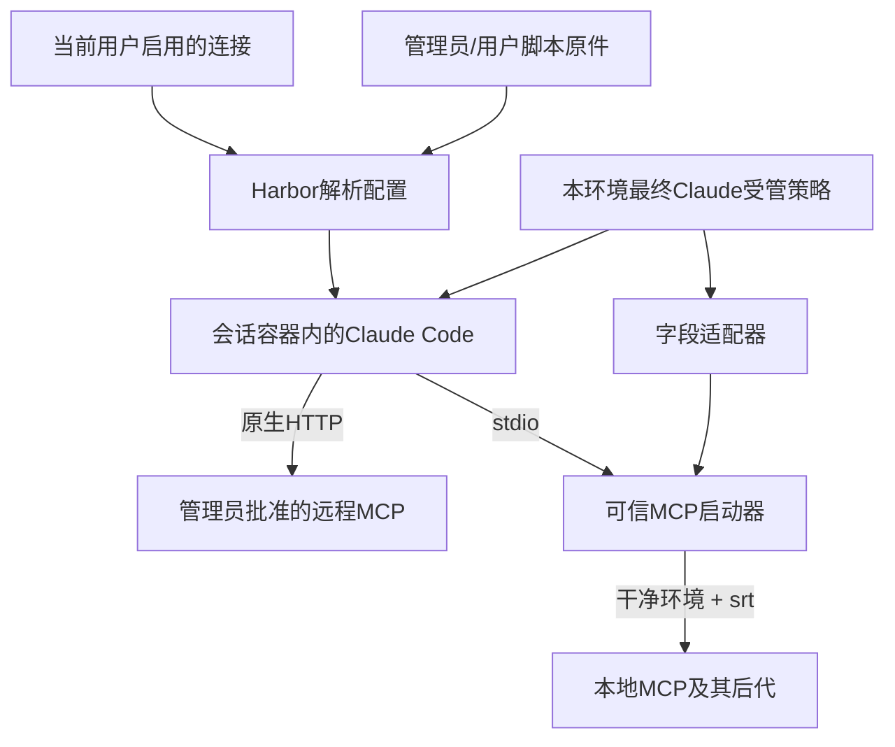

# 基础 MCP：原生直连与共享沙箱规则

2026-10-27：本轮实现方案。详细操作和限制以[使用指南](../mcp.md)为准，实际目录见[目录说明](resource-layout.md)。原生版本固定 Claude Agent SDK 0.3.306、Anthropic Sandbox Runtime 0.0.81。代码验收不代表现有本机服务已切换。

## 产品取舍

保留三个核心对象：管理员模板、用户连接、手写脚本原件。连接存个人选择和密文参数；模板固定允许的本地命令；脚本原件支持管理员和用户各自维护。每个运行环境只保留可重建的启动材料。

删除 MCP 协议网关、Grant 临时令牌、长期 Binding、每会话挑选连接和逐工具白名单。原生客户端已经能发现和调用工具，基础能力无需再维护两端协议与授权状态。代价是上游密钥进入可信原生运行环境，失去网关逐调用撤销和专属审计；远程目标首版必须由管理员批准，不能宣称仍具备网关的出站控制。

启用连接表示授权整个服务及未来工具；工具范围依赖上游账号/scope。旧白名单连接升级时先停用、待用户重新确认，避免静默扩权。Connection revision 只处理编辑并发，不再把旧会话永久锁定在旧版本。

## 调用链

“本地”指会话容器，不是直接运行在 Harbor 宿主或用户桌面。脚本复制到本连接 app 后运行；安装依赖同样经过 srt，npm/uv/pip 使用已有个人缓存，不创建通用资源发布系统。

## 为什么仍需要启动器

Claude Code 的 Bash 沙箱不会自动包住所有 stdio MCP。启动器先读取受保护文件，在干净环境下调用 srt，再交付工具自己的参数。否则直接在 MCP 配置写 command 会让用户代码继承可信进程的环境或直接读取平台文件。

srt是Anthropic提供的进程沙箱组件，这里显式复用它，并不是调用一个会自动保护任意MCP的Claude开关。外层Docker仍保留；同一会话内MCP与Bash共用工作区和部分依赖路径，不提供彼此保密的独立容器。

## 规则为什么只有一个来源

`managed-settings.base.json + paths.ts → managed-settings.json → 合并本会话网络 → Claude配置 + srt派生配置`。

适配器只转换明确支持的文件、网络和凭据字段。启用、失败拒绝、禁止无沙箱执行等条件必须成立；未知安全字段、不支持的凭据mask和路径语法明确报错，不自动忽略。它不复制Claude全部隐式权限解析，也不把工具层的Read审批当作进程文件隔离。

## 更新与取消

新建或重建环境解析当前连接。已运行任务不热更新，下次发送前比较运行摘要；改名称不影响摘要，脚本内容、模板命令、凭据变化则重建。空闲时可手动重载，聊天和工作区保留。

本地MCP可能在原生中断后继续执行，因此含本地MCP的任务取消时强制清理整个会话容器；确认停止后才允许新写入者。远程操作不可由杀容器回滚。现有session lock和Docker归属检查负责生命周期，不再自建本地进程表。

## 首版边界

不做用户任意宿主命令/挂载、不提供每MCP独立配额或强隔离、不实现完整OAuth管理/新调用审计/源码版本系统。手写脚本提供文本包新增与编辑；依赖安装限定npm锁文件或uv requirements，大型冷安装需管理员预装。原有Docker systempaths取舍见[seccomp说明](../../infra/seccomp.md)。

验证分工程检查、真实Docker/SDK夹具、浏览器操作、真实第三方/模型验收。本轮证据保存在本机 `var/evidence/mcp-native/2026-10-27/`；后两类中的真实账号验收不由夹具替代。
