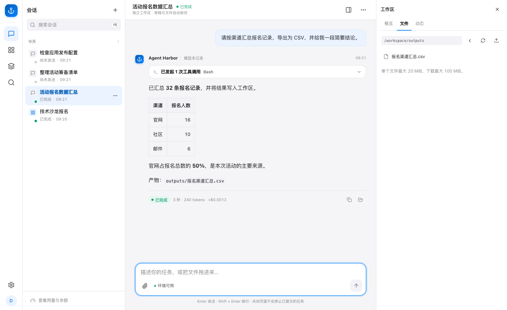

这篇教程带你完成一次「上传文件 → 发出要求 → 查看过程 → 下载结果」的任务。

## 准备

登录已有工作台，确认能选择模型且有可用额度。自己刚装好 Harbor 时，先由管理员 [接入模型](llm-gateway.md)。

在电脑上创建 `sales.csv` 文本文件，内容如下：

```csv
category,amount
书籍,12
文具,7
书籍,8
```

## 上传并提交

1. 在首页选择「对话」和可用模型，先发送「我接下来会上传一份 CSV，请等我上传后再处理」。发送后会创建会话并进入对话页。
2. 等这一轮回答结束，再点输入框旁的「上传资料」，选择 `sales.csv`，等待上传完成。已有会话可以直接从这一步开始。
3. 在右侧「工作区 → 文件」的上传记录中点「插入消息」，将文件路径带入输入框，再发送下面的要求：

> 读取我上传的 sales.csv。按 category 汇总 amount，写入 summary.csv，表头为 category,total。请在回答中告诉我总金额。

首页当前没有文件上传入口，需要先进入会话。上传只保存文件；发送消息才调用模型，包括上面的准备消息。连接实际模型会产生供应商费用，也可能消耗工作台额度。

## 查看和下载结果

对话中会显示执行进度、工具记录和回答。在右侧「工作区 → 文件」找到 `summary.csv` 并下载。

核对结果：书籍为 **20**，文具为 **7**，总金额为 **27**。类别排列顺序可以不同。若不一致，把具体差异告诉 Agent，让它检查后重新生成。



*截图采用报名数据，文件操作方式相同。*

## 继续修改

在同一对话中发送：

> 把 summary.csv 按 total 从高到低排序，并说明你修改了什么。

刷新文件列表后重新下载，确认它使用了之前的文件。离开页面后，可以从会话列表重新打开；要终止任务，使用「停止」。

[工作区与文件](workspace-files.md) · [对话与任务](session-lifecycle.md) · [返回使用指南](guide.md)
