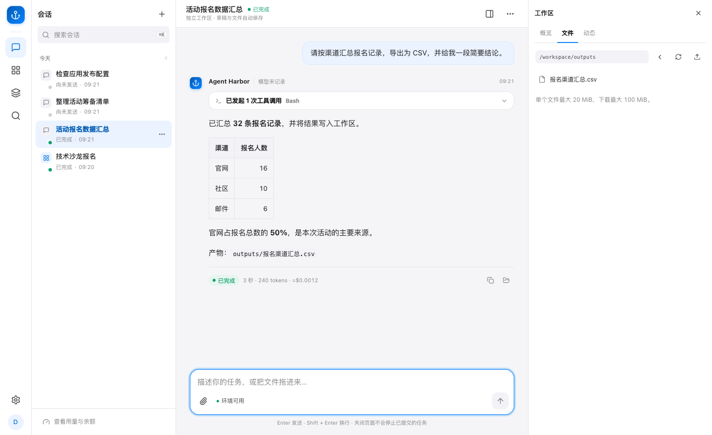

# Agent Harbor

在自己的机器上运行一个多用户 Agent 工作台。用网页或 CLI 提交任务，在隔离的会话环境中分析文件、修改代码，或把生成的 Web 应用发布到自己的服务。

*示例任务把 32 条报名记录按渠道汇总，结果可在右侧工作区下载。点击图片可放大。*

[看应用编辑与预览](applications.md#编辑和预览应用) · [看管理后台如何管理用户与额度](admin.md#管理用户和额度)

## 从哪里开始

| 我想做什么 | 从这里开始 |
| --- | --- |
| 先跑起来并登录 | [本地安装与启动](quickstart.md) |
| 接入模型、上传文件并完成首项任务 | [第一个 Agent 任务](first-task.md) |
| 构建一个可预览、可发布的应用 | [应用创建与部署](applications.md) |
| 给团队开通账号并管理模型成本 | [管理员与身份](identity.md) · [模型与网关](llm-gateway.md) · [额度与计费](wallet.md) |
| 部署到专用服务器，备份和恢复 | [托管部署与恢复](deployment.md) |
| 查参数、接口或启动错误 | [配置参考](configuration.md) · [HTTP 与 SSE](service.md) · [故障排查](troubleshooting.md) |

## 一项任务如何运行

以分析 CSV 为例。你在网页上传 CSV，要求 Agent 汇总数据并写出报告。Harbor 把消息交给当前会话的 Runner，Claude Code 在该会话的工作区读写文件，页面持续显示运行进度。关掉浏览器后任务继续。再次登录可以找回对话和产物。

管理员从「接入模型」向导配置供应商、模型、价格与试用额度，通过工具及流式测试后开始对话。会话可以带上 [Skills](skills.md) 或 [MCP 工具](mcp.md)。应用数据库与 Caddy 等前置条件就绪后，可在同一工作台迭代应用、预览、发布和回滚。 [功能启用条件](configuration.md#功能何时启用)

## 适用范围

当前部署目标是受信小团队和本地开发。运行模型需要你自己提供获准凭据。启用公网入口或让其他人运行代码前，先核对 [安全边界](../SECURITY.md) 和 [部署验收](deployment.md)。GitHub Pages 提供这套静态文档，Harbor 服务及用户数据运行在你自己的机器上。

Agent Harbor 自有源码采用 [Apache-2.0](../LICENSE)。Claude Agent SDK、Claude Code 及模型服务适用各自的许可与使用条款。
