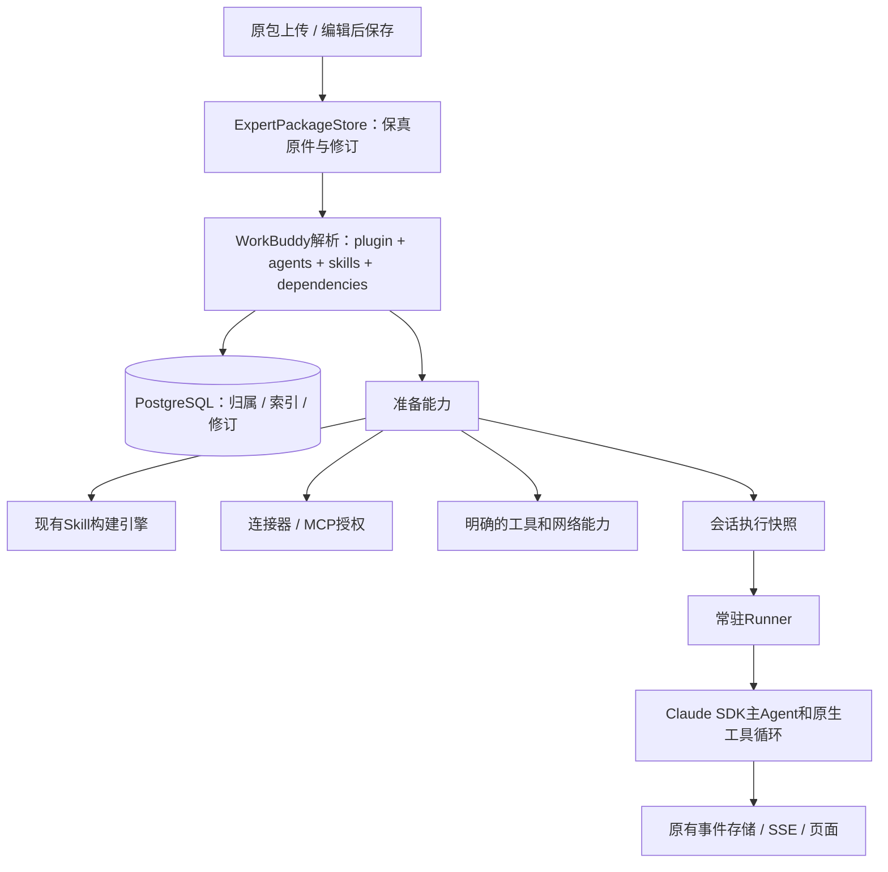

# WorkBuddy 专家包原生兼容方案

状态：2026-10-24进入实施，原包/主Agent/包内技能/MCP/OAuth已有实现；当前验证与边界见[使用说明](../workbuddy-experts.md)。本文保留完整目标和验收要求，不能据此宣称全部私有连接器已接入。

## 目标与验收定义

用户的目标是：一个现有WorkBuddy专家ZIP，上传后可以直接使用，不需作者重写配置、重新填写角色/方法/输出、不需拆出技能逐一导入。

以WorkBuddy开放平台专家、专家团规范及官方实际样包为兼容基线，核实日期2026-10-24。兼容的是包格式和声明能力的执行语义，不承诺不同模型输出逐字一致。WorkBuddy私有连接器服务、用户的登录凭证和腾讯账号权限不会随包转移，必须由本平台提供对应连接器并由使用者授权；这项不能伪装成仅解析JSON就已实现。

以下四层必须区分：

1. 原包保真：上传原ZIP可按字节原样下载，包含未知字段和资源。
2. 格式兼容：无需改包即可正确读取定义、展示、技能和依赖。
3. 运行兼容：实际使用正确主Agent、完整提示词、技能名称/预加载、参数及所需外部工具。
4. 整体声明：所有承诺支持的官方字段和样包通过对应执行验证后，才能称兼容完成；导入成功不能代替运行兼容。

专家团也是单独的运行能力，不把expertType=team降级为单专家。如尚未实现，应保留原包、明确显示“专家团执行尚未支持”，整体兼容任务继续未完成。

## 原生包作为唯一内容来源

```text
my-expert/
├── .codebuddy-plugin/plugin.json   展示信息、入口、版本、技能和依赖
├── agents/*.md                     YAML配置头 + 完整Markdown系统提示词
├── skills/<name>/SKILL.md           包内技能及资源
├── avatars/*                       头像
├── .mcp.json                       可选MCP配置
├── settings.json                   专家团等运行配置
├── bin/*                           如包中存在，原样保留
└── README.md / 其他资源             原样保留
```

数据库只持有身份、归属、版本、文件摘要和可重建的展示索引。完整文件包才是专家内容的唯一来源，不再让role/workflow/output成为另一份可编辑事实。

新建专家从同格式模板开始。网页展示基础信息、完整Markdown编辑、技能/依赖、文件浏览；表单更新实际plugin.json/Agent文件。未知字段、其他Agent和二进制资源不被表单序列化丢弃。保存直接生成新的不可变包修订，不引入草稿/发布流程。

包内version和平台修订号分开：原包的1.0.0保留，平台revision用于保存历史及会话引用。用户编辑时显式修改包版本，平台不伪造作者版本。

## 实际官方样包给出的兼容要求

正式样包原件：research/agent-harbor-experts/assets/workbuddy-2026-10-24/design-experts.zip（工作空间相对路径）。SHA256见同目录manifest.json。

已发现文档与样包不完全一致，不能用市场上架要求当运行拒绝条件：

- ZIP有一层design-experts目录、__MACOSX和.DS_Store。识别逻辑忽略系统元数据，但原ZIP完整保留；包根由.codebuddy-plugin/plugin.json唯一确定。
- 样包配置引用avatars/expert.png但实际没有头像。显示占位图并警告，不能因此阻断导入或纯角色执行。
- Agent带tools数组，且没有文档列出的displayName/profession。展示从plugin.json回退；tools保留，不把它当凭空授权；可识别的工具限制映射为平台可用工具的子集，差异需在实际工具验证中确认。
- categoryId、推荐提示词一致性、描述长度与当前上架规范不同。可提示，不强制用户修改历史包。
- plugin.json没有skills路径字段，但包内存在skills/design-reference，Agent.skills引用design-reference。默认发现skills/直接子目录，声明路径与发现结果去重；引用必须可解析。
- SKILL.md用title/summary/read_when，缺少Claude要求的name/description。原件不改；运行派生物以目录名补name，以summary和read_when生成description，正文保持原样。
- reference库不是58份本地文件，而是说明如何在线下载。当前项目命令网络策略禁止外联，因此不能宣称“能读SKILL.md即完整可运行”；需实现明确网络能力或连接器，下载真实验证通过后才能对该场景标记可用。

导入只校验必要结构、合法路径、大小、解析正确及必要引用；不审查技能正文或给Claude增加技能调用白名单。ZIP路径穿越/链接/体积限制是文件导入边界，沿用现有通用策略。

## 字段到行为的映射

| WorkBuddy内容 | 本平台行为 |
| --- | --- |
| name/version/author/license/homepage | 保留原字段；来源、版本、许可证在详情可见 |
| displayName/profession/displayDescription | 使用zh→en→基础字段回退，展示职业与简介 |
| avatar/categoryId/tags | 读取资源、分类和标签；缺失展示资源使用占位 |
| defaultInitPrompt/quickPrompts | 默认输入建议及快捷问题；不擅自自动发送 |
| agents/agentName | 读取声明Agent；agentName决定主对话身份，不能只取第一个文件 |
| Agent Markdown正文 | 完整用于专家系统提示，不能拆段重写，不能只作为用户消息 |
| description | 原生Agent激活说明，保留与展示简介的区别 |
| maxTurns | 保留包配置；使用平台预算上限内的有效值，显示上限差异 |
| plugin.skills及默认skills目录 | 包内技能按原有Skill引擎准备，固定源/构建摘要 |
| Agent.skills | 语义是预加载，不能只挂文件后声称等价；须验证SDK实际预加载及无歧义名称解析 |
| dependencies.mcpServers | 按声明顺序读取一个或多个配置文件；未声明时回退根.mcp.json |
| dependencies.connectors | 连接器ID映射到平台提供者，由使用者单独授权 |
| x-workbuddy | 保存本地化展示/图标/OAuth/Token表单定义；派生运行配置剥离展示字段 |
| headers中的${KEY} | 从当前用户凭据仓库解析；缺值显示连接引导，不使用专家作者凭证 |
| expertType/teamInfo/settings.json | 单专家/专家团分流，不忽略团队成员和主理人 |
| 未知扩展 | 保留原件；不假装理解它的运行语义，必要能力未实现则阻止召唤并说明 |

## 整体架构



文件存储建议：数据根users/<ownerKey>/experts/<expertId>/revisions/<revisionId>/下保存source.zip和source/，准备后的派生物放prepared/<runtimeDigest>/。source/是ZIP的可编辑展开视图，不是独立维护的第二份配置；修订提交时同时记录ZIP及文件树摘要，校验失败不能发布修订。新导入原ZIP保留字节；编辑后导出的是新修订包，不能声称它与原上传ZIP字节相同。

文件先写staging并校验、原子rename，再在数据库短事务登记修订及索引。取消/数据库失败的孤立目录由明确的恢复清理步骤处理，不留一半可见的专家。包内Skill和专家修订同一次发布，不分批污染“我的技能”。

包内Skill以expertRevisionId+relativePath+sourceHash关联已有构建引擎；“我的技能”不是安装专家的必经中转站，也不自动增添用户默认开关。可复用按内容摘要一致的构建，运行时仍保留每个包的命名空间和相对路径关系。

## 运行方式改为原生主Agent

当前SDK 0.3.306本地类型声明支持Options.agent、Options.agents，以及AgentDefinition.prompt/skills/maxTurns。

```ts
// 形状示意；真实路径和技能标识由服务解析，不接受网页直接传SDK选项。
query({
  prompt: userMessages(),
  options: {
    agent: manifest.agentName,
    agents: resolvedAgents,
    mcpServers: resolvedUserConnections,
    // 继续保留原有持久化、沙箱、事件与中断配置。
  }
});
```

主Agent来自包的agentName；resolvedAgents包含声明定义的原始正文。停止使用“通用claude_code角色+三个字段append”作为专家默认语义。原生主Agent选项能避免为了模拟专家而新增一层中转Agent；具体工具指引、名称解析和预加载行为必须通过真实SDK夹具确认。

每次会话固定：专家包修订/摘要、主Agent与成员定义、技能名称映射与构建、镜像、适配器版本、工具网络能力、连接器引用。凭据不进入专家ZIP或公开快照；会话只能按当前用户有效授权获取短期运行凭据，撤权后停止使用，不依赖历史快照绕过撤权。

同容器多轮、原生中断、环境关闭、15分钟空闲回收、事件和SSE继续复用。恢复核对完整runtimeDigest，不能读取latest或随意切换专家。原SDK本地状态保留。

技能预加载优先走SDK AgentDefinition.skills；必须验证实际内容进入上下文，以及包内原始短名调用能正确命中。若SDK不能维持WorkBuddy名字语义，应实现可验证的运行时名称适配，不能要求作者改正文，也不能仅增加一句“请调用namespace:name”就宣称等价。未知结果如实列为未完成兼容项。

## 依赖准备与召唤

用户流程：上传ZIP→详情（完整说明/头像/技能/连接器）→召唤→需要时自动准备技能/引导连接→就绪→输入任务。

纯角色包直接召唤，没有空的“安装”步骤。有技能时复用准备引擎，有连接器时展示逐项连接状态；关闭网页不取消已启动准备。依赖未满足时保留包并显示准确原因，不能进入缺能力的普通聊天。

MCP需建设按用户归属的连接记录、Token/OAuth授权、刷新/撤权、Runner运行配置和工具调用验证。不能将包内任意路径当宿主可执行命令，不能从共享包继承作者身份。Token从服务端加密存储或受支持的凭据系统获得，页面只显示连接状态。

WorkBuddy连接器ID需要连接器注册表映射；例如官方连接器依赖不能仅凭同名ID自动获得腾讯服务权限。不支持的ID保留并标出待实现，只有对应提供者及授权接入后才算该包能力兼容。

运行时下载是另一项必要能力：当前管理员allowedDomains为空。修改网络能力须按用户/平台允许范围提供明确可用配置，不能因提示词出现curl就自动授权全网。真实官方样包的在线参考库必须实测下载；保留外层容器和凭据隔离，不以“兼容”为由直接放弃原安全边界。

专家团的AgentTool/SendMessage及并行交付不能靠工具重命名承诺。应优先验证原生Agent/团队消息能力，补齐成员状态、委派结果、取消和共享文件行为；该部分验证前不可宣称专家团执行兼容。

## 数据和模块改动

- experts保留稳定ID/owner/source/status/currentRevision，补展示索引。
- expert_versions扩展sourceFormat=workbuddy、packagePath、packageHash、manifest索引、adapterVersion；包内版本与平台revision独立。
- expert_installs扩展为准备记录，继续复用已有取消/重试和Skill等待者；新增包内技能关联，不复制构建状态。
- 新user_connections保存用户到连接器/MCP的授权关联，敏感凭据与专家数据分开；快照只持引用和配置摘要。
- sessions保存执行快照，区分旧专家0.3和WorkBuddy新格式，不能以一条数据库UPDATE原地换掉旧会话的行为。

```text
service/experts/
  package-store.ts    原包、修订、文件读取和导出
  workbuddy.ts        原生清单/Agent解析和兼容报告
  service.ts         归属、版本、召唤、准备编排
  http.ts            原包导入导出及文件编辑接口
service/connections/ 用户连接、凭据引用、授权和配置解析
agent/               原生主Agent、MCP及持续输入输出
apps/web/features/experts/ 包导入、详情、文件编辑、依赖连接、召唤
```

复用并小幅拆分现有PackageStore的ZIP安全读取，不直接调用其“只有一个SKILL.md”的入口；专家ZIP允许多个技能和Agent。不要让Skill模块承担专家清单解析。

旧0.3专家另生成同结构WorkBuddy包作为新修订，完整保留既有编译说明到Agent正文；用户确认使用新修订后新开会话。已有版本/会话不变。迁移生成的作者/许可证等只能来自真实配置，不伪造来源或第三方授权。

## 开发顺序与完成门槛

A. 包保真、实际样包解析、Markdown原文编辑、原包导出。先用官方ZIP测试，不靠自造最简包代表兼容完成。

B. 原生主Agent、原始正文、包内Skill目录与旧头格式、预加载/短名调用、参数映射、相对资源、多轮及恢复。网络下载用本地可控HTTP夹具及正式允许策略验证，再对获准公开参考库真实下载验证。

C. MCP无授权/Token/OAuth三种依赖、相对图标、多个配置文件、连接器注册表、撤权、跨用户隔离。至少有实际可调用的MCP夹具，不能只测试配置拼接。

D. 专家团声明及团队运行语义，另列AgentTool/SendMessage、并行/串行委派、成员取消和产物交付验收；单专家先交付时明确不包含团队兼容。

E. 旧数据迁移、端到端网页、回归和兼容矩阵。各阶段是实施顺序，不是降低最终目标。

验收清单：官方ZIP无需修改完成导入；原ZIP下载SHA一致；未知字段/二进制往返保留；选对agentName；说明逐字进入正确原生角色；预加载内容实际可见；技能短名和相对引用可运行；缺头像不拒绝；依赖真实连接/调用；包更新不改旧会话；旧SDK或能力缺失有准确状态；零审查/名字白名单不倒退。真实模型效果与格式/工程兼容分层记录。

## 来源和当前状态

- https://open.workbuddy.cn/docs/expert （官方规范及模板入口）
- https://open.workbuddy.cn/docs/expert-team （专家团规范）
- https://codebuddy-platform-1258344699.cos.ap-beijing.myqcloud.com/open/static/files/design-experts.zip （本次下载原件）
- 本地node_modules/@anthropic-ai/claude-agent-sdk/sdk.d.ts：Options.agent/agents与AgentDefinition。
- 当前源码：src/shared/experts.ts、service/experts、skills/package-store.ts、infra/managed-settings.base.json。

本轮仅完成兼容设计与官方样包静态检查；未改运行代码、未执行包内脚本、未安装第三方内容、未调用模型、未升级当前服务。不能把本设计或原121项回归当作WorkBuddy兼容已完成证据。
