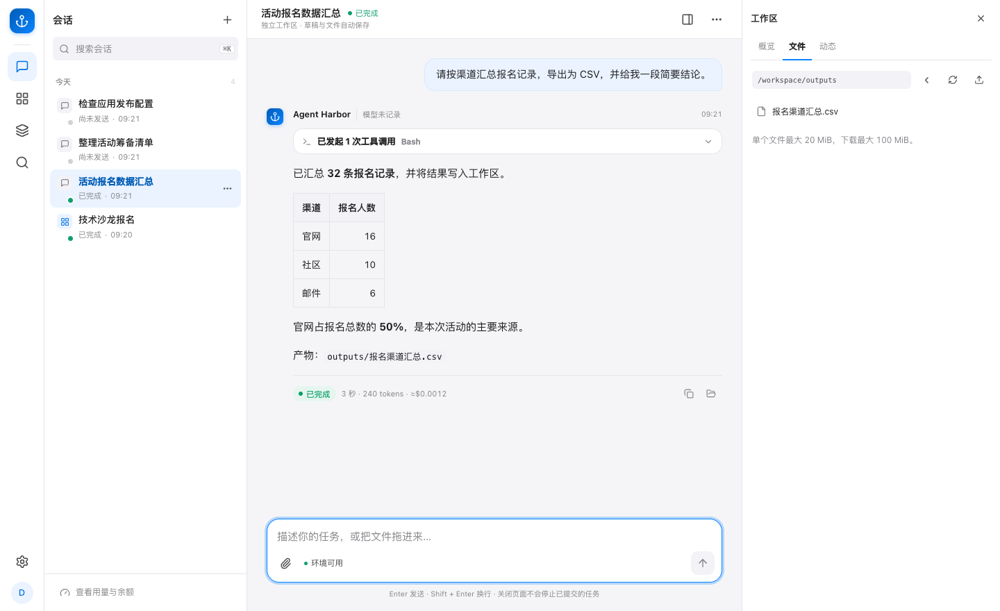

# Agent Harbor 能做什么

Agent Harbor 是面向个人开发者和受信小团队的自托管 Claude Code 工作台。通过网页或 CLI 提交任务，Agent 在会话自己的工作区中使用原生工具，过程与文件产物可以查看和下载。

## 从一个具体场景开始

例如组织一场技术沙龙，可以在同一工作台完成下面的步骤。

| 步骤 | 具体操作 | 检查结果 |
| --- | --- | --- |
| 创建应用 | 描述活动信息、报名字段、校验和数据保存要求 | 在测试预览中实际填写一次 |
| 接入能力 | 用 Skill 约定处理方法，通过 MCP 调用工具 | 查看实际工具返回和任务产物 |
| 管理应用 | 查看版本，在预览通过后发布 | 打开目标环境检查入口和数据 |
| 看运行与业务数据 | 查看工具记录、访问、转化和错误 | 确认环境、时间、样本与事件定义 |
| 继续优化 | 让问数读取获准数据，将确认结论带到编辑会话 | 修改后重新试填，检查新版本 |

[创建应用](applications.md) · [应用数据分析](application-observability.md)

## 哪些场景适合使用

| 需要解决的问题 | 可以怎么用 |
| --- | --- |
| 分析文件后还需要下载结果 | 上传 CSV，要求 Agent 汇总并生成可核对的文件 |
| 每次处理都要重复说明方法 | 把步骤、脚本与参考资料保存为 Skill |
| Agent 需要调用已有工具 | 配置 MCP 连接，测试后在会话里调用 |
| 需要一个小型报名或登记页面 | 用对话创建应用，验证表单、数据与手机布局 |
| 页面已经可用，下一版缺少判断依据 | 查看应用数据与只读问数，形成可验证的修改要求 |
| 团队需要共同使用模型 | 管理成员、模型范围、内部额度和使用记录 |

## Skills 和 MCP 有什么区别

Skill 保存做事方法，可以包含说明、脚本和资料。MCP 提供可调用的工具。例如报名分析 Skill 约定去重和汇总口径，MCP 文本工具返回字符统计。两者都需要在实际任务中验证返回结果。 [Skills](skills.md) · [MCP](mcp.md)

## 能通过对话创建并发布 Web 应用吗

可以。在应用创建前置条件就绪后，Agent 修改标准应用项目，平台构建测试预览。试用并核对数据后再发布，也可以查看历史版本和回滚。测试与正式环境分别管理。 [应用创建与部署](applications.md)

## 能看到什么监控信息

工作台显示任务和工具记录。模型与任务的进一步观测可以按需接入 Langfuse。应用运营观测则展示访问、业务事件、转化、质量和版本，业务事件需按应用含义声明。 [模型观测](llm-observability.md) · [应用运营观测](application-observability.md)

## Agent 能根据应用数据继续优化吗

可以先通过只读问数读取选定应用和环境的获准数据，查看报表并确认建议，再到应用编辑会话提出修改要求。修改后在预览中复验，发布后继续观察。字段权限、采集缺口和样本范围会限制可回答的问题，实际效果需要后续数据验证。 [只读问数与数据口径](application-observability.md#工作台只读问数)

## 使用前需要准备什么

准备部署环境与获准的模型凭据。应用创作另外需要应用数据库、创建者名单和 Caddy 等配置。当前目标是个人开发和受信小团队。使用远程模型时，发送的内容仍会交给所选供应商。 [开始安装](quickstart.md) · [功能启用条件](configuration.md#功能何时启用) · [安全边界](security.md)
