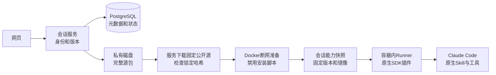

# 技能管理与运行

网页左侧“我的技能”保存一套可复用的说明、脚本和资料。它与对话文件分开：修改技能后保存新版本，已有会话继续使用创建时的版本。

## Claude Code默认技能

0.5.2镜像保留Claude默认技能。平台只保存用户技能并把选定目录通过plugins暴露；不维护技能名字白名单、不做额外初始化检查、不生成专用装载记录。发现和调用交给Claude Code。

默认技能沿用当前文件、Bash、网络、预算和工具限制，不自动开放Agent、WebSearch等额外工具；依赖这些工具的默认工作流不保证完整可运行。升级仅影响使用新镜像的新会话；已有快照继续原镜像，不热修改当前原生进程。升级镜像后，原启用的个人版本需要在新镜像重新准备一次。

## 怎么使用

1. **新建或导入**：填写名称、英文标识和用途，或导入含 SKILL.md 的 ZIP。确认保存直接生成 v1，不存在草稿和单独发布步骤。
2. **编辑并保存**：点击卡片进入详情页，修改最新版本中的文本，添加或删除文件。修改暂留页面内，切换文件不会丢失；点击“保存为新版本”一次提交全部修改并生成 v2、v3……历史版本只读，二进制文件原样保留。
3. **安装并启用**：打开卡片开关，或在详情点击“安装并启用”。有依赖时下载锁定依赖并在断网容器安装；显示进度、日志、取消和重试。安装成功才点亮开关，失败时原启用版本继续使用。
4. **安装更新**：已启用技能保存了新版本，卡片显示“有新版本可安装”。点击详情里的“安装更新并启用”切换新会话默认版本；保存本身不会切换。
5. **开始对话**：新会话使用已启用版本，Claude 根据用途发现和调用；也可发送如 `/personal:table-summary 检查上传的表格`。停用开关不会删除文件或改变已有会话。

页面按“用户自定义”和“平台内置”分组；当前没有远程市场接入。安装就绪不承诺业务结果正确，Claude 负责原生技能发现与调度。

## 一个最小技能包

```text
my-skill/
  SKILL.md
  scripts/summarize.py       # 可选脚本
  assets/report.txt          # 可选模板
  harbor-skill.json          # 需要依赖或脚本入口时添加
  requirements.lock          # Python依赖时添加
  package.json               # Node依赖时添加
  package-lock.json
```

```markdown
---
name: table-summary
description: 检查表格并生成摘要
---
先读取用户提供的表格，再解释主要发现。成果保存到/workspace。
```

可选`harbor-skill.json`：

```json
{
  "schemaVersion": 1,
  "dependencies": {
    "python": { "lockFile": "requirements.lock", "binaryOnly": true }
  },
  "entrypoints": [
    { "name": "summarize", "language": "python", "script": "scripts/summarize.py" }
  ]
}
```

Python锁文件使用`包名==版本 --hash=sha256:完整哈希`，包括全部间接依赖；仅接受可用wheel。Node使用完整package-lock v2/v3，所有依赖来自公开npm registry并有SHA256/512完整性摘要。Node声明为`"node": { "manifest": "package.json", "lockFile": "package-lock.json", "lifecycleScripts": "disabled" }`。生成入口的language可用`python`、`node`；无依赖Shell脚本可由Bash直接运行，实际字段以`src/service/skills/manifest.ts`校验为准。平台在发布产物的说明中追加稳定入口路径，Python入口自动设置该技能独立的PYTHONPATH，Node在技能自己的node_modules里查找依赖。

平台不审查技能正文，不因动态命令、原生frontmatter扩展字段或随包资源目录而拒绝导入。文件原样保留，由Claude解释。技能目录里的文件不会因此变成独立MCP或完整插件。

harbor-skill.json是可选的依赖安装服务配置；它的格式解析不判断技能内容是否安全或正确。没有此文件也可添加技能。文件存储仍需基本名称、描述、合法相对路径和体积限制。

## 为什么这样分层



服务只下载固定HTTPS源的数据，不在宿主运行用户的pip/npm。安装容器没有凭证、工作区或Docker socket，非root、只读根目录、断网，限CPU/内存/进程。实际会话通过只读挂载使用准备好的文件，仍受现有工具和原生沙箱限制。

Python采用`pip --target`而非可搬运的虚拟环境：依赖与技能一起复制，通过生成入口设置PYTHONPATH，避免虚拟环境中写死的安装路径。Node使用`npm ci --offline --ignore-scripts`。这些取舍降低兼容面，但能明确说明执行了什么。

## 代码和文件归属

| 模块 | 责任 |
| --- | --- |
| `src/service/skills/manifest.ts`、`package-store.ts` | 格式、ZIP、路径和大小校验；源包完整保存 |
| `src/service/skills/service.ts` | 个人库、保存版本、导入、内置内容 |
| `src/service/skills/build-manager.ts` | 排队、取消、重试、个人启用意图、会话快照 |
| `src/docker/skill-builder.ts` | 固定源下载、依赖校验、Docker安装和停止确认 |
| `src/agent/runner-options.ts`、`resident-runner.ts` | 只加载选中插件、暴露插件目录、原生调用和持续输入 |
| `apps/web/src/features/skills/` | 分组卡片、详情路由与文件编辑、版本和安装交互 |

数据根目录使用`AH_DATA_DIR`。数据库不保存机器绝对路径。

```text
users/<用户ID摘要>/
  skills/<技能ID>/versions/<版本ID>/
  skill-imports/<导入ID>/<UUID>/
  skill-builds/<构建ID>/attempts/<次数>/
    downloads/、build.log
  skill-builds/<构建ID>/artifact-<次数>/
builtin/skills/<技能ID>/versions/<版本ID>/
<会话ID>/capabilities/<快照摘要>/
  manifest.json
  personal/、builtin/         # 只含选中的技能插件
```

不再创建草稿目录；升级前的旧草稿原文件和失败目录暂时保留，尚无自动垃圾回收；不能随意删除数据库或旧会话引用的内容。每个包最多1000文件、单文件20MiB、展开100MiB、ZIP20MiB；文本编辑1MiB；每人最多50个活动技能、20个等待请求，每个会话最多20技能。每人源文件实际磁盘上限1GiB；准备前检查已有构建目录不超过1.5GiB，单次依赖下载512MiB；产物结束时校验最多2GiB。失败残留也计入已有用量。全服务同时准备2份、每人1份、单次最多10分钟。此限制用于单实例部署，不是容器写入时的硬磁盘配额；安装过程仍可能瞬时超过阈值。面向不受信的多租户前，需要独立的磁盘配额或限额文件系统。

一个构建可供多个请求等待，取消一个请求不会停止其他请求。最后一个等待者取消才停止安装容器。停止无法确认时保留占用、禁止重试，检查Docker后重启服务协调；不能用“CLI已返回”当作容器已停止。

## 部署与维护

先备份PostgreSQL和数据目录，执行`npm run build`与`npm run db:migrate`，再启动服务。迁移不会在服务启动时自动执行。

从旧版草稿流程升级时，停止服务后执行 `node --env-file-if-exists=.env dist/src/service/skills/migrate-drafts.js`。未发布内容与当前版本不同时保存为下一版本；内容相同时不重复增版。旧文件保留，仅清空活动技能的旧草稿指针；已删除技能不恢复。数据库旧 draftPath/draftRevision 列仅用于兼容升级，不再作为编辑状态或返回给网页。

```sh
docker build -f infra/Dockerfile.skills -t agent-harbor:0.5.5 .
```

此镜像基于已有`agent-harbor:0.4.0`。配置`AH_SKILL_IMAGE=agent-harbor:0.5.5`；可选`AH_PACKAGE_PROXY`是服务下载公开依赖的可信代理，安装容器仍断网。镜像ID写入快照，更新tag不改变旧会话；保留旧镜像和文件直到引用释放。旧会话没有快照时沿用原运行方式。

管理员分发内置技能：停止服务，运行`npm run skill:builtin -- package.zip "名称"`，再启动服务。命令复用服务锁；内容相同则不重复发布，内容改变则增加版本。内置技能只读，用户可复制到个人库；不会自动启用。

当前服务是单实例：文件变更由进程内队列保护，服务锁禁止同一数据根重复启动。扩为多实例之前需要把文件写入和工作队列改成分布式所有权，不能直接多开进程。包源暂不支持替换镜像源或私有认证。

## 验证

- `npm run check`：服务和网页类型检查。
- `AH_TEST_DATABASE_URL=... npm test`：使用可丢弃的PostgreSQL库，每个测试独立schema。
- `npm run verify:skills`：真实Docker/SDK/Runner，固定本地模型响应，验证原生Skill调用、动态预处理、Read/Write/Bash边界、持续会话、恢复和原生中断。
- `npm run verify:skills:dependencies`：真实公开包下载、离线安装、脚本入口执行与安装脚本禁用；按需要设置AH_PACKAGE_PROXY。

本地模型夹具验证工程链路，不等于真实模型任务质量或用户业务验收。专家配置、远程技能市场、热更新、自动清理属于后续功能。

## 保存 API

- `POST /api/skills`：新建技能并生成 v1，`clientRequestId` 去重。
- `POST /api/skills/:id/versions`：提交 `expectedVersionId`、`clientRequestId`、`changes` 和可选 `displayName`。每次成功保存生成下一版本；过期编辑返回 `409 VERSION_CONFLICT`，重复请求不再增版。
- `GET /api/skill-versions/:versionId/files`：查看任意已保存版本。
- `POST /api/skill-imports/:id/apply`：新建或导入为已有技能下一版本，更新目标时携带 `expectedVersionId`。
- `PATCH /api/me/skills/:id`：安装启用或停用，`expectedRevision` 仍表示个人启用设置的修订，与内容版本独立。

旧 `/draft` 和 `/publish` 路由已移除。保存时先完整写入新目录，再提交版本和当前指针；安装和会话快照仍是独立步骤。

## 原生运行时依赖

0.5.5增加uv、用户级uv/npm/pip缓存与会话独立Python环境。无harbor-skill.json的普通技能可以直接按原说明在沙箱内安装依赖；不要求平台预构建。详见[会话依赖与缓存](dependency-runtime.md)。原包只读，需原地安装时先复制到可写工作区。
