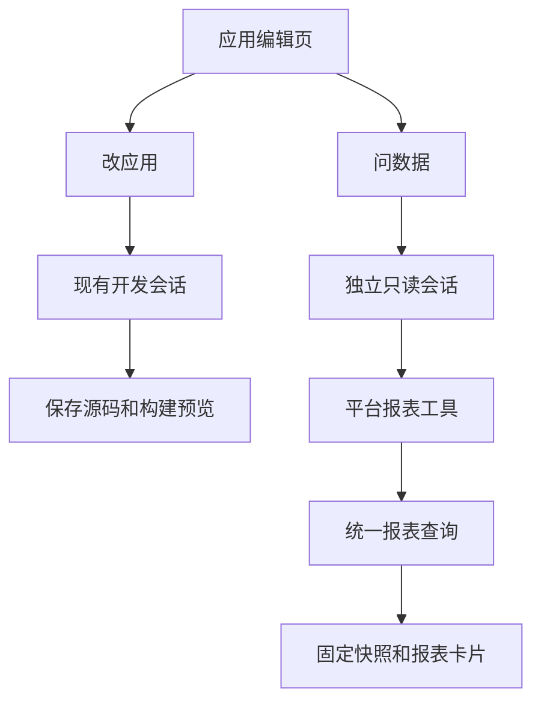
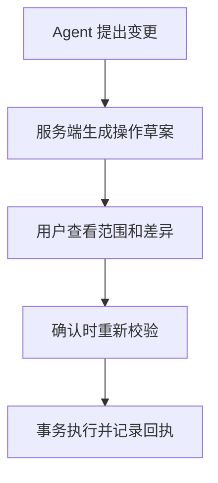

# Agent Harbor 应用数据工作台详细设计

日期 2026-11-05。应用对话已实现只读问数、报表回链、表目录及明细分页。当前启用条件见[应用功能配置](../application-configuration.md#只读问数的字段授权)，用户入口见[应用数据与分析](../application-observability.md#使用只读问数)。后续沿用同一套服务端权限，补可配置统计、记录管理和经确认的业务写入。

## 1. 用户怎么用

在活动报名应用的编辑页切到「问数据」，选择「正式」，直接问「最近 7 天开始填表的人不少，为什么报名成功少了？」Agent 可以查询漏斗、错误和版本分组，说明问题集中在哪一步、数据有多少、还有哪些原因需要复现。回答下方由 Harbor 放一张「打开同一报表」卡片。点开后，右侧数据分析面板显示查询当时的环境、时间范围、页签和结果。用户也可以从快照切回实时刷新。

「问数据」和「改应用」共用应用编辑页，各自有输入草稿和消息历史。问数输入框始终显示「测试」或「正式」，首次进入默认正式并显示当前选择。切换环境会切到各自的问数历史。问题中明确要求另一个环境时，Agent 提示切换选择后重问。首版每轮固定一个环境。用户可以把选中的结论复制到「改应用」作为后续需求。完整报表结果保存在有期限的快照中。

工作台报表支持概览、转化、质量和版本，汇总时间范围沿用最近 1、7、30 天。明细查询可以指定起止时间并逐页查看业务记录和观测事件，具体字段权限见第 8 节。任意时间段的汇总、修改指标设置和跨应用分析留待后续。问题归因仍需要足够证据和复现。

## 2. 当前实现与复用点

| 现有代码 | 行为 | 本次改动 |
| --- | --- | --- |
| [应用消息入口](../../src/service/applications/http.ts) 和 [ApplicationService.generate](../../src/service/applications/service.ts) | 接收应用消息后占用源码操作，成功后关闭开发环境、存源码并排预览 | 增加独立问数入口，复用会话生命周期和消息事件，分开源码收尾 |
| [SessionManager](../../src/service/session-manager.ts) 和 [会话存储](../../src/service/service-store.ts) | 处理归属、额度、去重、执行状态、模型绑定和事件。普通会话会解析个人 MCP | 增加只读用途和可信执行配置，问数跳过个人能力装配 |
| [Conversation](../../src/runtime/conversation.ts)、[Docker 启动](../../src/docker/docker.ts) 和 [Runner 工具配置](../../src/agent/runner-options.ts) | 使用原生 Claude SDK。开发环境有可写工作区和多种工具 | 保留原生循环，增加隔离的短命 Runner 配置 |
| [ObservationService.summary](../../src/service/observability/service.ts) 和 [report](../../src/service/observability/report.ts) | 按所有者、应用、环境及时间窗口汇总，读取有上限的原始事件 | 抽出一套共用的报告查询和面板数据投影，增加固定查询快照 |
| [ApplicationEditor](../../apps/web/src/features/applications/ApplicationEditor.tsx) 和 [ObservationPanel](../../apps/web/src/features/applications/ObservationPanel.tsx) | 编辑页管理当前开发会话，分析面板自己持有环境、日期和页签 | 加问数切换、可信报表卡片、URL 状态及快照视图 |
| [应用业务表供应](../../src/service/applications/data.ts) 和 [数据查询](../../src/service/applications/service.ts) | 测试与正式库分开，工作台从实际业务库读取表结构和只读记录，界面每页最多 25 条并支持游标翻页 | 首版不把整行查询挂到模型。后续另做受字段权限约束的读写服务 |

当前报表和诊断草稿属于应用运营观测。Agent 自身的模型请求、工具事件和 Langfuse 追踪是另一套数据，首版问数工具不访问它们。

## 3. 同一应用里的两条执行路径



### 3.1 会话、接收和生命周期

- 每个应用的测试与正式环境各有一个按需创建的内部问数会话。用受信 `purpose=app_analysis`、`appId`、`environment` 标识。建议在会话表增加用途和归属列，并在数据库对问数会话建立 `(appId, environment)` 唯一约束。旧会话按现有规则读取。内部会话从通用对话列表隐藏，仍纳入所有者的会话、任务、运行环境和模型额度。并发首次发送复用唯一会话。
- 沿用 `ServiceStore.accept` 和 `SessionManager` 的接收、模型选择、消息状态和费用绑定。问数入口在接收锁中核对所有者、应用状态及固定环境，再登记用户消息。应用归属、会话创建和消息去重由短事务协调，数据库查询和推理放在锁外。同一个 `clientMessageId` 按内部会话去重，重试固定应用、环境、正文及模型选择。网页在不确定请求结果时继续用原编号，不新开一轮。
- 通用会话消息、文件上传下载、环境开关、会话删除和任意 SSE 路径都必须识别问数用途并拒绝绕入。问数专用入口负责读历史、发送、停止和事件回放。SSE 使用现有事件游标，发送事件前复核访问资格，连接同时受登录和应用删除取消信号约束。鉴权取管理端登录身份，应用所有者校验复用 `ApplicationStore.owned`，访客登录不能获得管理访问。
- 每轮在自己的短命容器中使用原生 SDK。逻辑会话和消息保存在 Harbor，Runner 每轮重新初始化，沿用同一应用环境内最近已完成的问答。初值取最近 3 轮、合计 8 KiB，忽略原生开发会话和未完成消息。历史里的数值标为旧结果，问当前数据时重新调用工具。每轮私有管道、只读配置和容器随轮次终止，不恢复已有开发 Runner 或持久 Claude 状态。
- 问数只登记消息和报表引用。它不申请 `source` 操作，不调用 `generate`、`capture`、`queuePreview` 或发布接口。已运行的开发任务按现有规则处理。两个流程各有自己的停止和错误状态。上游断流或 SDK 失败时停止并核对容器，无法确认时保留待核对状态并撤销工具凭据。
- 应用删除、账号停用或权限失效时立即关闭报告与事件流访问，撤销本轮工具能力并停止在途执行。应用永久删除要清理两个内部会话、各自持久事件、快照和执行文件。模型账务继续按既有保留规则处理。启动恢复只核对和清理中断的分析轮次，用户重问才启动新推理。

### 3.2 管理端接口

沿用应用管理路由的身份、Origin 和 CSRF 检查。以下路径使用 `/api/applications/:appId` 前缀。

| 接口 | 作用 |
| --- | --- |
| `GET /analysis/:environment/messages` | 列出已存在的问数历史及报表引用。未创建时返回空列表 |
| `POST /analysis/:environment/messages` | 接受 `clientMessageId`、`text` 和可选的 `modelDeploymentId`，返回现有消息 DTO 和接收状态 |
| `GET /analysis/:environment/events?after=<id>` | 复用既有 SSE 事件编号和断线回放，新增服务端 `analysis.report` 事件 |
| `POST /analysis/:environment/messages/:messageId/cancel` | 停止同环境下属于该应用的这一轮 |
| `GET /observability/reports/:reportId` | 取当前应用授权的冻结报表。返回环境、范围、过期时间和报表内容，页签由卡片指定 |

## 4. 工具怎么接

### 4.1 Runner 里注册一个报表工具

首版只需要一个 `read_report`。工具允许改变统计范围和选取报表页，环境和应用已由用户界面及服务端绑定。用仓库固定版本的 Claude Agent SDK `createSdkMcpServer` 在 Runner 进程里注册，保留原生工具调用循环。Runner 启动前的 JSON 只传受信模式和私有连接参数。SDK 工具实例在 Runner 内建立。

```json
{
  "name": "read_report",
  "input": {
    "days": 7,
    "section": "funnel"
  }
}
```

- `days` 为 `1 | 7 | 30`，`section` 为 `overview | funnel | quality | versions`。严格校验类型和枚举，拒绝额外字段。工具输入没有应用编号、所有者、环境、SQL、字段名或请求地址。
- 工具返回 `reportId`、`section`、环境和窗口字段、`coverage` 以及该页必要的聚合数据。同轮、同窗口复用同一份快照，换页取同一快照的对应分区。最多读取 3 个时间范围、调用 6 次。单次返回以 16 KiB 为界，截断分组明细时会标记。工作台可查看同一快照保存的较完整汇总。数值与标志位取自服务端报表，Agent 负责解释和提出排查路径。
- 在 SDK 中使用 `tools: []`，只允许准确命名的报表工具。专用模式跳过默认开发专家、个人 MCP、项目设置、应用 Skill 和子 Agent 配置。运行器与 SDK 的权限检查共同覆盖拒绝路径。验收时实际尝试调用 Bash、编辑文件、Web 和个人连接，证明工具不可用。
- Agent 没有调用工具或查询失败时，可以说明目前缺少的数据。平台只对成功查询创建报表卡片。模型输出的链接和编号不能生成卡片或替代真实查询。

工具结果示例，数字为测试占位。

```json
{
  "reportId": "<server-issued-id>",
  "section": "funnel",
  "environment": "production",
  "days": 7,
  "from": 1793257200000,
  "asOf": 1793862000000,
  "coverage": {
    "status": "observed",
    "partial": false,
    "activeDeploymentInstrumented": true,
    "analysisConfigVersion": 2
  },
  "data": {
    "primaryGoal": "signup_succeeded",
    "goals": 21,
    "funnels": [
      {
        "name": "signup",
        "steps": [
          { "name": "page_view", "count": 120, "conversion": 1 },
          { "name": "signup_started", "count": 58, "conversion": 0.48 },
          { "name": "signup_succeeded", "count": 21, "conversion": 0.175 }
        ]
      }
    ]
  }
}
```

`disabled`、无部署绑定和查询失败返回结构化状态，避免模型把缺失理解成零。已接入但缺数据的快照允许打开，报表显示采集状态。

### 4.2 宿主侧报表入口与凭据

实现使用 Docker `--network none`。Runner 只保留容器内回环地址。原生 SDK 发到本机适配器，由宿主在专属进程管道上转发推理和报表请求。宿主只处理预定的报表请求和两条 Messages 路径，模型地址、钱包凭据和报表上下文由宿主掌握。此接法无需新增内部 TCP 服务或向 Runner 发放可重放的网络凭据。

管道绑定本轮的 `ownerId/appId/environment/sessionId/messageId`。每次查询及推理前重校验应用状态、归属和消息状态，报表返回前再核对一次。取消、超时和停服时关闭管道并确认容器清理。问数总时限 120 秒，单次报表预算 5 秒，独立观测连接池也有查询时限。服务重启沿用按数据根与会话标签清理 Docker 资源的恢复流程。

首版使用受管推理代理和现有模型额度。只读容器不挂载开发目录、个人缓存、SDK 持久状态、Docker socket 或任何数据库连接信息。必要的 SDK 临时文件只写本轮私有临时目录。生产数据查询由宿主使用现有观测查询层完成，容器没有业务库、控制库或观测库的账号。

报告汇总会进入已授权的模型推理上下文。首版使用专门的出站投影，仅放聚合数值、平台枚举、规范化错误类型与位置、版本标识和覆盖信息。应用自定义标签以有界数据处理。原始事件、任意文本、访问标识、请求体、业务字段和底层运行状态 JSON 留在 Harbor。问数在钱包代理按受信会话用途设置 LiteLLM 的 `no-log`，跳过外部追踪关联。Harbor 钱包仍按原规则保存模型用量和消息编号。固定版本 LiteLLM 的本地接收器验证包括普通正文正对照和问数正文负对照。模型供应商的数据处理沿用组织已授权的模型范围。

## 5. 怎么打开同一份报表

### 5.1 报表定义与查询

在现有 `ObservationService.summary` 和 `report` 上抽出共用入口。工作台的实时查询和问数查询使用同一计算实现和一致的报表 DTO。管理端当前可见的分析设置、诊断状态放在独立的管理字段中，工具从共用报表中挑选允许发给模型的字段。原始事件仍走现有查询上限，首版不引入第二套指标计算。

每次查询只取一个 `asOf`，用它确定窗口起止和近期规则提示。记录实际范围、环境、当前已确认部署与源码版本、实际生效的指标定义和分析配置版本、最后接收时间、样本上限和覆盖状态。观测库里的定义、事件和状态在同一个可重复读事务里取得，并在该事务里保存快照。控制库的端点身份读取前后核对。期间发生端点切换时返回 `REPORT_DEPLOYMENT_CHANGED`，本次工具调用不生成卡片，可重新查询。查询出错、无样本、未接入、延迟和截断都有不同状态。报表为 UTC 统计口径，界面可另外用本地时间显示。

版本页沿用现有分组。首版不承诺任意渠道与版本组合筛选或相邻周期同比。对于请求的切片超出当前口径，Agent 说明支持的范围。回答区分观察、可能原因和建议验证，标出部分数据、历史部署样本和漏斗关联缺口。成功目标、尝试提交次数和完成漏斗的会话分别使用各自定义。

### 5.2 快照、卡片和打开方式

1. 问数首次读取一个窗口时，在独立观测库的 `observation_report_snapshots` 表写一份不可变快照，保存报表、应用、环境、消息编号、窗口、`asOf`、受限报表 DTO 和过期时间。口径版本和覆盖信息保存在 DTO 中。用 `(messageId, days)` 唯一约束。同轮换页复用快照，最多三份。快照只含汇总，保留 7 天，单份最多 128 KiB。分组限长时冻结视图和模型输出会标记截断，仍超出字节上限则拒绝生成快照。
2. 快照成功写入后，控制库持久化 `analysis.report` 事件，再把工具结果返回模型。事件只含报表引用、规范化条件和页签。两库分别提交。事件幂等键用 `messageId/reportId/section`。快照成功但事件未落盘时不把这次查询当成可回链成功，重试复用快照，孤儿快照按过期清理。
3. 前端按可信事件渲染卡片，路由记录 `workbench=analysis`、报表编号、页签、环境和天数。直接打开、刷新和返回都能恢复对应面板。面板以当前应用和快照返回的环境、窗口为准，页签只接受四个已知值。点击「查看当前数据」退出冻结视图，沿用原筛选重新查询。报表不可用时也能从路由恢复查询条件。卡片用本地受信路由，内容里不嵌入凭据。
4. 快照读取每次校验当前管理用户和应用归属。过期提示「这份报表已过期」，可用原条件重新查；删除或跨应用引用拒绝。用户按环境清除观测数据时，使该环境的旧快照不可访问并清理。用既有清除墓碑或等效序号与快照提交协调，避免并发查询重新发布清除前的快照。已经写进对话的解释属于对话历史，清除界面说明这一点。删除应用同时清理问数历史和快照。

## 6. 故障和上线顺序

先做隔离环境的接线验证，再改工作台。步骤是固定 SDK 工具调用和容器网络，接入共享报表及授权快照，最后接界面、回放、取消和删除。使用项目固定 SDK `0.3.306`，依赖以仓库锁定文件为准。首先验证 SDK 的内置 MCP 与空内置工具列表是否在实际 Runner 镜像中生效。成功后按现有部署方式升级服务和对应 Runner。受管推理代理、观测库或版本兼容检查未通过时，工作台继续提供原有入口，并显示问数不可用的具体原因。

| 情形 | 预期结果 |
| --- | --- |
| 观测未启用或当前部署未接入 | 区分配置缺失与部署缺少采集。缺失数据按缺失处理 |
| 查询超时或观测库故障 | 有界结束，返回可重试状态。失败查询没有报表卡片，原工作台仍可独立使用 |
| 部分数据、迟到、旧部署数据 | 工具返回覆盖标志。Agent 说明结论受限，快照也显示同一限制 |
| 浏览器刷新或断流 | 用原消息编号查状态，按 SSE 编号补事件。重复请求和重复事件不额外调用模型或复制卡片 |
| 取消、停用、删除或重启 | 结束在途读取和推理，关闭本轮私有管道。取消不影响已授权且未过期的报表。停用和删除立即阻止相应报表访问 |
| 模型拒绝调用、余额不足或输出编造链接 | 显示相应失败或分析局限。受信卡片只来源于真实工具结果 |

## 7. 首版验收

用两个所有者、三个应用和各自的测试/正式环境建立隔离样本。报名页的数据包含访问、开始填写、提交、成功、5xx 和两个源码版本的记录。在产品界面完成以下检查。

| 验收项 | 可核对结果 |
| --- | --- |
| 正式 7 天问数 | Agent 真正调用 `read_report`。固定测试时钟下，工具返回与工作台的浏览、漏斗人数、目标、错误和版本分组一致 |
| 打开同一报表 | 卡片打开指定页签，显示应用、正式环境、窗口、口径和计算时间。补入迟到事件或发布新版本后，旧卡片仍显示原数。切到当前数据能看到更新 |
| 换范围和断线续看 | 同轮换页复用同一快照。问最近 30 天走独立窗口。刷新及重发不重复生成，重连恢复相同卡片 |
| 应用、环境和用户隔离 | 第二个所有者、同所有者另一应用、切换环境、伪造 ID、停用账号、已关闭管道、通用会话和公开入口绕入均失败。测试与正式样本不串 |
| Runner 权限 | 伪造提示要求读数据库、执行 Bash、改文件、调个人 MCP、访问管理接口和第三方地址均失败。验证实际工具清单、容器挂载和网络阻断 |
| 零业务副作用 | 问数前后业务行、应用源码指纹、版本、构建、发布和入口代次一致。只有问数消息、汇总快照和正常模型用量发生变化 |
| 退化与清理 | 模拟数据库超时、20,001 条事件、无绑定、迟到、清除期间并发读取、取消和服务重启。报表状态可分辨，过期或删除数据不能复活 |
| 数据与模型费用 | 测试数据放脱敏哨兵，检查输入、日志、本地遥测接收器和事件，确认没有个人资料、凭据或报告正文外传到追踪系统。推理结算按原链路记到本轮，验证正常、拒绝及取消 |

验收分三层。先跑共享报表契约、鉴权、权限、恢复和现有回归。再用隔离 PostgreSQL、真实 Docker 与原生 SDK、模拟模型走工具与界面，检查零副作用。真实模型质量用单独预算，在明确授权后验证提问、追问、数据不足和误归因四类场景。平台能力能跑通与模型分析结论准确分别记录。公网部署须在目标环境复验网络隔离和快照授权。

## 8. 后续记录管理与确认写入

### 已实现的表目录和只读明细

在原有「问数据」中可以询问「这个环境有哪些表？」或「查看上周五的报名记录」。`list_datasets` 从当前应用环境实际业务库的可查询表中列出业务表、字段类型与字段可读标记，并排除平台内部表，同时列出 `observability.events`。业务库尚未建好时目录明确返回 `businessReady: false`。

`query_records` 按数据集、列和可选的 ISO 8601 起止时间查明细。业务按创建时间、观测按事件发生时间筛选，起点包含、终点排除。每页默认 20 条，最多 25 条，结果还受字节预算限制。使用返回的 `nextCursor` 在本轮继续查同一数据集，游标同时保留原筛选和排序位置。明细读实时数据，不生成汇总报表卡片。统计与回链仍走 `read_report`。

业务表默认只向模型提供记录 ID 和系统时间戳。额外字段通过服务端配置 `AH_APP_ANALYSIS_TABLE_FIELDS` 按应用 UUID、环境和表显式授权，见 `.env.example`。只有在实际业务表中存在且符合上述系统字段规则或显式授权的列会读取。授权列的值会进入模型上下文，文本值限 256 字符。访客读权限和应用源码不能授予此权限。观测明细只提供事件名、来源、时间、事件版本和部署／源码版本，原始属性和访问标识留在观测库。平台内部表没有查询入口。

查询仍从无外网 Runner 的私有管道进入宿主。宿主逐次核对应用所有者、环境和消息状态，构造固定参数化查询。业务查询连接到对应应用环境的现有业务账号，连接配置启用只读事务和查询超时，数据库凭据始终留在宿主。

### 第二阶段 业务记录查看与运营管理

「数据库」面板已实现每页最多 25 条的游标分页。更多字段筛选、详情和受限导出仍留待后续。扩展平台管理政策，分别定义 UI 可见、Agent 可汇总、可读取明细、可编辑和导出字段。公开表单的 `publicRead/publicCreate` 继续只管理访客接口。手机号、邮箱、备注原文默认留在有权限的人类界面。

指标、维度与可关联字段按应用声明。若需要把报名记录与行为事件关联，单独设计最小、稳定的业务引用及用途授权。匿名浏览器标识和邮箱不作为默认联接键。先支持单应用常用过滤与分组。实际用量反复触及保留或查询上限后，再引入按日汇总、长周期查询或隔离分析库，保持统计口径、权限与删除传播一致。

### 第三阶段 经确认的记录写入

优先实现低风险单条更新和有明确含义的业务动作。普通备注编辑可用受控字段补丁。「取消报名」应走具名业务动作，由应用端执行状态约束及应有的副作用。写入权限在服务端单列，继承当前应用与环境隔离。开放多角色前，先按现有所有者模型交付。



- 草案固定操作者、应用、环境、目标主键、字段或动作、预期记录版本、策略版本、影响条数、过期时间和幂等编号。筛选条件在预演时解析为确定的目标集合，执行时不会自动扩大。正式库确认由受信管理界面发出，Agent 只持有提出草案的权限。
- 用户确认时重新校验身份、操作许可、策略和每条记录版本。现有表已预留 `row_version`。实施前要让所有受支持的写入者维护它或采用可证明等价的冲突检测。验收覆盖平台编辑与应用自身写入并发。首版批量操作限定单应用、单环境、单业务库和条数上限，冲突则整批停止并要求重新预演。
- 在目标业务库的同一事务内保存操作幂等记录、执行变更和写入结果回执。控制库展示可重建的任务投影。宿主在业务事务提交后崩溃时，按原操作号查询目标库回执，避免盲重试。涉及通知等外部副作用的业务动作，先走事务待发记录和下游幂等，再进入支持列表。
- 审计保留操作者、确认人、目标、前后差异摘要和结果，按字段政策限制原值。批量删除、导出敏感明细、跨表变更和破坏性迁移需要分别定义权限、数据保留和验收。现有应用永久删除继续走专用流程。

## 9. 工程落点

| 模块 | 预计落点 |
| --- | --- |
| 问数归属、路由及服务 | `src/service/applications/`、会话 schema 和管理 API。加问数用途及删除联动 |
| 原生工具与容器策略 | `src/agent/runner-options.ts`、Runner 装配、`src/runtime/conversation.ts`、`src/docker/docker.ts`、内部能力入口 |
| 报表统一查询和快照 | `src/service/observability/`，独立观测库显式迁移 |
| 共享 DTO、卡片与 URL | `src/shared/`、`apps/web/src/state/`、应用编辑器和报表面板 |
| 验证 | 扩展 `tests/observability.test.ts`、真实 Runner 验证、浏览器和隔离故障用例 |

## 启用与复验

先显式执行控制库迁移和观测库迁移。应用观测、受管模型和钱包代理准备好后自动启用。设置 `AH_APP_ANALYSIS_ENABLED=0` 可关闭。当前 SDK 和 Docker 启动方式可通过 `npm run verify:application-analysis` 在隔离环境复验。观测关闭或功能关闭时，工作台沿用原有入口。正式启用前需要在目标环境确认 Docker 网络和上游网关隐私边界。
