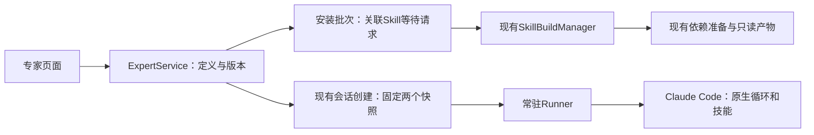

# 专家模式：产品与实现

> 本文记录0.3现有实现。用户于2026-10-24明确将后续目标改为WorkBuddy专家包原生兼容，后续设计以[兼容方案](../plans/workbuddy-experts-compatibility.md)为准；现有原生包实现与边界见[使用说明](../workbuddy-experts.md)，不能将格式兼容等同于所有私有连接器已接入。

版本：0.3 · 2026-10-24。按已实现的 Skill 体系收敛，替代此前尚无 Skill 的 0.2 方案。

专家是角色定义与固定技能引用的薄层，不另建 Agent 循环、安装器或技能调度器。

```text
专家 = 名称与用途 + 角色范围 + 工作方法 + 输出要求 + 具体 Skill 版本
专家会话 = 固定专家版本 + 固定能力快照 + 原有持续对话
```

## 用户怎么使用

1. 左侧“专家”进入 `/experts`，查看本人和平台内置专家。
2. 创建专家，填写名称、简介、角色、方法、输出和可选开场示例；选择已有 Skill 的具体版本。
3. 保存直接生成 v1；编辑最新版再保存生成 v2，不提供服务端草稿或单独发布步骤。历史版本和内置版本只读。
4. 点击“安装此版本”。已准备的同用户/同镜像 Skill 构建可复用；缺少的能力交给现有 Skill 模块安装。安装过程不调用模型。
5. 安装就绪后“开始对话”，此时只创建固定版本会话。用户发送第一条消息才启动环境和 Claude。
6. 后续对话维持同一专家。开场示例只填输入框，不自动发送。

安装专家不会修改“我的技能”的个人默认开关；零绑定专家不混入个人默认插件，但保留 Claude Code 自带技能。技能发现和调用继续交给 Claude。

首版所有绑定项都是必需项。暂无可选降级、专家市场、专家团、共享记忆、多运行档位和外部连接器。没有独立的“默认专家”开关，安装后可手动开启会话；移除专家阻止新建，旧会话保留。

## 固定版本与操作语义

| 操作 | 行为 |
| --- | --- |
| 保存新版本 | 原版本不修改，不自动升级已安装版本或旧会话 |
| 切换详情版本 | 历史只读；可安装并用该版新开会话 |
| 复制内置专家 | 复制定义和可分发技能引用，不复制历史或凭证 |
| 停用个人 Skill 默认开关 | 不改变专家绑定的具体版本 |
| 删除 Skill | 保留文件及旧会话；新的专家会话拒绝引用已删除技能 |
| 移除专家 | 软删除；不能再编辑/安装/新建，旧会话照常使用快照 |
| 取消安装 | 撤销本批次自己的等待者；不取消其他人的请求或声称共享容器已停止 |
| 重试失败技能 | 按 expectedAttempt 比较；共享构建已经成功时重新加入，不重复安装 |
| 停止本轮/关闭环境 | 沿用原生中断和整容器停止确认，不改变专家身份 |
| 运行镜像升级 | 新会话在新镜像重新准备；旧会话按原 imageId 与快照恢复 |

## 架构



Skill 的源文件、依赖、只读装载包和能力摘要只有一个事实来源。专家不复制一套 Skill 内容或构建状态。

### 安装如何复用

`SkillBuildManager.registerRequest(tx, ...)`只登记请求，不启动容器。专家服务在同一数据库事务中保存批次和全部子请求关联；任何一项权限或额度失败，整批登记回滚。提交后统一 `wake()`。

同用户、专家版本、镜像只保留一份未取消批次，重复点击不会重复占位。每个子请求仍是现有构建的独立等待者；个人安装和不同专家可共享构建。批次状态从子请求计算，不复制第二套构建 attempt。

取消先保存 cancelling，再撤销自己的子请求，最后记 cancelled。服务重启会继续完成取消意图。批次取消仅表示等待结束，子构建可能仍由其他等待者使用；停止不明时仍由 Skill 模块保留占用、拒绝复用。同用户取消/重试串行处理，防止迟到重试重新激活已取消等待者。

重试仅针对批次中的指定请求，携带原 attempt；失败构建重建，共享构建已成功或仍运行时重新加入。作业归服务持有，关闭页面只终止查看。

### 会话如何传给 Claude

客户端只传 `expertVersionId` 与原有 `clientRequestId`，不能传运行指令或 SDK 参数，也不能同时提交自由 Skill 选择。服务从本人/平台版本解析配置，确认当前镜像安装就绪，再调用 `selection(userId, 指定版本列表)`；零项也显式传 `[]`。

- `capabilitySnapshot`：沿用 Skill 版本、构建、命名空间与镜像的固定快照。
- `expertSnapshot`：保存专家版本、名称、已编译说明、开场示例与组合摘要。
- 两份快照随会话一次创建；请求去重、容量、文件准备和未知提交核对沿用既有逻辑。
- `SessionManager → Controller → Task → Runner`传递固定专家；`runnerOptions`只在创建原生query时向claude_code preset追加说明。
- 正常续聊保持同一个query；恢复时核对expertDigest、capabilityDigest和镜像，不读取latest。
- 新运行镜像声明 `io.agent-harbor.experts=1`；旧镜像拒绝专家任务，不静默忽略专家字段。

角色说明是确定的文本拼接，不调用模型。专家不能改变工具、文件、预算、网络或容器权限；不增加 Skill 名字名单、初始化审查或专用装载记录。

## 数据与接口

| 表/字段 | 内容 |
| --- | --- |
| experts | 归属、来源、状态、当前版本、创建请求去重 |
| expert_versions | 不可变定义、编译说明、内容摘要、保存请求去重 |
| expert_installs | 本人、专家版本、实际镜像、取消意图 |
| expert_install_skills | 批次到 Skill build request 的对应关系 |
| sessions.expertSnapshot | 固定专家定义与能力组合摘要；旧会话为空 |

迁移为 `0003_experts.sql`。只做软删除，不自动GC；保留旧会话引用的内容。

| API | 用途 |
| --- | --- |
| GET/POST /api/experts | 列表 / 保存v1 |
| GET/DELETE /api/experts/:id | 详情 / 本人软删除 |
| POST /api/experts/:id/versions | expectedVersionId + clientRequestId + definition，保存新版 |
| GET /api/expert-skill-choices | 本人或平台可绑定的准确Skill版本 |
| POST /api/expert-versions/:id/copy | 复制定义为个人v1 |
| POST /api/expert-versions/:id/install | 创建或查询当前镜像安装批次 |
| GET /api/expert-versions/:id/installation | 当前镜像的安装状态 |
| GET /api/expert-installs/:id | 批次、子技能状态与限长日志 |
| POST /api/expert-installs/:id/cancel | 取消本批次等待 |
| POST /api/expert-installs/:id/retry | requestId + expectedAttempt，重试或重新加入 |
| POST /api/sessions | 扩展 expertVersionId，服务解析快照；与skillSelection互斥 |

作者只能修改自己的个人专家；内置只读，私人无权对象返回404。本人/平台技能引用均重新核对，不能引用其他用户版本。内置专家仅允许绑定平台Skill。

定义字段：name≤40、description≤200、role/workflow/output各≤6000且合计≤12000字符；examples最多3条、每条≤300字符；Skill版本0–20项，同一调用名不能绑定两版。

## 目录与页面

```text
apps/web/src/features/experts/    列表、详情、表单与安装进度
src/service/experts/             定义校验/编译、业务事务、HTTP和内置分发
src/service/db/schema/experts.ts 四张表
src/shared/experts.ts            定义和固定快照类型
src/service/skills/              原有Skill版本/准备/派生包
```

`/experts`、`/experts/new`、`/experts/:expertId`挂在已有工作台路由下，保留侧栏和右侧工具栏。编辑暂留本页，保存才生成版本，离开时有未保存提醒。页面切换取消旧读取；安装与模型任务由服务持有。

## 部署和内置内容

先备份数据库及数据目录，停止服务，执行 `npm run build`、`npm run db:migrate`。构建 `infra/Dockerfile.skills` 为新的0.5.3镜像，设置 `AH_SKILL_IMAGE=agent-harbor:0.5.3`。原启用Skill需在新镜像重新准备，版本保持不变；旧会话及镜像保留。

管理员停服后可运行：

```sh
npm run expert:builtin -- examples/experts/document-review.json
```

内置相同定义不增版，内容变化生成新版；只登记专家，不替用户安装。升级不会自动修改旧会话。

## 验证边界

工程测试覆盖定义与版本、归属、并发去重、整批登记回滚、共享等待者取消与失败重试、重启完成取消、镜像变化与固定会话。Docker/SDK使用本地固定模型响应，核对角色传递、同环境多轮、关闭恢复、中断续聊和旧镜像拒绝；原Skill链路继续回归。

这些证明工程链路，不等于真实模型下专家效果。角色是否比普通对话更好，仍需用户用真实资料验收；自动GC、多实例、真实模型效果和生产部署另行验证。
