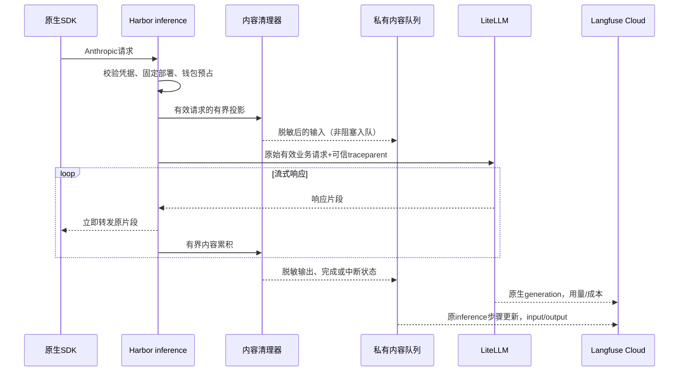

# Langfuse 内容观测实现设计

日期：2026-11-05。原生优先版本已实施。运行配置、字段和部署说明见[模型与任务观测](../llm-observability.md)。下文保留设计决策及备选方案。

## 0. 资料核查后的修正（优先于下文旧方案）

[LiteLLM原生能力核查](../../../../research/litellm-observability/REPORT.md)确认：模型输入输出已有原生采集与Langfuse映射，默认在Harbor再实现采集过早。下一步候选应先验证固定1.106.1、实际Anthropic路径、脱敏和llm_only的内容闭环；LiteLLM继续作为模型generation及其正文、用量、费用的单一生产者。Harbor补业务关联、Runner工具执行、版本与验收。

本轮纯合成格式探针发现：span_only启用而字符串true未启用；原始Anthropic响应与归一化响应在generation映射中行为不同，input_schema直接提取有缺口。它们是必须验证的边界，不等于当前HTTP链路必然失败。不得依据本设计直接打开正文或默认重写HTTP/SSE采集。

以下第1节原有模型落点、第3/6节Harbor模型采集流程及第10节原阶段A保留为**原生路径被证实不满足要求时的备选**，不再是推荐实施顺序；第8节内容队列只应按工具/任务与确有需要的补充数据重新评估。数据状态、脱敏、工具通道与验收原则保留，具体迁移与默认内容模式尚待实际原生链路验证后收敛。

## 1. 交付目标与主要决定

从一次失败任务出发，能看到用户目标、当次有效模型请求、模型响应、工具参数与返回、运行版本、实际结果，并明确哪些内容被脱敏、截断、排除或丢失。

继续使用三个必需配置决定是否启用Langfuse：host、Public Key、Secret Key完整有效才启用，全空关闭，部分配置报错且关闭。新增可选 `AH_LANGFUSE_CONTENT_MODE=redacted|metadata` 控制启用后的内容范围，不是第二个启用开关；实现选择默认 `metadata` 以维持现有数据范围，显式 `redacted` 后启用正文。旧数据不补采，版本上线前明确告知默认范围变化，仅对之后的新请求生效。本轮设计不授权自动升级或上传新的真实正文。

旧备选方案提出以下职责（当前默认采用第0节原生优先方向）：

- **Harbor钱包转发入口采模型输入输出**，写到现有 `harbor.inference` 步骤；这个步骤是一次SDK模型请求的可读内容记录。
- **LiteLLM继续独占模型generation及供应商用量/成本**，保留原有正文日志关闭与仅模型调用导出。Harbor不再写第二条generation，也不在父步骤重复写Token或供应商费用。
- **Runner原生Hook采工具内容**，经专用通道到宿主脱敏后进入观测存储；不改变SDK工具循环、权限或取消规则。
- **Harbor任务记录补任务目标、可确认的最终可见回答和版本**；执行完成与业务验收分别记录。

这意味着Langfuse的请求trace首页能看到输入输出，选中LiteLLM子generation时仍以指标为主。后台默认把“查看模型输入输出”定位到内容所在的父步骤，并明确标识来源。数据分析/样本导出以 `harbor.inference` 为内容行，再按traceId和gatewayCallId关联generation；不要求每条generation行自行包含正文。

这一备选落点仅在原生generation内容经隔离探针证实不满足要求、且最小网关映射适配仍无法解决时再评估。默认先用原生generation自身的input/output，不能因尚未验证而先建设一套平行采集，也不能重复生成generation或跨进程争写字段。

## 2. 当前实现中必须正视的边界

1. `wallet/proxy.ts`持有发往LiteLLM的完整Anthropic格式请求，并转发模型响应；其现有流式解析只提取计费用量，没有累积可读内容。
2. `runner-options.ts`已有PreToolUse、PostToolUse、失败和拒绝Hook；当前只传少量工具元数据。已安装SDK的PostToolUse含 `tool_input`、`tool_response`，失败Hook含 `error`，但工具返回结构是unknown，不能假定总有统一stdout/exitCode字段。
3. `runtime/conversation.ts::recordEvent`当前会先把Runner事件写入诊断JSONL，之后才通知服务。直接在普通事件中增加工具正文，会早于宿主脱敏而落盘。
4. `session-manager.ts`会把部分事件转入产品事件流；新增观测内容不能顺带暴露到普通SSE、管理CSV或通用审计。
5. LiteLLM固定镜像有内容型OTel回调，但其内容映射涉及标准日志payload、HTTP根步骤与流式结束钩子；`llm_only`又可能排除HTTP根。读到类定义不等于当前Anthropic路由已验证generation内容齐全。
6. v33的任务trace与模型请求trace通过SDK回执关联；常驻SDK的后台/辅助请求不能用当前活跃轮次猜归属。本版保留这一原则，不把完整树传播作为内容交付前提。

## 3. 一次请求的完整流程



输入采集位置在模型路由替换和不可信metadata清理之后、fetch之前；输出采集位置在原始转发旁路。脱敏只作用于观测副本，绝不重写模型实际收到的消息、工具结果或用户流式响应。

观测声明 `capture_boundary=harbor_litellm_anthropic`：它是SDK经Harbor发往网关的有效请求，以及网关返回给SDK的响应。不能将其描述为供应商转换后的原始HTTP字节，也不能声称包含SDK没有发送的本地文件或内部思考。

## 4. 每层数据契约

| 层次 | input | output | 元数据与状态 |
| --- | --- | --- | --- |
| 用户一轮任务 | 用户原始目标与显式约束 | 归属可靠的最终可见回答、产物/版本引用 | messageId、executionStatus、assessmentStatus、停止原因 |
| 一次模型请求 | system、按顺序的messages、文本/工具块、tools定义、有效模型与参数 | 文本块、tool_use及参数、停止原因；取消时已收到的部分 | requestId、callId、输入输出完成度、边界、模型版本 |
| 一次工具调用 | 工具名称、有效参数 | SDK提供的结果、可确认的错误/退出码 | toolUseId、原消息/子代理来源、权限状态、耗时 |
| 子代理 | SDK明确提供的类型/父工具与任务引用 | SDK明确提供的结束信息/结果引用 | agentId、原来源、来源可信度；没有原生内容时标unavailable |
| 业务结果 | 用户/平台明示的验收要求 | 已实际执行的验证结果、用户反馈 | assessedBy、evidenceRef、时间；不把执行succeeded自动当业务通过 |

模型输入必须保存当次有效上下文，而不只是最后一句用户消息。历史内容、工具反馈与tool_use_id的顺序和关联需保留；内容受上限约束时明确标记缺口。图片/音频/文件只留类型、大小、已知摘要和安全引用；首版不上传base64或重新下载远程资源。

工具适配：

- Read：安全工作区相对路径、实际返回片段与范围；敏感文件读取只保留排除原因。
- Write/Edit：有效参数、SDK真实返回及可确认的修改/版本引用；不另扫描整个目录制造“修改结果”。
- Bash：脱敏命令及SDK实际给出的返回；只有原生响应确实提供exitCode/stdout/stderr时才写这些字段，否则保留结构化返回和来源说明。
- MCP：连接/工具的安全标识、脱敏参数/结果；认证配置不属于工具内容。
- 权限拒绝：记录尝试的安全参数及denied，不能伪造“工具返回成功”。

共享 `ContentEnvelope` 建议字段：

```typescript
type ContentEnvelope = {
  schemaVersion: 1;
  policyVersion: string;
  kind: "task.input" | "task.output" | "model.input" | "model.output" | "tool.input" | "tool.output" | "error";
  state: "captured" | "redacted" | "truncated" | "excluded" | "unavailable" | "dropped";
  complete: boolean;
  value?: unknown;             // 只能是经过清理、有限深度的JSON
  sourceBytes?: number;        // 实际可测才填
  storedBytes: number;
  omittedBytes?: number;
  reason?: string;             // 受控代码，不放异常全文
  redactions: Record<string, number>;
  digest?: string;             // 仅对保存的脱敏投影计算，不宣称是原文摘要
  capturedAt: number;
};
```

不以空字符串同时表示“模型没有输出”“被排除”“未接入”“取消”和“采集失败”。实际合法的空输出保留为空，并另有状态字段。

## 5. 脱敏、限量与存储

### 脱敏在新观测数据持久化和出网之前完成

新增纯函数模块 `tracing/content-policy.ts` 与 `content-sanitize.ts`，宿主和Runner共用结构/规则；规则版本写入每份内容。宿主可用当次已持有的密钥值加强替换，不为脱敏复制所有凭据，也不把密钥列表发给Runner。

处理顺序：结构解析→字段/路径排除→凭据和个人标识替换→有界投影→检查可序列化结构→计算脱敏摘要。大文本只在有界内存中处理；跨块凭据识别与截断边缘需保留扫描余量，不能逐个chunk独立替换后直接写日志。

- 认证头、Cookie、私钥、数据库连接凭据、结构化password/secret/access_token等值删除。
- 已知密钥值及受支持的API Key/JWT/认证串在自由文本中替换；日志只显示规则命中数量。
- 按明确格式识别邮箱、手机号等个人标识；不能宣称正则能够识别所有隐私。
- `.env*`、密钥目录、进程环境等敏感文件的内容整体排除。路径从当前工具的实际参数提取，并按已知工作区规范化；未知来源只记录受控摘要。
- 错误保留类型、HTTP状态、阶段、脱敏后的有限说明，默认不导出整段堆栈。
- 无法解析、深度/数组数超限或疑似不安全的部分降级为元数据与明确原因；不让脱敏异常变成任务失败。

### 首版建议默认上限

以下是实施起点，必须用夹具测量序列化后的UTF-8大小，不是Langfuse宣称的上限或费用承诺。

| 对象 | 建议上限 |
| --- | --- |
| 单次模型输入 | 256 KiB |
| 单次模型输出 | 128 KiB |
| 单次工具参数 / 返回 | 32 KiB / 64 KiB |
| 单次错误说明 | 8 KiB |
| 单轮任务累计内容 | 2 MiB，元数据不因此停发 |
| 进程待写内容队列 | 16 MiB；不阻塞业务等待清空 |
| 持久待发内容队列 | 128 MiB，继续保留现有行数上限，先触发者生效 |

超限保留结构和安全的首尾片段、块顺序及省略标记；不把整个请求变成一段无法定位的截断字符串。摘要只对应实际保存的投影。已有引用只有确实可解析时才标available；无法还原的上下文明确标incomplete，不承诺精确重放。

建议本地内容保留7天、未发内容最多重试24小时，之后标记expired并保留缺口计数；现有元数据投影可维持30天。Cloud的实际保留由项目套餐/配置决定，本地清理不等于云端删除；上线前核对，不声称实现了自动Cloud七天删除。

## 6. 模型请求和流式响应的实现

- 新增 `tracing/inference-capture.ts`，与 `MessageMeter` 分离；钱包用量解析器保持原职责和结算条件。
- JSON响应从已解析对象建立观测投影；SSE按message_start、content_block_start/delta/stop、message_delta、message_stop维护有限状态，保留文本及tool_use结构。
- 不延迟首字、不逐token写DB或发OTLP；完整或终止时形成一次有界输出。达到内容上限后只继续统计完成状态和可测大小，业务流继续转发。
- 取消、流中断、上游错误和超时都保存已收到的可用部分，`complete=false`及明确原因；无响应内容时标unavailable。用量是否完整继续由钱包原逻辑决定，不能从内容字符数推算扣款。
- 首个用户可见文本/工具内容到达时间与网关TTFT分别标明测量边界；不要把HTTP响应头时间冒充首Token。
- 在现有inference span上加入 `langfuse.observation.input/output` 的脱敏JSON字符串，以及capture状态、policyVersion、boundary。更新使用原traceId/spanId，不新增另一条模型generation。
- 调用方传入的采集范围、目的地和身份设置仍不能覆盖受信配置。

## 7. 工具内容的专用通道

新增内部 `trace.content` 事件，携带有限内容和toolUseId/agentId/promptId/原attemptId等引用。Runner只在宿主明确启用redacted内容策略时构造此事件，默认关闭不读取/序列化大工具结果。

必须调整 `runtime/conversation.ts::recordEvent`：

1. 在写runner-events.jsonl和轮次events.jsonl之前识别专用内容事件，先校验事件形状、字节上限及已登记Runner/原轮次身份。
2. 路由到专用宿主处理器，完成第二次内容清理和私有队列写入。
3. 通用诊断日志只保留类型、关联编号、字节和处理状态；不把正文重新转入普通事件流。
4. 来源未知保持同会话未关联，不能挂到新前台轮次。晚到/重复事件沿原映射，使用稳定去重键。

仅靠Runner端脱敏不够：Runner缺少宿主持有的全部当次凭据，也可能提供不可信返回。宿主再次校验是出网边界。不能用Hook的 `updatedToolOutput` 为观测重写结果，那会改变Agent实际看到的内容。

内容策略/协议摘要加入Runner连接摘要。切换模式后按现有受控重建规则对新执行环境生效；旧镜像不支持内容时明确标metadata_only，不伪造完整工具内容或改写原会话镜像。

## 8. 数据落点与投递

下一条可用迁移编号在实施时确认，避免与并行迁移争号。建议新增：

- `tracing_payloads`：destination、sessionId、可空messageId/requestId、spanId、kind、sourceKey、revision、ContentEnvelope、expiresAt。
- `tracing_outbox`增加bytes/revision等投影信息，或用独立内容待发队列管理字节预算；现有元数据不因内容饱和丢弃。
- 持久目标状态增加内容积压字节、丢弃/过期计数及policyVersion；管理页只暴露这些状态，不回传原始秘密或通用SQL错误。

生产路径通过有界内存队列接收已清理的内容；后台写入后才成为可重启重试的记录。队列满/DB失败直接降级，累计缺口，不阻断模型、工具或钱包。进程在落库前崩溃可能丢内容，这个窗口必须在报告中保留，不能宣称100%不丢。

私有内容投影落库与对应outbox修订同事务提交；内容revision单调增长，较旧pending投影不得覆盖complete/partial终态。重启重放更新同一span；旧目标队列不转发新项目。清理/删除先立墓碑并停止待发，再清内容，避免迟到Hook或恢复旧备份重新导出。

复用当前资源删除流程前须核对其已提交范围；新内容表按session/request定向清理，Cloud删除单列状态及重试。首版不能把本地删除或删除链接等同于Cloud已清除。

## 9. 版本、业务结果与界面

每条内容记录附schema/policy版本，执行记录附实际Harbor构建标识、Runner镜像/SDK版本、模型部署版本、专家/技能快照摘要。缺少构建信息填unknown；不把仓库当前HEAD当作正在运行版本。真实提示词正文已在模型输入中，摘要仅对脱敏投影有效，不宣称原始system prompt指纹可恢复。

任务记录将 `executionStatus` 与 `assessmentStatus` 分开。现有succeeded只表示执行层结束；只有平台明确执行的验收或用户反馈才能写checks_passed/reviewed。首版不增加收费的自动LLM打分，也不根据一句“完成了”制造业务成功。

后台在现有请求证据面板增加：内容模式、输入/输出状态、字节/截断/排除原因，以及“查看模型输入输出”“查看任务与工具”。链接目标为实际内容所在步骤。首版沿用Cloud项目权限看正文，Harbor面板显示状态与引用，不新增面向普通用户的全量内容API，也不让CSV/审计默认带正文。上线前核对Cloud项目成员，不能把Harbor的用户隔离当作Cloud成员权限隔离。

## 10. 实施顺序与验收

当前优先阶段为A0：固定镜像原生内容探针及导出脱敏验证，覆盖实际Anthropic JSON/SSE、system/history、tool_use/tool_result/schema、失败/取消、llm_only及Cloud显式io字段回读。通过后收敛配置和最小适配；下表A是旧备选，并非已授权直接开工的默认方案。

| 阶段 | 改动 | 必须通过的验证 |
| --- | --- | --- |
| A：模型内容闭环 | content policy/sanitizer、inference capture、私有内容投影、原span I/O更新、后台定位 | JSON/SSE输入输出可见；完整历史/工具定义结构；原费用/取消不变 |
| B：工具与任务内容 | 专用协议、recordEvent分流、Hook内容、任务目标/回答、原轮次关联 | 读改测全过程可查；普通日志/SSE/CSV不出现新增正文；晚到不串轮 |
| C：恢复与运行条件 | 版本、字节预算、TTL/墓碑、缺口状态、模式切换 | 重启重放、饱和、删除/迟到、关闭不发送、旧镜像降级及配置回退 |

建议先交付A，验证内容确实能解释一例失败，再做B/C；总粗估3–4个开发工作日，SDK工具返回适配或删除流程未完成会影响后两阶段，不构成工期承诺。

验收数据分两类标记：`OBS_VISIBLE_*`为应在Cloud读到的业务文本；`OBS_SECRET_*`模拟的密钥/认证串必须在结构化或自由文本中被替换。不能继续用“所有input/output为空”作为内容模式通过条件。

必测：

1. 无配置/部分配置、metadata/redacted两模式及重启切换；启用判断仍只依赖原三项配置。
2. system、多轮消息、tools定义、tool_use/result顺序；非流式、UTF-8跨块、拆分JSON工具参数和正常空输出。
3. 成功、上游4xx/5xx、拒绝、超时、首包前取消、流中取消；部分输出不伪装完整，也不改变钱包结果。
4. `.env`读取、嵌套认证字段、URL凭据、自由文本密钥、跨chunk密钥；清理失败时不把原文写进异常。
5. 超长上下文/返回、深度和数组上限、内存/DB/Cloud队列饱和；模型继续运行且缺口可见。
6. 原轮次工具晚到、未知后台来源、来源伪造、SDK重复事件；新内容不进入普通Runner/产品日志，回放不重复生成记录。
7. Cloud通过带 `fields=core,basic,io,metadata,model,usage,trace_context` 的API读取，核实可见标记出现、秘密标记不存在、输入输出所在span正确，并检查浏览器真实详情页；不能把未请求io字段当作内容为空。
8. 一次可定位的失败夹具：模型收到了什么、发出了哪个工具参数、工具返回了什么、最终停在哪里，四项能相互核对。模型generation数量及费用不因补内容翻倍。
9. Cloud不可达/部分拒绝、持久化后重启、过期/墓碑、模式关闭与切目标；说明落库前窗口及直接网关callback缺口。
10. 类型/构建、相关专项、全量回归、固定镜像Docker/SDK、公开审计分别留证；在隔离项目先只发送合成内容，不复用此前真实模型预算。

## 11. 官方依据与验证范围

设计参考2026-11-05读取的本地源码、安装SDK声明，以及固定LiteLLM镜像内 `integrations/otel/langfuse_logger.py`、`logger.py`、`model/payloads.py`。这些只证明可用数据面和限制，不代表内容方案已经运行通过。

- [Langfuse脱敏](https://langfuse.com/docs/observability/features/masking)：发送前过滤输入输出与span属性。
- [Langfuse OTLP接入](https://langfuse.com/integrations/native/opentelemetry)：HTTP/JSON与属性映射；按实际步骤组织内容。
- [Langfuse观测API](https://langfuse.com/docs/api-and-data-platform/features/public-api)：显式选择io/metadata等字段组。
- [Langfuse采样](https://langfuse.com/docs/observability/features/sampling)：如以后降采样，应按整次任务/追踪统一决策，不能独立抽掉某个工具步骤。

本轮只形成设计；没有改采集开关、运行代码、Cloud权限或现有服务，也没有发送新的真实正文。
