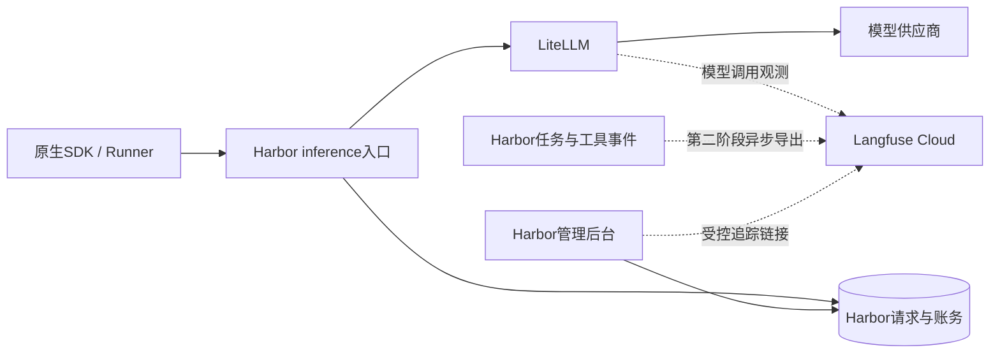

# Agent Harbor 模型与任务观测方案

> 阅读范围：本文件保留元数据观测的阶段设计和验证记录。“完整内容调试作为以后范围”等表述属于当时范围；当前已提供显式启用的脱敏正文模式，配置与数据范围见[模型与任务观测](../llm-observability.md)。

日期：2026-11-05。状态：已实现并完成隔离验证；使用Langfuse Cloud与配置自动启停，未调用付费模型。

## 目标与建议

让管理员从 Harbor 的一次任务或模型请求出发，查到实际模型调用、耗时、Token、供应商成本、错误，以及相关工具和子代理事件。先完成 LiteLLM → Langfuse 的可用闭环，再补任务追踪。

用户已确定使用 Langfuse Cloud。采用配置自动启停：配置完整有效就启用，未配置就关闭，不增加单独的enabled开关，也不要求本地部署Langfuse服务。默认只上报结构化元数据，不采集提示词、回答、文件、工具参数或工具返回正文。完整内容调试作为以后显式启用的独立范围。

用户已授权按方案实施与验证，并通过已登录Chrome配置日本区Cloud。实现、隔离运行、现有实例部署与真实供应商验收分别记录，不沿用此前真实模型验收的10元预算。继续维护唯一总任务 `T-20261104-agent-harbor-delivery`。

## 已核对的现状

| 位置 | 当前事实 | 本次如何复用 |
| --- | --- | --- |
| `infra/litellm.compose.yml` | 源码固定 LiteLLM `v1.106.1`，独立网关数据库，监听宿主4320 | 先对这个版本做兼容验证，不顺带升级网关 |
| `infra/litellm.config.yaml` | 已有 Prometheus callback；`turn_off_message_logging: true`；路由重试为0 | 追加 Langfuse callback，保留现有指标、脱敏与预算策略 |
| `src/service/wallet/proxy.ts` | `/inference` 转发 Anthropic `/v1/messages`；生成钱包请求ID，记录网关call ID、耗时、状态、失败；只转发少量协议头 | 在这个可信入口注入请求追踪上下文，不能照搬 OpenAI 示例到请求体 |
| `src/service/db/schema/wallet.ts` | 钱包请求已有sessionId、messageId、gatewayCallId及模型/价格版本 | 增加最小追踪映射，不重复建设账本 |
| `src/agent/resident-runner.ts`、`src/service/session-manager.ts` | SDK通过 `request-id` 回执，在请求返回后关联原始消息；已有工具/子代理生命周期事件 | 保留精确回执及原轮次映射，不按当前活跃消息猜归属 |
| `src/agent/observation.ts` | 已按tool/prompt/agent保存跨轮次来源 | 复用来源；未知归属保持未知 |
| `src/service/admin/`、`apps/web/src/features/admin/RequestEvidence.tsx` | 已有请求事实、网关观察、对话与执行事件详情 | 添加追踪链接和上报状态，不重做管理台 |
| `src/service/observability/` | 已有生成应用的流量、业务事件和运行观测 | 这是另一类观测，本轮不混入模型追踪库 |

核对时源码HEAD为 `ba93c08` / v30；应用预览相关文件已有其他未提交修改，本规划不修改这些文件。上述是源码核对，不等于核实当前运行中的 LiteLLM 版本、已有 Langfuse 实例或生产健康。

## 职责与数据流



- LiteLLM负责模型调用观测：模型、输入/输出/缓存Token、调用时间、错误及可确认的供应商成本。
- Harbor负责业务上下文：用户归属、会话、消息、工具、子代理、停止及最终状态。
- Langfuse负责追踪检索与分析，不参与请求授权、扣款或容器清理。Harbor人民币扣费、LiteLLM供应商美元成本和SDK估算继续分开，未知不填0；不得相加或用Langfuse反向结算钱包。
- 每次模型调用只由一个出口写入generation，首选LiteLLM；Harbor只补任务/工具等span，避免双份调用和双份成本。

## 第一阶段：接通模型调用与管理台入口

### 1. 先做兼容探针

使用固定LiteLLM镜像、隔离网关库、确定性模型夹具和独立Langfuse Cloud测试项目。先验证真实使用的 Anthropic `/v1/messages`，覆盖流式、非流式、错误及客户端取消，不能只验证 `/chat/completions`。

验证 `langfuse_otel` callback、宿主变量、W3C `traceparent` 的实际作用，以及该路由如何接受会话/用户等观测元数据（包括是否需要 `litellm_metadata`）。提供已知trace ID后，必须在Langfuse读取回相同ID才算关联通过；把字符串显示在metadata里不算追踪传播成功。

当前官方文档已包含 OpenTelemetry v2，不能据此认定 `v1.106.1` 具备所有新设置。本轮先保留版本；如存在硬阻塞，再单列最小升级建议、预算/价格/取消回归和回退办法。不得直接开启新版开关代替验证。

### 2. 增加可选配置

拟调整 `infra/litellm.config.yaml`、`infra/litellm.compose.yml`、私有环境变量加载及 `.env.example`，并同步统一交付工具、doctor和部署文档。观测按配置自动启停，默认关闭；不增加 `AH_LANGFUSE_ENABLED` 等独立开关。

统一对外配置为以下三个私有环境变量，由交付工具映射给LiteLLM及后续宿主导出器，避免维护两套相互矛盾的配置：

| 配置 | 用途 |
| --- | --- |
| `AH_LANGFUSE_HOST` | 用户Cloud项目所属区域的明确HTTPS地址 |
| `AH_LANGFUSE_PUBLIC_KEY` | 项目的Public Key |
| `AH_LANGFUSE_SECRET_KEY` | 同一项目的Secret Key |

空字符串和纯空白按未配置处理。行为约定：

| 配置/运行情况 | 行为 |
| --- | --- |
| 三项均未配置 | 关闭；不初始化Langfuse客户端、不注册callback、不发请求、不要求密钥 |
| 三项完整且本地格式校验通过 | 自动启用；LiteLLM与宿主导出器使用相同目标，保留Prometheus |
| 只配置部分字段或地址格式错误 | 不初始化；明确显示“配置不完整/无效”，仅提示缺失字段名，不输出值；Harbor核心服务仍可启动，doctor单列此配置错误 |
| 完整配置但云端不可达、鉴权失败或限流 | 保持已启用，标为观测降级，按有界重试处理；不伪装成正常关闭，不阻断模型与账务 |
| 移除三项配置并重启/重新加载部署 | 关闭；停止导出及队列重试，管理台显示未启用；保留已有记录 |

首版按服务重启生效，不承诺热切换。关闭后不得继续发送待发数据；重新配置目标时不将旧目标队列自动转投新项目。链接所需的项目定位信息由已认证项目查询/缓存获取，不能让额外的UI字段成为启用前提。

部署时按解析结果生成LiteLLM的实际配置。关闭时callback仅保留 `[prometheus]`，不能把 `langfuse_otel` 永久写入基础YAML后靠空密钥关闭。启用时的配置方向如下，最终可执行配置以固定版本探针为准：

```yaml
litellm_settings:
  callbacks: [prometheus, langfuse_otel]
  turn_off_message_logging: true
```

启用时将统一配置映射为LiteLLM私有环境中的 `LANGFUSE_PUBLIC_KEY`、`LANGFUSE_SECRET_KEY` 和host；当前官方示例使用 `LANGFUSE_OTEL_HOST`，该固定版本接受哪个host变量需探针确认。不依赖默认云区域，不把真实密钥写进配置、日志或仓库。不要把Langfuse密钥下发到Runner、应用容器或浏览器。

如后续决定采用OTel v2，单独验证 `LITELLM_OTEL_LANGFUSE_SPAN_SCOPE=llm_only`，限制发往Langfuse的代理内部噪声；不同时启用旧版 `langfuse` callback，也不同时包一层客户端自动模型日志。不要给现有Harbor占用的4318端口直接新增OTLP监听器。

### 3. 建立可靠编号映射

| 业务对象 | 计划映射 | 边界 |
| --- | --- | --- |
| 用户 | 由凭据binding推导的稳定匿名ID | 不从客户端传入用户ID认领归属，不发邮箱/姓名 |
| 会话 | 由实例命名空间+Harbor sessionId生成Langfuse sessionId | 测试与正式项目分离，避免备份实例串数据 |
| 单次模型请求 | wallet requestId → 32位小写十六进制trace ID | 请求发出前生成/保存，可用命名空间种子稳定生成 |
| 网关调用 | `x-litellm-call-id`及Langfuse observation映射 | 不假定网关call ID就是Langfuse trace ID |
| 用户一轮消息 | `model.request.link`确认后的messageId | 在回执前允许为空；不能把当前活跃轮次当事实 |
| 模型与发布 | deploymentId、versionId、环境、Harbor版本 | 使用白名单元数据，限制字段大小和标签数量 |

宿主校验钱包凭据后注入可信 `traceparent` 和观测字段；覆盖/移除调用方伪造的追踪、身份及上报目的地设置，不把未校验的浏览器上下文透传到供应商。Anthropic自身的metadata字段不随意覆盖。`count_tokens`与真正模型生成分开标注，不虚增generation/消费。

最小存储可用可空追踪字段或独立小映射表；最终由探针结果决定，至少能保存requestId、traceId、网关callId、目标项目、关联确认状态。历史记录保持无追踪，不伪造补采。已有账务迁移和API兼容必须保留。

### 4. 在现有请求详情提供入口

在请求证据和任务详情增加“查看模型追踪”。链接由服务端按固定Langfuse地址、项目和已确认trace ID构造，管理员打开后使用自己的Langfuse权限；不共享密钥、不默认创建公开分享链接。

追踪状态区分未启用、等待上报、已确认、上报失败、历史无记录、归属未确认。已发送不是Langfuse已入库；用测试查询或受限核对器确认，不逐次同步等待远端入库，也不在用户打开页面时发送付费模型探测。

第一阶段验收：一次正常任务中的多次模型调用均可从Harbor打开正确Langfuse记录，并按会话归组；有可靠回执的请求能回链正确消息。该阶段不承诺完整工具树或所有模型调用已嵌入消息trace。

## 第二阶段：增加任务、工具和子代理追踪

在宿主新增小型 `src/service/tracing/` 模块，通过现有持久事件导出 `message.accepted/finished`、工具开始/成功/失败/拒绝、子代理开始/结束及停止状态。原生SDK继续控制工具与Agent循环；不改写执行器，不对每个文本流片段打点。

按用户一轮消息建立任务trace，工具/子代理形成子span。复用runnerId+seq、toolUseId、promptId、agentId及现有来源映射；派生稳定span ID，事件重放不新增相同动作。不导出已有tool.started中的自由文本detail、命令、路径或参数。

关键取舍：

1. 默认先让“任务trace”和“请求trace”通过经过确认的requestId/messageId映射互相定位。SDK回执到来时再补关联。任务详情列出准确的关联请求与直达链接，这已经能完成故障排查。
2. 若要在Langfuse内形成一棵完整的任务→模型→工具树，必须在每个模型请求发出前，可靠获得原始消息/子代理上下文，并传递到LiteLLM。常驻SDK、多轮、并发子代理及后台任务使一次性环境变量头不可靠。先做按请求上下文传播探针，验证通过再合并追踪层级。
3. 不以全局“当前messageId”、修改常驻进程的静态header或仅设置metadata.trace_id代替上述验证。无法确认的辅助/后台调用先归会话，显示未确认；不强塞到前台任务。不要为了画完整树重复写入相同generation。
4. 崩溃、丢事件或被拒绝后缺少完成回执时，span标记interrupted/unknown，不伪装成功。tool.started只代表进入检查，不等于工具已经执行。

导出采用后台有界队列和现有事件的持久游标；源事件落盘后再投递，失败退避、重复投递按稳定ID处理，并监测积压、最老等待时间和丢弃数量。对无法可靠恢复的网关callback事件明确记录缺口；不承诺所有断网/重启情况下完整无损。队列和保留窗口确定后做重启重放验证，不能只证明进程内flush。

## 部署、数据与故障处理

- 使用Langfuse Cloud，测试与正式项目分开；不在Harbor交付中增加Langfuse自身的Web、worker、数据库、缓存或对象存储。
- Cloud地址与项目密钥放私有环境文件，区域按实际项目填写；成员权限与套餐由用户账户管理。配置完整才启用，未配置时普通安装、doctor、模型调用和管理台都不依赖Cloud账户。
- 先元数据100%采集，记录模型和缓存Token、状态、耗时及已知成本。首Token耗时只有实际可测时才展示；Harbor转发总耗时与供应商生成耗时不混用。
- `turn_off_message_logging`之外还须对最终出站payload和落库结果做哨兵测试：提示词、响应、工具文本、header、错误body、URL中的凭据均不得被带出。不要只检查开关存在。
- Langfuse断开、超时、429/500、密钥失效或积压时，模型响应、结算、取消和清理继续按既有规则完成。上报失败有结构化状态，不把异常吞掉后显示健康。导出有限超时、有限队列，关闭时有限flush，不无限等待。
- Langfuse故障不应使Harbor readiness失败而拒绝全部任务；另报观测降级。部分或错误配置由doctor清晰报告，区别于完全未配置的正常关闭。
- Cloud保留、删除、配额和费用以实际选定套餐为准，接入前核对，不将30天保留或无限上报写成保证。Harbor备份保存本地映射与导出游标，不宣称备份了Cloud端追踪数据；恢复后核对实例命名空间，避免重复或串项目。
- 回退移除三项观测配置并重启，由配置生成器移除Langfuse callback；保留映射和观测数据，不改历史余额，不删除网关库或重置spend。

## 实施顺序与验收

| 顺序 | 交付 | 通过标准 | 粗估工作量 |
| --- | --- | --- | --- |
| 0 | 固定版本/协议/脱敏/传播探针 | 流式、错误和取消数据可在Langfuse读取；ID与哨兵检查通过；形成兼容结论 | 约0.5天 |
| 1 | Cloud配置自动启停、可信请求映射、请求详情入口 | 无配置正常关闭、配置完整自动启用；一个任务多次调用可查，跨会话不串；不改变余额和网关策略 | 约1–1.5天 |
| 2 | 任务/工具/子代理导出与持久恢复 | 原始归属可靠；晚到和重放不串轮/重复；上报失败可见 | 约1–2天 |
| 3 | 故障、恢复与小规模真实业务验收 | 下列场景留证，具备关闭开关与回退步骤 | 约0.5–1天 |

总计约3–5个开发工作日，不是工期承诺；已排除自建Langfuse基础设施工作，Cloud账号/项目准备单列。固定版本存在兼容缺陷、完整树需要SDK改造及生产恢复演练另评估。建议先交付0和1，再按实际排障价值推进2和3。

必须覆盖的验证：

0. 未配置、空白、部分配置、错误地址、完整配置、删除配置后重启、切换目标项目；逐项检查callback/客户端是否实际初始化、是否发送请求、日志是否泄露密钥；Cloud无效密钥属于已启用但降级。
1. 同会话两轮、同轮多次调用、工具循环、原生辅助请求；同用户不同会话和不同用户隔离。
2. 流式/非流式、缓存Token、SDK重试、工具拒绝、上游4xx/5xx、网关授权/预算拒绝、计数路由；请求与实际供应商尝试分别计数，拒绝不伪造模型执行。
3. 首响应前失败、流中断、取消后继续、后台任务晚到、Runner/服务重启；无回执保留未知，旧请求不挂到新轮次。
4. Langfuse不可达、错误密钥、429/500、队列满及重启重放；对照启用前后模型响应、耗时和账务结果。预先保存基线后再设置可接受性能差异，不承诺零开销。
5. 密钥/个人信息/正文哨兵、元数据伪造及非法trace输入、管理权限和链接访问；同时检查LiteLLM、宿主导出及Langfuse存储。
6. 配置与构建检查、相关数据库测试、完整回归、公开审计；Docker集成与浏览器检查分别留证。按项目规则执行 `npm test`、`npm run check`、`npm run audit:public`；既有历史审计阻断保留。
7. 真实模型验证另列明确预算，使用隔离账号/数据核对requestId→callId→trace，费用与供应商账单的最终核对分别记录。夹具通过不等于真实供应商验收。

## 官方依据与尚未核实项

官方网页查阅日期为2026-11-05；在线文档会变化，不能替代固定镜像运行验证。

- [Langfuse × LiteLLM](https://langfuse.com/integrations/gateways/litellm)：`langfuse_otel`与凭据接入。
- [LiteLLM Logging](https://docs.litellm.ai/docs/proxy/logging)：call ID、关闭正文日志、传播上下文。
- [LiteLLM OpenTelemetry文档](https://docs.litellm.ai/docs/observability/langfuse_otel_integration)：当前OTel v2配置及范围控制；与项目固定版本适配待验。
- [Langfuse追踪ID与分布式追踪](https://langfuse.com/docs/observability/features/trace-ids-and-distributed-tracing)：32位hex trace ID及上下文传播。
- [Langfuse Masking](https://langfuse.com/docs/observability/features/masking)：在数据离开应用前过滤。

未核实：运行中的LiteLLM实际镜像、Cloud项目地址/区域/凭据及套餐、固定版本对Anthropic路由的全部callback/metadata兼容性、端到端传播、最终脱敏效果、上报可靠性和生产容量。本轮没有更改模型配置、运行服务或账务数据。

## 2026-11-05 用户确认

用户选择Langfuse Cloud，并要求“配置了就启用，没配置就关闭”。据此替代初稿的本地自建建议和独立开关表达；缺项显示配置错误并保持观测关闭，完整配置运行故障显示降级，核心服务不因此停用。本轮仅更新规划，尚未实现自动启停。

## 实施记录（2026-11-05）

已实现三项配置自动启停、容器有效配置生成、可信请求traceparent、持久事件队列/游标、SDK回执后的原消息关联、管理状态/请求与任务链接、doctor及显式云端核实命令。使用原生langfuse_otel与固定镜像的OTel v2；另在HTTP导出边界加字段白名单适配，清理异常正文、堆栈、事件及非白名单资源属性，避免仅关闭正文开关仍泄漏错误详情。适配锁定当前镜像，升级必须重验；不改变供应商调用或账务。

日本区独立项目已通过已登录Chrome配置，密钥仅保存在忽略的私有配置中。隔离PG、固定LiteLLM、实际Docker/SDK两轮任务与Bash工具、3条逐请求Cloud generation回读及浏览器后台跳转通过；付费模型请求0。完整210项回归通过，最终地址规范化、容器五种配置状态与错误过滤以专项及实际链路复验。操作步骤以[配置与恢复说明](../llm-observability.md)为准。

任务与模型仍为分别关联的trace，不承诺所有辅助请求已形成一棵完整任务树；未知归属不挂到当前轮。网关callback仍可能丢观测，Cloud长期额度、生产灾备与真实供应商另验。初稿中“未实施/待选择”保留设计阶段历史，当前交付事实以本节及总任务为准。

## 内容观测后续设计

用户要求进一步设计模型输入输出、工具内容及结果观测。具体实现与验收见[内容观测实现设计](llm-observability-content.md)；该文档属于待实施设计，不改变上述v33元数据采集范围，也不表示已上传真实正文。
