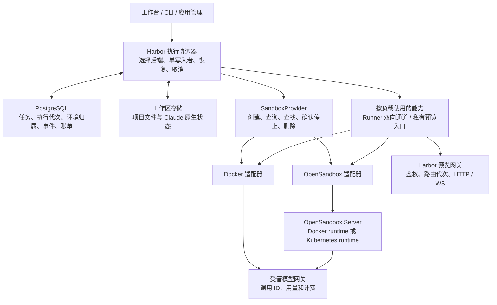

# Harbor 可替换执行后端方案

2026-11-06。方案基线 `dda58c3`，包含此前 PostgreSQL 队列规格 `813c901`。目标是在一套 Harbor 业务代码之下同时支持 Docker 和 OpenSandbox，经过验证后按工作负载切换。当前处于设计阶段。

## 一、选定路线

- **Harbor 定义接口。** 业务层只调用环境创建、状态查询、停止确认和按需提供的通信或入口能力。Docker 与 OpenSandbox 各自负责将这些操作映射到后端。
- **先验证预览，再验证 Agent Runner。** 预览能测试创建、接入、路由、回收和切回，并且故障面较小。Runner 需要持续双向通信、原生工具隔离和旧进程停写，单列准入。
- **OpenSandbox 首轮固定 1.2.0，先在专用 Ubuntu 24.04 使用其 Docker runtime。** 同一镜像和主机对比，先只替换 Harbor 管环境的方式。若部署目标包含移除宿主 Docker 依赖，第二阶段另验 OpenSandbox Kubernetes runtime 和存储挂载。这里 `docker` 指 Harbor 直连 Docker，`opensandbox` 指 Harbor 通过其服务调用，后者还能选择不同的底层运行时。
- **按环境固定后端。** 新环境才根据策略选后端。旧环境的停止、核对和删除始终走其创建时的后端及实例标识。换后端是停止旧环境、交接持久状态、重建新环境的流程。

现有本地探针在 OpenSandbox 1.2.0 的 Docker 后端完成了 5 次创建、文件读写和命令执行，验证了 HTTP 预览、有序重启管理服务后的重连及挂载文件保留。该环境的匿名预览返回 200，内置 Secure Access 拒绝启用；TypeScript、Harbor 原生 Runner、断网、引擎重启、跨租户和压力未验。本方案以此为证据起点。 [既有探针](../../../../research/harbor-opensandbox-feasibility/REPORT.md) · [固定发布版](https://github.com/opensandbox-group/OpenSandbox/releases/tag/release-1.2.0) · [固定 TS SDK](https://github.com/opensandbox-group/OpenSandbox/blob/release-1.2.0/sdks/sandbox/javascript/README.md)

## 二、职责与边界



| 层 | 承担 | 明确边界 |
| --- | --- | --- |
| Harbor 业务 | 用户权限、任务领取和取消、应用发布版本、账单、事件游标 | 业务 ID 和状态由 Harbor 定义；后端 ID 是外部资源引用 |
| 执行协调器 | 选择运行配置、提交创建意图、认领资源、停旧启新、收尾 | 一条工作区只有一位写入者；租约与实际停写分别验证 |
| 后端适配器 | 运行环境、镜像启动、资源和网络策略、状态观察、私有端点 | 后端专属参数封装在适配器配置；上层拿不到 Docker 命令或 OpenSandbox SDK 对象 |
| 工作区存储 | 工作文件、原生对话状态、快照、校验和、恢复 | 执行环境可清除；文件归属不随容器 ID 变化 |
| 网关 | 浏览器与租户鉴权、入口代次、令牌、HTTPS 和回调 | 对浏览器只公开 Harbor 管理的域名及路由；后端管理与端点凭证仅在服务端 |

FastGPT 的契约将生命周期、命令、文件和健康检查拆开，并区分释放本地连接和停止远端环境。Harbor 借鉴这条边界，另外把原生 Runner 的双向通道和可证明的停写纳入契约。 [FastGPT 适配器契约](https://github.com/labring/FastGPT/blob/09192051eec4e70de4d02e4c5131e11844e0b28f/sdk/sandbox-adapter/src/contracts/lifecycle.ts)

## 三、接口草案

首版在 `src/runtime/providers/` 定义 TypeScript 内部接口。生产只实现已被调用的能力。预览用生命周期和端点，Runner 再加持续双向通道。一段独立的命令执行可以作为适配器测试能力，待迁移一次性任务时再形成独立端口。

```ts
type EnvironmentRef = {
  environmentId: string;       // Harbor 分配
  backendId: string;           // 已登记的后端实例标识
  resourceId: string;          // 后端实际返回的 ID
  environmentGeneration: number;
};

type EnvironmentSpec = {
  environmentId: string;
  generation: number;
  purpose: "preview" | "agent";
  image: { reference: string; digest: string; platform: string };
  resourceProfile: string;
  networkProfile: string;
  workspaceRef?: string;
};

type Observation =
  | { state: "starting" | "running" | "stopped" | "absent" }
  | { state: "unknown"; reason: string };

type StopResult =
  | { state: "quiescent"; evidence: StopEvidence }
  | { state: "unknown"; reason: string };

interface SandboxProvider {
  validate(spec: EnvironmentSpec): Promise<void>;
  create(spec: EnvironmentSpec, deadline: AbortSignal): Promise<EnvironmentRef>;
  findOwned(intent: CreationIntent): Promise<InventoryResult>;
  inspect(ref: EnvironmentRef): Promise<Observation>;
  stopAndConfirm(ref: EnvironmentRef, deadline: AbortSignal): Promise<StopResult>;
  remove(ref: EnvironmentRef, proof: StopEvidence): Promise<void>;
}

interface PreviewEndpointProvider {
  resolvePrivateEndpoint(ref: EnvironmentRef, service: "preview"): Promise<PrivateEndpoint>;
}

interface ResidentRunnerProvider {
  openRunner(ref: EnvironmentRef, launch: RunnerLaunch): Promise<RunnerTransport>;
}

interface RunnerTransport {
  send(command: RunnerCommand): Promise<void>;
  readonly events: AsyncIterable<RunnerEvent>;
  readonly diagnostics: AsyncIterable<Uint8Array>;
  readonly closed: Promise<ChannelClose>;
  close(): Promise<void>;
}
```

实现约束：

- `create` 负责把环境推进到可检查状态。Docker 可以内部执行 create/start；OpenSandbox 可以通过一次创建进入运行。业务就绪由 Harbor 另验，包括 Runner 握手或应用健康端点。
- `validate` 在分配环境前核对镜像平台、挂载、端口、资源和网络约束。能力必须绑定具体后端实例、运行配置和已验证版本。缺能力时返回可定位的错误。可启动普通 shell 的环境未必能启动 Harbor Runner。
- `findOwned` 返回完整盘点、空结果或未知。标签查找要分页；空结果只有在目标后端、权限、分页及观察范围都核实后才可信。标签、资源 ID 和用户请求 ID 均不作为访问凭证。
- `stopAndConfirm` 以“原写入者及其后代已失去执行能力”为判据。OpenSandbox 可以把删除作为终止操作，此时后续 `remove` 对同一已证实资源自然幂等。删除返回、SDK `close()`、命令断开、过期和状态超时各自只是信号。
- `send` 处理背压、大小上限和连接关闭，返回仅表示本端已交给传输。Runner 对具体命令的接受由协议事件证明。命令或回执丢失均按执行结果未知处理，连接失败后禁止透明重发。
- `PrivateEndpoint` 带目标标识、私有地址、连接方式和服务端凭证引用。按负载和代次重新解析，地址变化由网关核对后更新。适配器与网关校验允许的后端地址范围及端口，避免把任意地址当代理上游。
- Provider 错误区分能力缺失、无权、状态未知、确定不存在、配置错误和暂时不可用。连接超时不映射成不存在。失败可重试由协调器根据操作阶段决定。

当前耦合点与改造入口：

| 当前代码 | 调整 |
| --- | --- |
| [Controller](../../src/runtime/controller.ts) 直接创建 `DockerBackend` | 组合入口注入后端注册表，先接原 Docker 实现。运行中的会话按已持久化引用找后端。 |
| [RunnerChannel](../../src/runtime/runner-channel.ts) 接受 Node 子进程 | 拆成 JSONL 编解码和命令/事件状态管理。Docker 管道适配成 `RunnerTransport`，原生事件序号、attemptId、generation 检查继续保留。 |
| [会话恢复](../../src/runtime/conversation.ts) 和 [启动恢复](../../src/service/recovery.ts) 直接扫描 Docker | 按环境记录盘点对应后端，保留旧 Docker 标签发现兼容路径，按会话隔离核对失败。 |
| [应用运行](../../src/service/applications/docker.ts) 的回环端口与 [应用入口](../../src/service/applications/edge.ts) 的上游 | 仅预览使用私有端点解析。业务健康探针仍核对 app、build、deployment 和代次。路由更新只能改该预览。 |
| [备份](../../src/clients/ops/backup.ts) 通过 Docker 发现 Runner | 启用第二种 Runner 后，停机备份必须能核对两种后端及写入者。未补齐前，能力门槛不允许 OpenSandbox Runner 进入生产。 |

## 四、持久化与切换

沿用[队列契约](postgresql-execution-queue.md)。任务执行代次用于挡住旧轮次写 PostgreSQL、旧事件和旧推理凭据。环境代次用于识别同一会话或预览环境的前后实例。一次环境能服务多轮，两种代次各自独立。

环境记录至少包含实例归属、用途、会话或应用 ID、后端实例、资源 ID、镜像摘要和架构、规格指纹、工作区引用、环境代次、期望/观察状态和最后核对时间。后端 API 地址和凭据通过实例配置引用解析，凭据不上记录；同一个后端 ID 不得重定向去接管一个无关集群。

### 创建结果未知

1. PostgreSQL 先写创建意图，保存稳定的 `environmentId + generation + backendId`。
2. 后端创建携带环境身份、实例身份和规格指纹。Docker 名称及标签可用于找回；OpenSandbox 按固定版本的 metadata 筛选，实际列表行为在故障探针中复核。
3. 丢响应时，用完整盘点找回正确的资源，核对环境归属和规格，再填 `resourceId`。只有后端提供已验证的幂等创建或证明前一次未创建时，才可再发请求。单次列表为空可能来自请求仍在进行或结果尚不可见。盘点不完整或发现多份资源，冻结派发、记录遗留，逐个确认停写。
4. 每个环境由其记录的后端管理。删除中断后继续核对原资源；清理请求不得通过另一个后端猜测资源状态。

### 从 Docker 切到 OpenSandbox，再切回来

- **新会话/新预览**：按负载和灰度规则选择后端，例如 `preview=opensandbox-local`，`agent=docker-local`。已有环境继续按持久引用执行。
- **切既有会话**：暂停派发 → 拿会话锁 → 核对原后端并确认停写 → 校验工作区、Claude 状态与镜像兼容 → 在目标后端挂载或恢复 → 验文件及 Runner 握手 → 将已预留的环境代次设为当前，才允许接收下一轮。旧执行凭据随旧代次失效。执行结果未知的旧轮次保留待核对。
- **切预览**：可独立启动固定产物的候选环境。候选就绪并核对部署身份后，通过代次切换入口，旧环境下线后回收。数据库迁移仍由 Harbor 发布链路处理。回退重新确认目标健康与身份再切流。
- **回退**：把新分配策略改回 Docker，存量 OpenSandbox 环境按记录逐个停和迁。后端失联时仅受影响环境待核对，切默认配置也不放行同一工作区的新写入者。

### 文件和镜像的可移植性

协调器把逻辑工作区 ID 交给存储层解析，适配器只拿已校验的挂载描述。存储层负责预备工作区、版本校验和恢复，路径、挂载类型和对象存储由其配置决定。

同一台机器的 PoC 可以共用专用挂载目录，只允许在服务器配置登记的工作区根下挂载，并验证路径、符号链接和归属。使用同一份宿主锁，挂载权限、UID/GID、应用工作目录、Claude 状态目录、运行配置的只读边界和技能依赖需核对。

跨机器才引入归档或对象存储恢复。先停写，生成含文件大小、哈希、格式版本和镜像信息的快照，目标端校验并安全解包到暂存目录，再原子切入新工作区。依赖缓存按镜像、平台、技能版本重建。排除连接文件、网关和 MCP 凭据。恢复时拒绝路径逃逸、危险链接、压缩炸弹和校验不符。旧机器隔离不到位时不得把共享可写卷交给下一位。

镜像以 OCI 摘要和平台为跨后端契约。Docker 本机镜像 ID 对应到可拉取的固定版本，缺少映射的旧会话继续用 Docker。Claude SDK 与技能依赖跨镜像或架构变更另做恢复验证。

## 五、Runner 与预览的两条风险路径

### Runner 双向通信

当前 `docker exec -i` 维持一个长期进程，向 stdin 写 JSONL，从 stdout 读 JSONL，stderr 独立。OpenSandbox 1.2.0 TypeScript 文档支持流式 stdout/stderr；execd 官方说明另有 PTY WebSocket，且部分扩展没有进入公开规范。普通命令 SSE、SSH 风格 PTY 和 Harbor 所需的非 TTY 双向传输具有不同语义。 [固定 TS SDK](https://github.com/opensandbox-group/OpenSandbox/blob/release-1.2.0/sdks/sandbox/javascript/README.md) · [execd 通信能力](https://open-sandbox.ai/architecture/data-plane/execd)

先用一个回显 Runner 测官方公开接口：多条 stdin 指令、stdout/stderr 分离、顺序、无回显、半关闭、断开和退出。如果固定版本提供可验的原始双向通道，用薄适配即可。否则评估一个 **Harbor Runner Bridge**：由受信运行镜像启动，私有地址只接受 Harbor 服务端连接，把已定义的 Runner 命令和事件接到真实进程的非 TTY 管道。Bridge 不提供任意命令或 shell API，不向应用浏览器暴露。凭据按环境和代次限制、短期有效，工具不能读取凭据或访问控制端口。服务端确认身份、限制帧大小和并发连接。Bridge 与工具隔离及故障停止是硬门槛。

继续使用原生 Claude 的 query、技能、MCP 与中断。初版遇到管道丢失，从持久事件看进度，核对并停止旧环境，下一轮从持久工作区和 SDK 会话恢复。恢复上一轮传输连接、还原运行中内存和重放未确认输入留在后续。真实 SDK 发出的模型请求须经 Harbor 受管代理及队列规格中的调用 ID 去重；provider 切换不改变模型的计费和故障语义。

### 私有预览入口

OpenSandbox 1.2.0 的内置 Secure Access 需要 Kubernetes 和 ingress gateway，Docker 后端拒绝该配置。首轮仍由 Harbor 网关做用户授权，OpenSandbox Server、execd 和应用端点只在私网可达，防止绕开网关直连。对外使用独立于工作台的预览来源，默认只有应用创作者和明确授权者可访问。绑定应用、环境、部署代次和短时凭证，撤销后已打开的 WebSocket 也要关闭或在短期内重新授权。服务端处理 HTTP、静态文件、iframe、WebSocket 和路径转发，检查伪造 Host、重定向、非允许端口与旧代次地址。 [固定版本 Secure Access](https://raw.githubusercontent.com/opensandbox-group/OpenSandbox/release-1.2.0/docs/guides/secure-access.md)

Runner、Builder、预览分别使用用途限定的网络配置。运行环境无 Docker socket、控制库和真实模型密钥。只开放必要的推理代理、受准入的依赖源、应用自身数据库和观测接口。资源探针验证 CPU、内存、进程、磁盘及日志限制。Docker runtime 上的 OpenSandbox 仍需承担同等级容器隔离验证；需要更强隔离时单独测试 gVisor 或 Kata 与 `bwrap`、Claude SDK 的兼容性。能力不足就把该负载限制在已验证的环境范围。 [OpenSandbox 安全运行时指南](https://open-sandbox.ai/guides/secure-container)

## 六、交付范围与排期顺序

| 阶段 | 实现 | 完成条件 |
| --- | --- | --- |
| A · 接口落地 | 环境引用与创建意图、后端选择、Docker 适配、错误和观察结果。把 RunnerChannel 对子进程的依赖移入 Docker 传输适配器。 | Docker 全量回归及真实 Runner 测试等价。旧会话、旧资源、备份与删除路径均有兼容或明确拦截。 |
| B · OpenSandbox 预览 | 以固定 TS SDK 建生命周期适配，创建、盘点、就绪、端点解析、停写和回收。实现灰度选择、私有路由和 Docker 回退。 | 两套后端通过相同合约及 Ubuntu 故障验收。带业务库的真实预览、iframe 和 WS 通过。 |
| C · Runner 准入 | 固定镜像及安全策略，验证双向通道或 Bridge，接原生 Runner、代次和推理请求约束。先迁少量新普通会话。 | 真原生 SDK 工具、MCP、恢复、停写与计费边界验收通过，双向后端切换实测。 |
| D · 扩展后端 | 业务有明确需求时，另测 Kubernetes、独立节点、持久卷、对象存储恢复与强隔离。 | 节点隔离、可搬迁与恢复达标，再扩大部署范围。 |

首轮范围包括普通预览、后端接口、Docker 兼容与 OpenSandbox 试验适配。**正式应用长期托管、OCI 镜像构建、技能依赖构建、应用问数、旧 CLI 单次运行、运维 Compose**分别保留各自现行路径。它们的网络、数据库、镜像和安全要求不同，后续独立接入。可移动运行中进程、第三种后端、Kubernetes 平台建设、资源池预热、公开多租户、代码解释器、直接向用户开放上游终端均不列入首轮。PostgreSQL 继续负责队列与账单，OpenSandbox 托管执行环境。

## 七、上线与运维

- 默认策略由平台管理，环境记录保存选用的后端实例。平台重启后可列出当前后端、待核对资源和回退阻塞原因。用户无需选择供应商或理解容器 ID。
- 阶段 B 和 C 分别从隔离环境、维护者白名单、新会话或新预览开始。观察创建失败、未确认停止、残留资源、预览错误和每个后端的可用容量。后端异常时停止该后端的新分配，保留其他已验证负载的正常入口。
- 每个后端实例使用独立的管理凭据、连接超时和健康探测。OpenSandbox 管理服务放在运维私网，校验 TLS 证书；宿主引擎的高权限凭据限定在管理服务侧。日志记录可追踪的 ID、动作和结果，过滤 URL 中的票据、请求内容和密钥。
- 上游版本升级先在同一验收矩阵中对比，记录配置、镜像和后端资源兼容性。旧环境迁完并确认资源回收后才退役旧后端配置。

## 八、验收矩阵

使用同一台独立 Ubuntu 24.04、同一平台的固定镜像、同一应用、同一份测试数据跑 Docker 和 OpenSandbox。记录 Node、Docker Engine、主机架构与内核、OpenSandbox Server/SDK/execd/egress 镜像摘要及配置，记录每个阶段的请求 ID、环境 ID、代次和后端资源 ID。区分冷拉取、热镜像、环境 ready 和网页首屏。以下次数和时间是建议验收线，需以固定基线复核。

| 测试 | 注入与核对 | 通过判据 |
| --- | --- | --- |
| 生命周期和幂等 | 100 次创建、就绪、访问、停用及清理，再测 10 并发。创建已发生后切断响应；重复 stop/remove；列表分页；跨实例资源 ID。 | 每个意图只有一位可用执行者；意外资源可识别并清理；越权 ID 不产生影响。 |
| 预览全链路 | 固定版本 Node 应用接测试 PostgreSQL，登录后浏览、写入、刷新、静态资源、iframe、WS、撤销、重建和回退。 | 绑定正确版本与环境。未登录、跨用户、直接访问私有端点和伪造路由均失败。 |
| 停止与故障 | 每个故障点至少 10 次：Harbor 退出、OpenSandbox Server 退出、Engine 重启、创建/终止请求结果未知、端口变化、租约过期但旧容器仍写。 | 旧文件写入者仍活跃或未知时拒绝接手，确认停止后才放行。A 故障时 B 仍能访问和执行。旧路由从网关撤下。 |
| 通道 | 多轮 JSONL、UTF-8 分帧、超大帧、慢客户端、stdin 半关闭、stderr 与结果隔离、重复序号、双连接争用、断线。 | 不错配轮次、无静默丢事件或重复派发，连接异常有确定的回收分支。 |
| 真实 Runner | 两后端各至少 20 轮，实际 Read/Write/Edit/Glob/Grep/Bash、流式、Skills、stdio/HTTP MCP、用户中断、工具后代和下一轮续聊。 | 原生工具及沙箱自检通过；旧进程停止及权限拒绝均用实测断言。初始目标正常中断 ≤5 秒、强停确认 ≤30 秒，超时显示待核对。 |
| 模型与钱包 | 计数模型替身，分别断在准备、上游收到后、响应发送中、结算回执重复。核对旧代次请求和真实 SDK 传输重试。 | 无重复逻辑调用转发、无重复扣费；未知保留原请求和账务状态。真实供应商行为由独立验证确认。 |
| 双向迁移和恢复 | Docker → OpenSandbox → Docker，比较原文件和 Claude 状态，重建后继续下一轮；模拟目标创建失败与持久文件损坏。 | 文件哈希与归属一致，恢复不带旧凭据；坏快照或镜像不兼容时拒绝激活，源状态可追踪。 |
| 安全与资源 | 横向访问、宿主/元数据地址、DNS 与跳转、预览浏览器同源攻击、磁盘/进程/日志耗尽。 | 所有硬负例被拒绝，其他负载保持可用。读取真实 Linux 状态验证策略生效。 |
| 运维与性能 | 热镜像至少 100 样本，记录 p50/p95 启动与首屏、RSS、磁盘、故障收敛、升级回退和人工步骤数。 | 同机对比明确收益与开销。建议热环境就绪 p95≤3 秒、固定轻量应用预览 p95≤5 秒、可恢复故障 p95≤60 秒；安全与数据正确性独立通过。 |

### 判定

A 的通过只说明接口切分保持 Docker 行为。B 通过才允许切少量新预览。C 通过才允许切少量新 Agent 会话。只要出现双写、越权、任务误重放、重复扣费、旧资源失联却被当作已停，立即撤掉对应负载的新分配并保留现场。P95 只说明该受控场景的样本，生产承诺要在目标负载和故障演练下确定。

本轮核对了 Harbor 入口、已有探针和官方固定版本文档，未安装新版本、未运行新 PoC、未切换服务。下一实施项为阶段 A 的 Docker 行为等价测试，与阶段 B 的目标 Linux 私有预览及阶段 C 的回显双向通道探针分开提交验收。
