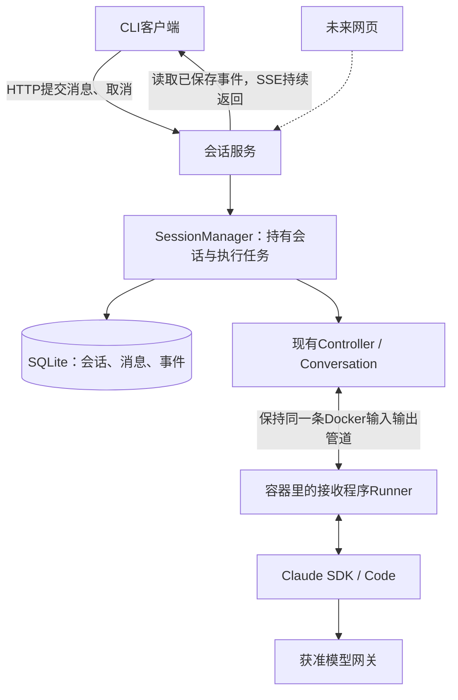

# 独立服务管理会话

V3实现规格，2026-10-22。独立服务、HTTP/SSE、SQLite、开发身份、客户端、回收与启动协调已实现。工程验证入口为`npm run verify:service`；真实网关、生产隔离与用户验收仍单列。模块位置见[架构](../architecture.md)。

本文保留初始设计的阶段叙述。V3有两项调整：用户停止优先原生中断，确认本轮结束后保留环境，5秒未结束则关闭兜底；正文直接比较原始文本，不另存textHash。当前生命周期以[会话说明](../session-lifecycle.md)为准。

## 1. 先看改变了什么

现在是CLI直接管理容器：CLI退出，会话就关闭。下一阶段增加一个长期运行的服务，CLI和未来网页只负责提交指令、查看结果。



**用户断开的是查看结果的连接，服务到容器的连接继续保留。** 打开新的客户端，只需要重新查看同一个会话，不需要重新执行上一次输入。

用户已确认：断开后当前任务继续；本轮结束后空闲15分钟回收容器，对话、文件和事件仍保存。任务超时、明确取消、服务异常仍按各自规则处理。

## 2. 第一版的范围与取舍

| 选择 | 理由与边界 |
| --- | --- |
| 一个Node进程、一个本地数据根 | 先把所有权和恢复做清楚；同一数据根只允许一个服务进程 |
| HTTP提交指令，SSE返回事件 | 提交和观看分开；SSE中断不影响执行，不引入双向连接协议 |
| SQLite保存服务记录 | 消息接收、去重和事件编号需要一起提交；不再用多份JSON文件拼装事务 |
| 继续使用现有Conversation、Docker CLI、原生SDK | 服务持有现有执行对象，不重写容器执行与原生工具循环 |
| 一会话一次前台执行，忙时拒绝 | 保持V2行为；不同会话可以并行，第一版不增加排队系统 |
| 重启后停止旧环境，再恢复对话 | 不尝试重新接管已经丢失的exec管道；不自动重放未确认完成的消息 |

第一版不做网页、外部账号登录、分布式调度、自动重试任务、逐后台任务停止、租户计费和生产隔离升级。保留用户归属检查，避免后来再补接口权限。

## 3. 谁负责什么

| 模块 | 责任 |
| --- | --- |
| `server.ts`（新增） | 启动、数据根总锁、请求入口、停止服务 |
| `http-api.ts`（新增） | 身份校验后的路由、参数校验、HTTP响应 |
| `session-manager.ts`（新增） | 持有Conversation、接受消息、控制执行/取消/空闲回收 |
| `service-store.ts`（新增） | SQLite短事务：会话归属、消息去重、状态和事件 |
| `event-stream.ts`（新增） | 从已保存事件中补发和持续返回，不直接控制执行 |
| `service-client.ts`（新增） | CLI使用的HTTP与SSE客户端 |
| `auth.ts`（新增） | 将访问凭证转换成可信userId；后续可接登录系统 |
| 现有Controller/Conversation | 持锁、创建Runner、原生恢复、容器停止确认 |
| 现有Runner/SDK/Code | 继续通过同一条输入流处理消息和原生工具 |

`SessionManager`内存表只放活的执行对象、当前消息、取消控制器和空闲定时器。进程退出后表会丢失，因此它不作为持久事实来源。

现有执行层还需要两处小接口补充，不能原样套一个Map就完成：

1. `Conversation.run`增加可选受信参数`{ attemptId }`。服务在接收消息时生成messageId，并把同一个UUID作为本轮attemptId。已有调用方不传时仍自动生成。
2. `Controller.open`增加可选的**会话级异步观察回调**：接收全部Runner事件及环境变化，包括空闲崩溃、后台通知、正常回收和未知停止。当前每轮onEvent仍保留给本地调试；服务通过会话级观察回调写事件，不双重订阅。

示意签名：

```ts
controller.open(sessionId, gatewayToken, { onRuntimeNotice });
conversation.run(text, undefined, serverAbort.signal, { attemptId: messageId });
```

观察通知区分`runner.event`与`environment.changed`；后者携带Session执行事实。通知等待持久保存，但不等待某个客户端接收。

Runner事件通知放在现有recordEvent的前台轮次过滤之前，不能因为当前没有activeTurn就丢掉后台事件。环境变化在执行层状态保存后通知；服务数据库只在快照确实改变时记录environment.changed。

## 4. 一条用户消息的完整过程

以“读取README，然后修改说明”为例：

1. 客户端生成一次clientMessageId，发送HTTP请求；正文中的换行原样保存在JSON text字段。
2. 服务核对身份和会话归属，先查重，再判断是否忙。相同请求重试不会因忙而错误地变成第二条任务。
3. 服务在一个短事务中保存消息、标记accepted、写message.accepted事件。成功后返回202和messageId；它只表示已接收，不表示已执行或已成功。
4. 接收时就登记该messageId及服务自己的AbortController，再由服务执行流程创建/复用Conversation。这个控制器不绑定HTTP请求或SSE连接的关闭。执行前检查cancelRequested，确保accepted后、尚未交给SDK时也可以取消。
5. 执行前保存running和message.started，再将messageId作为attemptId交给Conversation。后续仍走V2的Docker管道→输入队列→原生SDK。
6. 回答片段先写入事件表。客户端的事件连接读出它们，逐段显示。
7. 原生agent.result保存SDK结果并将消息推进finalizing；要等Conversation.run完成环境处理后，才提交最终消息状态和message.finished事件。

提交成功但HTTP响应丢了，客户端必须用**原来的clientMessageId**重试，或查询记录，不能默默生成新ID再发同样内容。

这保证的是服务接收去重，不是“所有外部副作用恰好发生一次”。工具可能已经改了一部分文件；服务崩溃后不会自动重做它。

## 5. 保存哪些数据

服务数据库是对外消息与事件的事实来源。现有session.json仍由执行层记录容器/原生会话事实，用于恢复和诊断，不再直接充当HTTP消息状态。

| 表 | 主要字段 |
| --- | --- |
| sessions | id、ownerId、title、createdAt、updatedAt、environment、lastMessageId、lastEventId |
| messages | id、sessionId、clientMessageId、text、status、cancelRequested、createdEventId、startedAt、finishedAt、result |
| events | sessionId、eventId、messageId（可空）、type、payload、sourceEventKey（可空） |

约束：

- `messages(sessionId, clientMessageId)`唯一。相同ID且正文相同返回原记录；正文不同返回冲突。直接比较解析后的原始文本，不去掉缩进、换行或首尾空白。
- 同一session只允许一条accepted/running/finalizing/reconciling消息，使用部分唯一索引配合SessionManager的同步占位。打开Conversation期间也算忙。
- `events(sessionId, eventId)`唯一；每次事务递增该会话的lastEventId。编号跨Runner和服务重启继续，不能直接使用会重置的Runner seq。
- Runner事件的sourceEventKey使用`runnerId:seq`，同一session内唯一；用于识别重复通知，不作为客户端重连游标。
- 最终消息状态和message.finished事件在一个事务内提交，避免查状态说完成却补看不到结束事件。

正常消息状态：accepted → running → finalizing → succeeded；启动失败或早期取消可以从accepted直接结束，执行中失败/取消也不要求先收到SDK结果。停止未知时进入reconciling。服务重启后的未完成消息，经旧环境清理确认后标记interrupted，不伪造成功。

环境状态独立记录：closed、starting、ready、stopping、reconciling。关闭容器不会删除会话、消息或工作文件。

文件布局：

```text
<AH_DATA_DIR>/
├── .service/                   不挂载到用户容器
│   ├── .lock                   只允许一个服务管理该数据根
│   ├── control.sqlite          及SQLite自己的wal/shm文件
│   └── access-keys.json        开发访问配置，私有、不进Git
└── <session-id>/
    ├── workspace/
    ├── claude-state/
    ├── session.json            执行层状态，非HTTP消息账本
    └── attempts/               沿用V2日志、任务与独立租约
```

数据库使用WAL、foreign_keys=ON和synchronous=FULL，事务里只做SQL，不等待模型或Docker。原生日志继续用于诊断，HTTP事件只从events表读取，不混读多个JSONL文件。

第一版不自动删除历史事件，不设计磁盘配额；数据库磁盘满时停止接受新执行并清理正在管理的环境，不能在没有记录的情况下继续产生副作用。

## 6. HTTP接口约定

统一前缀`/api`，身份来自Authorization Bearer凭证。首期只监听`127.0.0.1:4318`，地址是拟定默认值。

| 接口 | 请求/返回要点 |
| --- | --- |
| POST /sessions | `{title, template?: "empty"或"fix-project"}`；201返回服务生成的UUID |
| GET /sessions | 只列出当前用户的会话，按updatedAt倒序，limit上限100 |
| GET /sessions/:id | 会话元数据、当前/最新消息和环境状态、lastEventId |
| POST /sessions/:id/messages | `{clientMessageId, text}`；新消息202，重复请求200返回原消息及当前状态 |
| GET /sessions/:id/messages | 按createdEventId分页，`after=0&limit=50`；包括用户正文和执行状态 |
| GET /sessions/:id/events | SSE，`after=<eventId>`，从该游标之后补发并继续返回 |
| POST /sessions/:id/messages/:messageId/cancel | 持久化取消意图后返回202；对终态消息返回200原状态，不影响新一轮 |
| POST /sessions/:id/close | `{expectedMessageId: 最新消息ID或null}`；202关闭运行环境，保留数据；终态关闭且目标未变化时200 |
| GET /health | liveness/readiness分开表示，不返回用户信息或秘密 |

JSON请求体上限256KiB；clientMessageId为UUID，text必须是非空白字符串，保存原文。首期只支持文本，默认不开放跨域访问。SSE游标必须是非负整数；超出当前lastEventId返回400，不能默默跳过后续事件。身份校验先于读取事件。

每条新消息更新lastMessageId；close的expectedMessageId不匹配则409，防止旧的关闭请求重试把后来恢复的新任务关掉。关闭中的会话拒绝新消息，等待active run结束后才能调用Conversation.close。

主要错误：401凭证无效；404会话不存在或不属于当前用户；409 SESSION_BUSY、SESSION_CLOSING、MESSAGE_ID_CONFLICT、STALE_CLOSE；503 RECONCILING、SERVICE_STARTING、SERVICE_STOPPING、STORAGE_UNAVAILABLE或CAPACITY_REACHED；413正文过大。公开错误使用固定信息，原始异常只留内部日志。

客户端不能指定ownerId、Docker参数、网关凭证或任意模型配置。会话ID是索引，不是访问凭证。

## 7. 回答如何实时显示、断线后如何补看

```text
SDK事件 → 服务持久保存 → 事件连接读取 → 客户端显示
                             ↑
重连时带上“我已显示到第38条” → 从第39条继续
```

SSE示意：

```text
id: 39
event: assistant.text.delta
data: {"messageId":"...","text":"README中描述了……"}

```

传输中的data使用JSON.stringify，正文换行会被编码，不会破坏SSE分隔。公开事件包括message.accepted、message.started、assistant.text.delta、tool.started、task.updated、message.finished和environment.changed；后台task.updated带创建轮次的messageId，未知归属则messageId为空，不挂到下一轮。

为了第一版容易理解，事件连接每200ms从SQLite批量取新增记录，每次至多100条；这是服务内部读库，不是客户端反复发HTTP请求。它天然避免“先补历史再订阅实时”的交接竞态。后续有性能证据再改为提交后唤醒，不先加内存广播队列。

每15秒发一条SSE注释保活，不写入业务事件。客户端收到并显示完整事件后更新游标，并按eventId去重；重连可以重复收到事件，不能重复显示。SSE自身不替我们持久保存历史。

CLI使用fetch读取事件流，并携带Authorization和after参数；浏览器客户端同样可用fetch。首期不依赖浏览器原生EventSource携带自定义Bearer请求头，也不把凭证放进URL。未来网页另做登录和安全存储设计。

某个客户端太慢，只关闭它的事件连接；例如等待drain超过5秒或写缓冲超过1MiB时断开，让它从游标重连。不能让它阻塞Runner读取或其他客户端。轮次结束不关闭整个会话事件连接。

## 8. 断开、空闲和取消是三件不同的事

| 情况 | 行为 |
| --- | --- |
| 浏览器关闭、网络断开、CLI进程退出 | 只停止该客户端接收；执行继续，服务仍更新容器心跳 |
| 用户明确取消当前消息 | 服务AbortController请求原生中断，等待本轮结束后保留环境；超时或异常升级为整容器清理。取消不撤销文件修改或独立后台进程 |
| 本轮结束后15分钟没有新的被接受消息 | 服务关闭运行环境、释放会话锁，保留数据；下一条新消息重建并resume |

正在运行的轮次不计入15分钟空闲，但现有单轮timeout仍有效。消息完成、失败或取消后开始计时；一次新的被接受输入重新安排时限。只查看状态、保持SSE连接或后台日志持续输出，不延长空闲时间。

原生后台任务可以跨轮，但空闲到期会连同容器一起停止；这不是长期托管后台服务器的功能。

CLI `/exit`和空闲Ctrl+C改为断开；执行中Ctrl+C仍是明确取消自己当前提交的messageId。SIGTERM/SIGHUP或进程强杀只代表断开，不默认发取消。增加明确的`close`命令用于回收环境；关闭请求必须带它看到的最新消息ID。

## 9. 服务崩溃和重启

首期服务重启不承诺正在运行的任务继续执行，只承诺不盲目启动第二个写入者、不自动重做未知副作用。

启动顺序：

1. 取得数据根`.service/.lock`，防止两个服务管理同一根目录。
2. 打开数据库、检查schema版本。API处于starting，暂不接受执行指令。
3. 汇总数据库、合法会话目录和该数据根所属Docker标签中的会话。逐个试取会话锁；仍有活的本地CLI持锁则停止启动并报告DATA_DIR_IN_USE，不强行抢走。
4. 对遗留容器核对归属、停止并删除；没有新租约，更不会先更新旧心跳文件。标签查询需要新增按owner枚举方法，不能只遍历数据库漏掉孤儿。
5. 将未完成消息标记interrupted并记录message.finished，将已协调环境记录closed，然后进入ready。

若Docker状态未知，相关消息和环境保持reconciling，服务不进入执行ready；已保存历史可按权限读取。没有停止事实不能接收新执行。元数据损坏不覆盖成空会话。

服务被强杀时，现有Keeper会在心跳超时后退出，但下一次启动仍必须向Docker确认。会话文件与原生记录保存下来，用户下一条**新输入**可以resume；原消息不会自动排队重试。

收到正常关机信号：先拒绝新指令，取消正在执行的消息，等各run收尾，再逐个close，关闭数据库和服务锁。目标宽限30秒；超时不假报清理成功，记录可保存的reconciling状态、停止心跳并以失败退出，后续仍走Docker协调。

若事件写库失败：执行流程不继续当作成功。服务进入存储不可用状态并直接清理环境；清理不依赖再次写库成功，也不能递归调用同一个失败的观察回调。日志记录原异常，存储恢复后再协调，客户端只收到已持久保存到游标的事件。

## 10. 最小身份与容量边界

第一版是受信本地开发服务，不直接开放公网。`auth.ts`从私有access-keys.json读取访问凭证哈希到userId的映射，用两个测试用户验证归属。模型网关凭证只由服务持有，与访问服务的凭证分开。

创建会话时把认证userId写成ownerId。列表、正文、事件、取消和关闭全部经过同一归属检查。请求中伪造userId无效；仅知道sessionId不能读取别人的事件。没有可用开发访问配置则拒绝启动，日志不回显凭证。

默认最多4份打开中的运行环境，包括启动中与空闲环境；超出返回503，不增加隐式队列。初期只支持单机本地盘，DB与Docker所用数据根固定；不声明多租户生产隔离或多机高可用。

## 11. 数据和命令迁移

服务端使用AH_DATA_DIR定位同一份执行数据；`.service`附属于该根，避免换一个DB目录就能绕过单服务锁。访问地址与访问凭证用AH_SERVICE_URL、AH_SERVICE_TOKEN，后者只用于客户端；服务继续从本地配置取得AH_GATEWAY_TOKEN。

拟新增`npm run server`作为独立进程入口；它应由单独终端或系统进程管理器运行，不能由每个chat命令临时拉起并随客户端结束。系统自启动部署另行验收，本轮不擅自改变电脑设置。

服务版CLI的chat/status/cancel/close改为HTTP客户端；init创建服务会话并返回UUID，可选固定示例模板。当前直接操作Controller的路径保留为本地开发入口，与服务使用不同数据根，不再作为服务版CLI默认行为。

旧V2目录没有ownerId，不能自动认领或暴露给首个登录用户。首次服务验收建议用新数据根；旧数据保留，显式导入和归属迁移另行设计。不改掉旧imageId来绕过镜像恢复保护。

## 12. 分阶段实现和验收

### A：服务真正持有会话

- 新增数据库、身份入口、SessionManager、HTTP接收与状态查询。
- 增加执行层观察通知与受信attemptId绑定，继续复用现有执行代码。
- 用户断开时任务继续；用户中断等待本轮结束并保留环境，close等待整容器停止。
- 验收：杀掉客户端后实际工具仍执行；任务完成和结果可查询；同会话第二条新输入被拒绝，其他会话可并行。

### B：事件补看与CLI接入

- 接入持久事件、SSE和客户端游标，完成服务版CLI。
- 验收：回答生成一半断开，重连能补齐且不重复显示；模拟HTTP响应丢失，用同clientMessageId重试，原生命令只提交一次；相同ID改正文被拒绝。
- 验收：多行正文完整到达；后台通知仍属于原轮次；慢客户端不阻塞任务或其他查看者。

### C：回收、重启与权限故障

- 实现启动协调、优雅关机、空闲回收、容量拒绝与存储失败处理。
- 验收：缩短同一路径的空闲时限测试回收，真实默认保持15分钟；后台任务随容器停止，文件保留且新消息可恢复。
- 验收：服务SIGKILL后Keeper回收，新服务不续旧租约；同数据根第二服务被拒绝，遗留Docker未知时无新写入者。
- 验收：accepted前后、SDK提交前后、SDK结果后但收尾前分别强杀，不自动重放；取消旧messageId或迟到close不误伤新消息。
- 验收：两个开发用户互读/取消/订阅均失败；数据库磁盘满或写入失败触发停止，不能假报完成。

每阶段保留不调用真实模型的单元与Docker夹具检查。真实网关、自主读改测、费用、长时间稳定性及生产多租户安全单独验收；已有V2检查不能替代服务端新路径检查。

## 13. 官方依据与未实现边界

- [WHATWG SSE标准](https://html.spec.whatwg.org/multipage/server-sent-events.html)：事件id、UTF-8流和重连标识；持久保存及补发由本方案自己实现。
- [Node24.19.0 SQLite文档](https://raw.githubusercontent.com/nodejs/node/v24.19.0/doc/api/sqlite.md)：可使用内置DatabaseSync；该版本仍是Release candidate。仅在ServiceStore封装它，固定验收版本，后续升级另测。

本机Node24.19.0支持内置SQLite；V3已接入服务并运行HTTP/SQLite及实际Docker/SDK工程检查，见[测试指南](../testing.md)。网页、真实模型和生产安全验收仍未完成。
