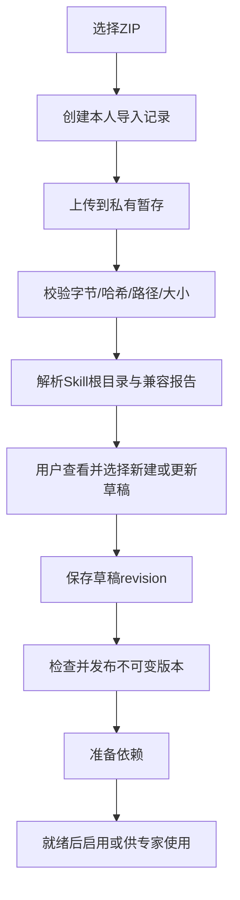
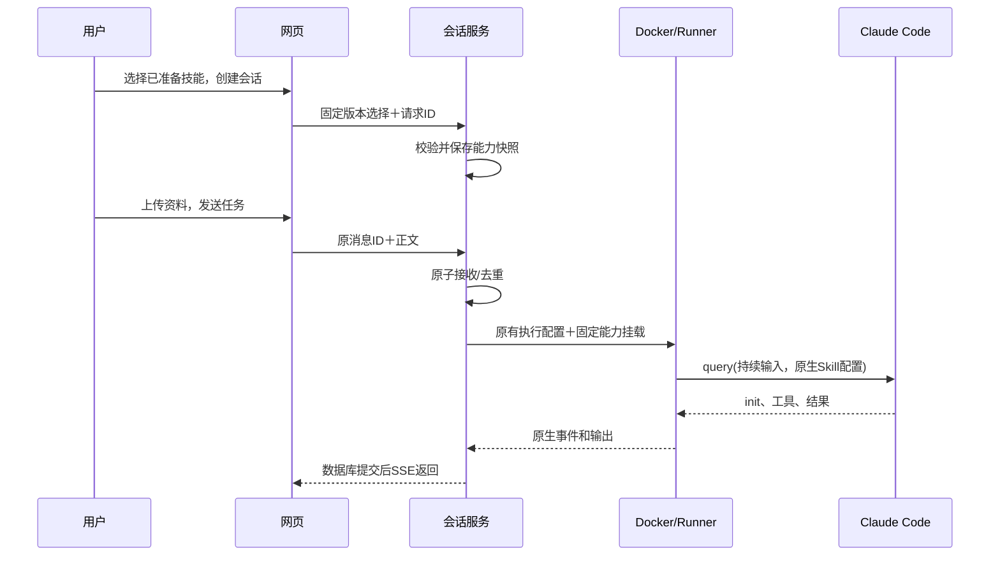
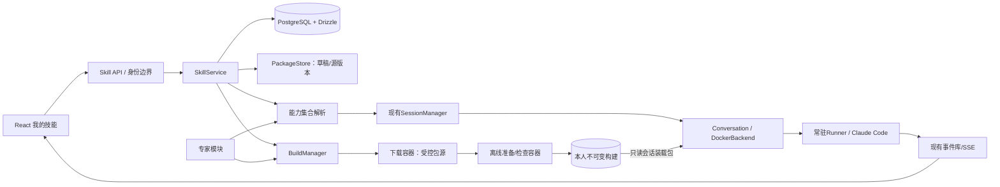

> **2026-10-23 交互调整**：当前实现取消草稿和发布步骤，保存直接生成不可变版本，点击安装启用。旧版章节中的草稿/API仅代表初始设计，当前操作和 API 以 [技能管理与运行](../skills.md) 为准；目录界面按用户自定义/平台内置分组卡片，无市场接入。

# Skill功能完整设计：产品、开发与架构

版本：0.2 · 日期：2026-10-23 · 状态：V8首版已实现，完整目标与后续范围保留。

实施说明：当前可用功能、配置及验证入口见[技能使用与架构](../skills.md)。下文保留完整产品目标；搜索以名称/标识为准，尚无独立筛选器、历史版本回退编辑、导入差异视图、自动GC、专家产品和远程市场。实现使用服务端固定HTTPS源下载字节，Docker断网安装；Python采用pip --target和生成入口，不构建可搬运venv。不得把下文所有拟议项视为已交付。

0.5.2后续取舍：按用户要求，Skill层只负责保存和暴露；取消名字白名单、额外初始化检查、专用装载记录和正文审查。下文早期方案与此冲突的条目不再是当前行为，以使用文档为准。

本文是Agent Harbor Skill功能的正式设计原件。覆盖个人管理、技能包、版本、依赖下载与构建、容器加载、专家使用、数据接口和验收。下文覆盖完整目标；当前实现范围以实施说明和使用文档为准。专家功能由独立规格维护，本模块只提供固定技能版本和准备请求，不实现专家产品。

阅读顺序：产品看第1–5节；依赖和文件位置看第6–9节；开发看第10–15节；更新、安全、运维和验收看第16–20节。

## 1. 目标、概念与关键决定

用户在网页添加一个Skill，平台保存完整文件，准备好所需依赖后，让本人的Claude Code容器使用。用户可以持续对话、处理文件并下载成果；不同用户相互隔离。

贯穿示例：“表格摘要”Skill含SKILL.md、Python脚本和报告模板。用户导入、查看、准备并启用后，新建会话上传CSV；Claude按技能步骤检查数据、执行脚本、生成摘要。需要第三方库时先准备，不能运行到一半才发现没有依赖。

| 概念 | 含义 |
| --- | --- |
| Skill | 一套可复用的方法、脚本和资料，不是一个独立用户或模型 |
| 技能版本 | 发布后不可变的源文件和依赖声明 |
| 构建 | 某技能版本在指定Linux运行环境中准备好的可运行产物 |
| 启用 | 本人希望新普通会话默认使用哪一版技能 |
| 能力快照 | 某会话实际选定的技能、构建、名称和运行环境 |
| 调用 | Claude自动选择技能，或用户显式发送技能命令 |

关键决定：

- 完整保存Skill目录，不只存一段提示词。
- 个人库跨会话保留；技能元数据进PostgreSQL，文件和构建在磁盘。
- 不在Node宿主安装用户依赖；准备与执行都在容器内。
- 运行时显式加载平台生成的纯Skill插件，保持现有配置隔离。
- 一份会话固定一组能力版本；关闭/恢复环境仍使用原快照。
- 普通启停、内容删除、安全撤销是不同操作。
- SDK负责原生发现和调用，平台负责身份、版本、依赖、挂载和生命周期。

### 1.1 当前基础与差距

源码核查基线为2026-10-23：已有React/Chakra网页、会话服务、身份/归属、文件传输、持续Runner、Docker驱动、原生沙箱、中断与SSE恢复。已见PG/Drizzle改造代码；本任务没有重新验收其部署状态。

当前tools只有Read/Write/Edit/Glob/Grep/Bash；runnerOptions设置settingSources: []、严格MCP配置，尚未传plugins。容器挂载workspace、claude-state和attempts，没有个人Skill包挂载。没有技能实体、网页、包校验、构建管理和能力快照。

当前安装SDK0.3.306的类型中有plugins、skills、reloadSkills/reloadPlugins和initializationResult。接口存在不等于当前镜像/管理员策略组合已实测可用，实施的第一关是原生能力验证。

### 1.2 首版范围

| 功能 | 首版决定 |
| --- | --- |
| 本人技能、平台内置技能 | 支持；内置只读，可复制可分发内容 |
| 新建说明、ZIP导入、文件查看/编辑、版本发布 | 支持 |
| Python/Node本地处理脚本及资源 | 支持兼容的运行档位和明确依赖清单 |
| 下载、准备、日志、重试、取消 | 纳入完整首版，不只支持上传 |
| 启停、指定版本、普通会话使用 | 支持，影响新会话 |
| 专家引用 | 固定版本，复用同一构建模块 |
| 导出源包 | 支持本人版本及允许导出的内置内容 |
| 任意Git URL/远程市场安装 | 后续；首版不放下载仓库入口 |
| 任意MCP、Hooks、Agent插件 | 不接入；Skill不是完整插件安装器 |
| 任意apt/系统安装、私有源凭证、联网业务API | 后续；缺少对应能力明确显示不兼容 |
| 热更新运行中会话、跨用户共享私有构建 | 首版不做 |

“支持Skill”不等于兼容所有第三方技能包。导入检查应说明不兼容项，不能静默丢掉作者依赖的行为，也不能为了导入成功放宽平台权限。

## 2. 完整功能清单与页面

左侧增加“我的技能”，与“专家”分开。列表可筛选全部/我的/内置、搜索名称和描述；状态需结合当前运行档位显示。

```text
┌──────────────┬────────────────────────────────────────────────────┐
│ Agent Harbor │ 我的技能                  搜索…  ＋新建  导入ZIP   │
│ 新建会话     │ 全部 / 我的 / 内置                                  │
│ 会话工作台   │                                                    │
│ 专家         │ 名称        发布版本   准备状态        新会话默认   │
│ 我的技能     │ 表格摘要    v2        v2准备中/v1可用  v1已启用    │
│ 最近会话…    │ 报告排版    v1        未准备           未启用      │
│              │                                                    │
│ 用量与密钥   │ 详情内查看说明、文件、版本、依赖、构建和引用         │
└──────────────┴────────────────────────────────────────────────────┘
```

| 页面/区域 | 展示和操作 |
| --- | --- |
| 技能列表 | 搜索、筛选、准备状态、默认版本；新建、导入、详情 |
| 概览 | 用途、适用输入、调用方式、依赖、兼容情况；准备并启用/停用/使用 |
| 文件 | 树形列表、文本预览、替换/新增/删除资源；只编辑草稿 |
| 版本 | 发布历史、源内容摘要；查看、导出、基于旧版新建草稿 |
| 依赖与构建 | 清单、运行档位、安装阶段、日志摘要、失败原因；重试/取消 |
| 引用关系 | 哪些专家版本和会话引用；普通删除不会破坏它们 |
| 会话能力面板 | 该会话实际固定的技能版本与装载状态；显式调用入口 |

正文和编辑区16px，辅助文字至少13px；窄屏列表改卡片，文件树用抽屉。复用Chakra主题、输入与错误控件，不增加一个单独的前端工程或全局状态库。

### 2.1 用户日常操作

**新建纯说明技能**：新建→名称/标识/描述/正文→保存草稿→检查并发布→准备并启用→新建会话使用。无外部依赖也要完成版本包装和校验，但不会因此调用模型。

**导入已有技能**：选择ZIP→上传/校验→查看目录、元信息及兼容报告→确认创建或更新草稿→预览→发布→准备并启用。不能上传后立即执行包内脚本。

**更新技能**：从v1创建草稿→编辑/替换文件→发布v2→准备并设为默认。v2失败时v1保持原有启用状态；旧会话始终继续v1。

**在会话中使用**：选取已准备技能创建会话；自动调用由Claude判断，手动调用通过技能菜单填入命令和参数，用户发送才执行。技能不在当前快照时，入口应为“用此技能开启新会话”，不能暗中注入当前query。

**作为专家能力**：专家作者绑定技能具体版本。使用者启用专家时，平台创建本人的准备请求；不要求先在“我的技能”逐项启用。专家使用不改变个人通用默认设置。

## 3. 状态设计：不要把上传、准备和使用混为一谈

| 维度 | 状态/字段 | 含义 |
| --- | --- | --- |
| 内容 | 草稿、已发布、已软删除 | 文件和说明是否形成可执行版本 |
| 构建 | 排队/下载/准备/验证/就绪/失败/取消/待协调 | 依赖在指定运行环境中是否完整 |
| 本人设置 | 默认关闭、启用的activeVersion、待切换desiredVersion | 新普通会话如何选用 |
| 会话 | 已绑定、正在装载、装载确认/失败 | 本次环境是否真的加载 |
| 执行 | 尝试调用、调用结果 | 是否实际用到，不能由卡片状态推断 |

界面示例：

- “v1已发布 · 未准备”：保存成功，不承诺可运行。
- “v2准备中；新会话暂用v1”：新版不会覆盖可用旧版。
- “已启用v2；此会话仍使用v1”：个人设置和执行事实分开。
- “需要浏览器运行环境，当前不支持”：不会用一个绿色“可用”掩盖缺失。

依赖准备成功只证明指定检查通过，不证明业务结果正确。实际可调用性需要Docker/SDK验证，业务效果需要真实任务验收。

## 4. 包结构、配置和兼容规则

### 4.1 源包

```text
my-skill/
  SKILL.md                 必需：用途、调用方式、操作方法
  scripts/                 可选：Python/Node/Shell脚本
  references/              可选：参考文档
  assets/                  可选：模板、图片等
  requirements.lock        有Python依赖时提供
  package.json             有Node依赖时提供
  package-lock.json        有Node依赖时提供
  harbor-skill.json        可选：本平台的依赖和入口声明
```

ZIP支持SKILL.md直接位于根目录，或位于唯一的一层外包目录。多个候选Skill根目录要求拆包/选择，首版不支持一个ZIP批量发布多个技能。

不要求每个包都有所有目录。不接受上传node_modules、.venv、.git或平台保留的.harbor-runtime目录；运行依赖由准备过程生成，避免混入Mac本机环境和不可追溯内容。

### 4.2 SKILL.md

```markdown
---
name: table-summary
description: 检查用户提供的CSV表格并生成摘要，适用于字段、缺失值与基本统计检查。
user-invocable: true
disable-model-invocation: false
---

# 表格摘要

先确认输入文件和统计口径。信息不足时先询问。
读取表头、检查缺失值，使用配套脚本完成统计。
报告写明数据范围、处理方法和限制，成果保存到工作区。
```

首版支持的行为字段：name、description、argument-hint、user-invocable、disable-model-invocation。name与平台固定slug一致；描述不能为空，name使用小写字母/数字/连字符，1–64字符。显示名称可以是中文，与调用标识分开。

author、license、version等说明性元数据可保留，但平台发布号和权限以数据库为准。文档、配置和文件总量限制由服务端实施。

allowed-tools不转化为平台授权；当前allowManagedPermissionRulesOnly策略下应验证其不能授予额外权限。导入报告明确说明这一点。Hooks、子Agent上下文、模型覆盖、额外工具等不支持的行为字段须明确拒绝或要求作者调整，不能静默声称兼容。

首版不支持技能正文中的动态Shell预处理。应关闭原生相应行为并拒绝检测到的动态命令语法，实际SDK/策略组合必须做正反例验证；不能仅靠一条正则宣称完全安全。正常scripts仍可在已授权Bash工具中运行。平台不在导入/预览时执行任何正文。

### 4.3 harbor-skill.json（本平台扩展）

这不是Claude Skill通用标准，目的是让平台知道怎样准备依赖和运行入口。无需依赖的技能可以不提供；第三方包导入时也可由用户在界面补充，发布后和源文件一起固定。

```json
{
  "schemaVersion": 1,
  "runtimeProfileId": "standard",
  "dependencies": {
    "python": { "lockFile": "requirements.lock", "binaryOnly": true },
    "node": {
      "manifest": "package.json",
      "lockFile": "package-lock.json",
      "lifecycleScripts": "disabled"
    }
  },
  "entrypoints": [
    { "name": "summarize", "language": "python", "script": "scripts/summary.py" },
    { "name": "format", "language": "node", "script": "scripts/format.mjs" }
  ]
}
```

示例展示字段，不代表包必须同时使用两种语言。删除无关依赖即可。所有路径必须位于技能内，entrypoint只能引用存在的普通文件；不接受任意安装Shell字符串、镜像地址、代理、宿主路径或凭证。

初期Python依赖支持固定版本/哈希的wheel清单；没有锁文件时可在受控解析步骤生成候选锁文件，给作者审阅并发布新版本后再准备，不能在“准备时”悄悄改源版本。初期Node依赖要求package-lock与manifest一致，禁用生命周期脚本。需要源码编译、npm postinstall、浏览器下载或apt的包显示不兼容，使用平台维护的专用档位后再支持。

### 4.4 不是自动猜依赖

不能仅凭SKILL.md中的自然语言可靠推断安装内容。检查器可以提示发现requirements/package.json，但必须展示确认后的清单。平台不自动执行install.sh，不把运行出错后的任意pip/npm命令当成安装需求。

需要外部网络业务接口、MCP或私有包源凭证的技能，可保存草稿和说明；首版不能标记为功能已就绪。普通上传说明里藏着网络调用也不会获得额外出站权限，最终仍由原有执行策略拒绝。

## 5. 导入、编辑、发布与导出

### 5.1 导入流程



导入记录有uploading→validating→review→applied；失败为failed，服务重启时不完整上传为interrupted。上传和应用草稿分别幂等，响应丢失后查询原记录，不重新创建一份技能。

同slug导入不能默认覆盖。用户明确选择“创建新技能（更换标识）”或“更新我的技能”；更新时校验目标草稿revision，避免覆盖另一标签页的编辑。内置技能不能直接覆盖。

### 5.2 解析与文件边界

必要校验：绝对路径、../、Windows盘符/UNC、控制字符、重复或规范化冲突路径、符号/硬链接和特殊文件均拒绝。展开时实际计数和累计字节，不能只信ZIP头部大小；先确定唯一根目录，再逐项流式写入私有暂存，不能调用任意解压命令直接写数据根。

初始限制（可配置，非容量验收结论）：ZIP 20MiB、展开100MiB、1000个文件、目录深度16、单文件20MiB、网页文本编辑1MiB。同一包对跨平台大小写/Unicode规范化冲突采用保守拒绝。已知.DS_Store/__MACOSX可忽略，但在导入报告列明；有行为意义的配置不能静默丢弃。

文件名支持中文；slug和服务分配的userKey用于定位，不使用外部userId或显示名称拼任意路径。所有私有目录不可通过静态资源目录访问。

### 5.3 草稿与不可变版本

草稿编辑带expectedRevision。文件修改先写到新的私有草稿revision目录，全部成功后才用数据库事务切换指针；旧指针在失败时仍有效。初期允许小包直接复制，优先可读实现；后续确有空间/性能证据再做内容寻址存储。

发布顺序：校验草稿→计算规范文件清单与内容哈希→准备完整版本目录并原子发布→事务检查草稿revision及请求ID→插入skill_version。数据库失败可留下未引用文件，由维护清理，不能让数据库指向半份版本。

版本号由平台单调分配，执行引用versionId。发布请求保存clientRequestId与正文摘要；相同请求返回原版本，不重复加号。配置、依赖清单和资源都参与sourceHash，不能只哈希SKILL.md。

### 5.4 导出

导出仅包含发布的源包、平台扩展声明和必要许可说明，不包含.venv、node_modules、构建缓存、日志、凭证、会话资料或平台启动配置。内置内容需要满足平台分发/许可策略。导出是下载，不创建外部分享链接。

## 6. 文件存放位置：原件、构建、会话三层

```text
AH_DATA_DIR/
  builtin-skills/<skillId>/versions/<versionId>/        平台维护的可分发原件
  users/<userKey>/
    skill-imports/<importId>/                          私有上传/校验暂存
    skills/<skillId>/
      drafts/<revision>/                              本人草稿
      versions/<versionId>/                           发布后的正式原件
    skill-builds/<buildId>/
      attempts/<attemptId>/                           日志/检查结果，非执行真相来源
      artifact/                                       完整可运行技能目录
  sessions/<sessionId>/capabilities/<snapshotDigest>/
    manifest.json                                     本会话能力清单
    personal/.claude-plugin/plugin.json                服务生成
    personal/skills/<slug>/                            本人的所选构建
    builtin/.claude-plugin/plugin.json                 服务生成，可选
    builtin/skills/<slug>/                             所选内置构建
  sessions/<sessionId>/workspace/                      输入/成果/任务缓存
```

| 层 | 为什么单独存 |
| --- | --- |
| 原件 | 用户跨会话编辑与复用，容器关闭不能丢失 |
| 构建 | 下载/安装成本较高，可固定版本重复使用；不能和可编辑源文件混在一起 |
| 会话装载包 | 只暴露本会话选中的内容，保存明确执行事实 |
| workspace | 本次任务输入和产出，不是个人技能库 |

原件只有版本目录一份正式内容；草稿是编辑过程，构建和装载包是明确标识的派生物，不形成另一份可编辑原件。后续接对象存储时仍需先还原到容器可访问目录，不能把对象存储当作POSIX工作区。

只给本人容器挂相应装载包，不挂所有用户根目录或该用户全部历史版本。初期不共享跨用户私有构建；内置源包可共享只读，但构建产物和安装日志仍按本人归属管理。

## 7. 容器目录、依赖路径与运行入口

```text
/opt/harbor-skills/                              整个会话能力包只读
  personal/skills/table-summary/
    SKILL.md                                    发布原件编译出的运行副本
    scripts/summary.py
    references/
    assets/
    node_modules/                               有Node依赖时生成
    .harbor-runtime/
      python/                                   有Python依赖时生成的venv
      bin/summarize                             服务生成的入口包装
      runtime.json                              无凭证的实际环境/依赖摘要
  builtin/skills/<slug>/                         可选，同样只读
/workspace/                                     输入、成果、可写缓存
/tmp/                                           有限临时空间
/platform/                                      原有平台程序/连接/状态保护
```

personal和builtin是平台固定插件名，用于避免个人与内置同名冲突；实际命令为/personal:table-summary或/builtin:table-summary。个人slug在本人范围唯一；复制内置到本人时需选择未占用slug。界面展示友好名称和实际命令，不让用户猜命名空间。

Python依赖构建在最终绝对前缀，例如/opt/harbor-skills/personal/skills/table-summary/.harbor-runtime/python，运行时保持完全相同路径。构建指纹包含namespace/slug，改变它们需要重新构建。运行镜像中的解释器/系统库也必须兼容，不能只复制一个Mac虚拟环境。

Node依赖放在技能脚本的祖先目录node_modules，保持模块查找关系；不依赖NODE_PATH解决所有ESM情况。包装入口调用固定语言解释器和已校验的脚本，以参数数组/正确参数转发传递用户参数，不拼接任意Shell字符串。

运行副本SKILL.md可以追加平台生成的“实际入口/解释器/输出位置”说明，指向.harbor-runtime/bin中的入口；不修改用户发布原件。运行编译版本与哈希进入buildDigest。原始技能若硬编码另一目录或在自身旁写缓存，导入/检查应给出兼容提示，必要时由作者修订。

缓存写workspace/tmp或允许的临时目录。只读技能不能自我升级或写回原件；Node/Python工具仍可能需要可写缓存，所以准备时和验收时都要测试这一点。

## 8. 依赖下载与构建

### 8.1 分类与支持范围

| 类型 | 方案 |
| --- | --- |
| Python/Node基础运行时和少量稳定通用库 | 由平台镜像预装，公开实际清单 |
| Python固定wheel依赖、Node锁定包 | 按清单准备，构建后离线使用 |
| 字体、浏览器、系统动态库、编译工具链 | 平台维护专用运行/准备镜像档位 |
| 任意源码编译、npm生命周期脚本、私有源 | 首版不保证支持，不绕过校验硬装 |
| API密钥、MCP、远程业务访问 | 属于授权/连接器能力，不是安装一个库就完成 |

当前镜像有Python/Node不代表pip、venv、所有文档库和浏览器齐备；实施前读取镜像真实能力并验证。平台档位包含固定运行镜像digest、兼容准备镜像digest、系统/CPU和语言版本；不是用户传入的Docker配置。

### 8.2 两阶段准备

为避免下载阶段执行包脚本接触网络，建议一个构建任务分两个短阶段，不部署两套长期服务：

1. **下载阶段**：受信下载容器只收到依赖清单，不收到用户会话、模型密钥或完整私有技能资料。限制到平台指定包源；Python仅下载兼容wheel并检查哈希，Node下载锁定包且关闭生命周期脚本。生成可离线使用的依赖材料。
2. **离线准备阶段**：另一容器network:none，读取固定技能源和依赖材料，安装到最终路径、生成包装入口、执行限定检查，然后发布完整产物。

首版Node生命周期脚本继续禁用；确需离线脚本/编译的包以后提供专门兼容档位并验收，不能失败后自动放开网络。下载节点不在宿主运行pip/npm，离线节点不挂Docker socket、其他用户目录、模型/连接器凭证或真实会话文件。

限制下载出站需要实际网络控制，不能仅设置HTTP_PROXY环境变量就宣称无法绕过。实现时可用内部网络与受控下载代理，或经过验证的等价出站策略；允许的域名/CDN、重定向和目标地址校验由平台维护。网络边界未实现/验证前不开放第三方自动下载。

### 8.3 构建过程

```text
queued → downloading → building → validating → ready
                      任一步失败 → failed
无等待者且请求取消 → cancelling → cancelled
容器停止无法确认 → reconciling（保留占位，不发布、不复用）
```

构建指纹至少包括：sourceHash、依赖锁与完整性信息、运行/准备镜像digest、语言版本、OS/CPU、namespace/slug、构建器及运行指令编译版本。相同本人/指纹直接复用ready产物，不重新联网；不只按技能名称缓存。

构建前持久保存确定容器名/归属标签与attemptId，再发创建请求。CLI超时不等于未创建，按确定名称协调，遵守现有停止确认原则。构建任务不计模型消息额度，但要计构建并发、下载/展开字节和技能存储额度。

### 8.4 检查和产物发布

验证至少包括：锁文件与实际安装结果、入口路径、Python导入/Node模块查找、无真实用户资料的最小运行检查，以及在匹配运行镜像中读取资源/写workspace的检查。验证可能执行第三方代码，仍需在隔离容器中，不能回到Node宿主执行。

产物也视为不可信文件树。发布遍历用不跟随链接的方式，拒绝特殊文件/越界链接并去除特殊权限；保留的venv/npm合法链接必须指向包内或平台明确允许的运行时目标，复制和哈希不得跟随它们去读宿主文件。合法链接与路径约束作为真实Linux正反例验收项。

先生成完整文件、依赖清单和result manifest并原子发布，再将数据库状态改ready。数据库记录指向不可变产物；发布后不再原地安装。失败只保留有限诊断，不把半份产物交给会话。

## 9. 共享准备、取消与失败恢复

同一用户可能同时从“我的技能”和两位专家请求同一个构建。需要区分可复用的build与某个使用者的build request：

- build按本人+指纹唯一，负责实际容器与产物。
- build request说明谁在等待：个人启用操作、专家准备操作或单纯准备操作。
- 取消一个request只解除这份等待；其他请求仍需它时，构建继续。
- 最后一个有效等待者取消时，才请求停止构建容器；确认停止后终结和释放占位。停止不确定保持reconciling。
- 新请求不能把cancelling/reconciling的旧attempt复活；协调完成后再显式新建attempt。

失败重试以expectedAttempt比较交换，同一失败attempt至多启动一次后继attempt；迟到结果不能覆盖新状态。ready构建被多个会话引用时不能因一个页面取消而删除。

服务重启先核查旧准备容器并确认停止。未完成构建标为需重试，不自动重放安装脚本；完整已发布产物可重新核对后复用。文件已发布但DB未ready的情况保留待协调记录，不自动当作成功，更不能启动未经检查的技能。

网页关闭不取消服务端准备，只停止轮询。准备面板每2秒轮询自己的request/build，页面隐藏或离开时取消读取；不新增WebSocket。错误日志有限长、脱敏，不包含私有源凭证或完整环境变量。

## 10. 默认启用、指定版本与会话能力快照

### 10.1 个人默认设置

个人设置保存enabled、activeVersionId、desiredVersionId、desiredEnabled、pendingRequestId和revision。active表示已经生效的默认；desired是准备完希望切换的目标。

“准备并启用v2”先记录目标和revision，构建成功后事务校验目标request/版本/revision仍匹配，才切换active和enabled。v2失败保留v1原状态；若期间用户停用或改选v3，v2迟到成功不能重新启用或覆盖v3。

构建完成本身只修改build/request状态；只有绑定了本人启用意图的SkillService才可修改默认设置。专家发起的准备不自动改变个人设置。重启后的待生效意图依据持久request结果协调，不能依靠已丢失的内存回调。

### 10.2 新普通会话

网页展示默认启用的ready版本，用户可在创建时选择子集。服务在会话创建事务中校验选择与本人访问权/构建状态，固定capabilitySnapshot。默认集合有摘要，旧标签页按旧摘要创建时返回明确冲突并刷新，不能默默改成另一组技能。

当前会话创建接口尚无客户端请求去重，专家/技能会话需新增clientRequestId与正文摘要。相同请求返回原会话，不重复初始化或启动；旧客户端可以继续创建无技能普通会话，不自动加载全部个人技能。

### 10.3 专家会话

专家引用固定Skill versionId，激活时解析出本人的build request与构建。个人通用enabled开关不控制专家依赖，两个入口共享内容和构建，不共享启用意图。

专家会话只加载专家快照中明确选定的能力，不自动混入个人全部启用技能。必需缺失阻止开始，可选缺失按专家定义明确降级；参数和命名与专家设计保持一致。

### 10.4 更新何时生效

首版所有会话固定能力快照。发布/启用v2影响新会话；已有普通或专家会话继续v1。关闭环境、空闲回收、服务重启后重建，仍恢复原快照，不解析latest。

这是对早期“普通会话重建环境即可更新”提议的收敛：原生历史可能保留v1指令，所以不把重建容器包装成干净升级。需要v2时提供“以新版本开启会话”，文件/历史仅在用户明确选择时另行复制，不默认共享工作区。

原生热重载虽有接口，首版不接；后续若要支持，必须另外设计历史残留、后台脚本、原子切换和失败恢复，不能只调用reloadSkills就声称完全替换。

## 11. Claude Code装载与消息链

### 11.1 显式插件加载

服务根据capabilitySnapshot生成personal/builtin纯Skill插件，manifest只含平台固定字段。保留settingSources: []；不通过启用project来源顺带加载用户workspace配置。

Runner配置示意：

```ts
plugins: selectedPluginPaths.map(path => ({ type: "local", path })),
skills: snapshot.skills.map(skill => skill.invocationName),
tools: snapshot.skills.length ? [...baseTools, "Skill"] : baseTools,
```

路径和invocationName来自受信服务，不接收浏览器任意路径。空快照显式skills: []，不把未配置误解为“加载全部”。平台自带的原生命令/内置能力受管理员策略单独管理；这里限定的是个人/平台Skill包，不宣称SDK过滤等同于文件安全边界。

canUseTool和PreToolUse需要按当前SDK实际输入协议验证Skill目标属于快照并响应取消；不能只把Skill加进tools而不改原来只许可文件工具的回调。某些调用由原生流程直接处理，不能把canUseTool当成所有工具唯一入口。Slash命令派发也要核对原生语义，不能仅靠skills列表隐藏未授权文件。

### 11.2 文件权限

Docker只读挂载/opt/harbor-skills；原生文件工具和Bash沙箱允许读取这个明确目录并禁止写入。现有/platform与/etc/claude-code保护保持，不把模型凭证/平台状态放进Skill包。

上传方提供的plugin.json、hooks、MCP、agents、命令源和安装器不直接交给SDK。平台的内部包装是装载格式，不是向用户开放通用插件权限。

### 11.3 启动和恢复

共享协议增加受信capabilitySnapshot摘要及解析内容。启动task携带完整配置；后续消息携带同一digest。Runner拒绝中途更换能力摘要，query正常持续，不为每条消息重装技能。

优先验证initializationResult能否在正文入队前返回期望能力；确认失败则不开展业务工具操作。若原生init必须由首条输入触发，应明确存在初始化模型消耗，Runner/Hook必须阻止未确认的业务工具执行并终止失败轮；这个时序是实施第一关，不用文档推定。

init列表仅作为证据之一，user-invocable:false等技能可能不出现在菜单清单。装载确认、实际Skill工具调用、脚本运行结果分别记录，不把tool.started当成成功。



runtime/session.json记录capabilityDigest，与数据库快照和imageId共同核对。恢复时丢失构建可按同一版本和锁清单显式重建，不能替换新版本或删除兼容检查来强行恢复。

## 12. 总体架构与模块责任



| 模块 | 负责 | 不负责 |
| --- | --- | --- |
| SkillService | 归属、草稿/发布、本人设置、准备意图 | 不在宿主执行技能 |
| PackageStore | 私有暂存、包校验、文件/版本发布 | 不授予网络或工具权限 |
| BuildManager | 持久作业、共享等待、并发、容器确认、产物发布 | 不管理会话消息 |
| CapabilityResolver | 解析固定版本/构建、命名空间、快照 | 不从latest覆盖旧会话 |
| SessionManager | 原请求去重、容量、任务/会话、中断与关闭 | 不临时安装缺少依赖 |
| Docker驱动 | 固定参数、只读挂载、归属和停止确认 | 不接受用户Docker参数 |
| Runner/SDK | 原生发现、调用、消息循环与事件 | 不自行联网安装或修改个人设置 |

实现仍为单Node服务+PG+Docker，下载/准备是短期容器。首版不用Redis/Kubernetes/独立工作流引擎，不构建第二套Agent工具循环。

## 13. 数据结构、事务和一致性

使用PG + Drizzle定义类型、普通查询和迁移；关键行锁/唯一约束/提交顺序明确表达。下面是拟议逻辑字段，不是已执行SQL。

| 表/扩展 | 核心字段与约束 |
| --- | --- |
| skills | id、ownerId、source(private/builtin)、slug、displayName、status、draftRevision/Path、currentVersionId、创建请求ID/摘要；本人slug唯一，builtin另有唯一范围 |
| skill_versions | id、skillId、versionNumber、sourceHash、manifest JSONB、文件清单/字节、源相对路径、发布请求ID/摘要；版本不可变，(skillId,versionNumber)和发布请求键唯一 |
| skill_imports | id、userId、clientRequestId/Hash、预期文件size/hash、status、暂存相对路径、检查报告、应用目标与结果；本人请求ID唯一 |
| user_skills | (userId,skillId)、enabled、activeVersionId、desiredVersionId、desiredEnabled、pendingRequestId、revision；实际默认与待切换意图分开 |
| skill_builds | id、userId、skillVersionId、buildKey、runtimeProfileRevision、state、attempt/attemptId、容器标识、artifactHash/Path、errorCode、时间；(userId,buildKey)唯一 |
| skill_build_requests | id、userId、buildId、consumerType/consumerId、clientRequestId/Hash、state；独立等待/取消，共享同一build；本人请求键唯一 |
| sessions扩展 | capabilitySnapshot JSONB、capabilityDigest；创建请求ID/摘要用于新模式去重，旧会话可为空 |

attempt历史日志/结果在私有attempt目录保留；当前作业状态和停止真相以数据库及Docker确认共同判定，不能用日志里一行“完成”代替。必要的诊断索引可后续增加，不先搭通用任务平台。

capabilitySnapshot含schemaVersion、selectionMode、运行档位与镜像digest、每项skillVersionId/buildId/namespace/slug/invocationName/sourceHash/buildDigest以及省略项。它是实际技能装载的唯一事实来源。

专家会话沿用同一capabilitySnapshot，expertSnapshot只保存角色和capabilityDigest关联，不再独立复制一份可变技能清单。专家规格中原来合并展示的snapshot应按此共同模型实现。

### 13.1 关键事务

- 草稿：先写完整新revision文件，再比较expectedRevision切换指针；失败不覆盖原稿。
- 发布：锁skills，校验版本引用和请求摘要，写version并更新currentVersion；先发布文件再引用，避免半文件版本。
- 准备：建立request并唯一选择build，事务提交后启动容器；并发重复请求不会多启动一个构建。
- 成功：先发布完整产物，再按attempt CAS写ready，更新仍有效的requests；按匹配的个人意图/revision才更新user_skills。
- 取消：锁request/build，撤销该等待，检查剩余有效等待者，再决定是否停止；最后一个等待者与新加入者的竞态必须串行化。
- 建会话：校验当前用户/版本/构建/撤销状态及选择摘要，写固定快照；消息接受后才启动执行。

数据库事务内不等待下载、模型或Docker命令。不确定提交按原请求键查询，不生成新ID盲目重试外部动作。JSONB里的版本引用不是数据库外键，需要应用校验和保守删除保护；不可省略这部分。

### 13.2 文件与数据库没有一个共同事务

采取“文件完整发布在前，DB引用在后”。进程崩溃可能产生孤儿暂存/产物，但不会把半份内容标ready。清理前检查发布/草稿/构建请求/会话和实际容器引用，未知状态保留；不因DB短时不可用就删除文件。

## 14. API与请求示例

沿用/api、Cookie/Bearer、Origin/CSRF、x-harbor-user身份一致性。私人对象越权返回404，ownerId由服务取得。文件API与会话workspace上传分开，二者归属和生命周期不同。

| 接口（拟议） | 用途 |
| --- | --- |
| GET /api/skills?scope=all\|mine\|builtin&query=&after=&limit= | 本人和内置列表，稳定分页，默认20/最多100 |
| POST /api/skills | clientRequestId＋名称/slug，创建草稿，不调用模型 |
| GET /api/skills/:id | 内容/版本/本人默认/当前档位准备状态 |
| PATCH /api/skills/:id/draft | expectedRevision＋元信息，保存草稿 |
| GET/PUT/DELETE /api/skills/:id/draft/files?path= | 读取/新增替换/删除草稿文件，写入带revision |
| POST /api/skill-imports | 建立有size/hash约束的本人导入记录 |
| PUT /api/skill-imports/:id/content | 原始ZIP字节；不是base64塞JSON |
| GET /api/skill-imports/:id | 核对上传/解析/兼容结果，支持响应不明恢复 |
| POST /api/skill-imports/:id/apply | 选择新建/更新及expectedRevision，幂等应用草稿 |
| POST /api/skills/:id/publish | 请求ID、草稿revision，发布版本 |
| GET /api/skills/:id/versions | 版本及引用摘要 |
| GET /api/skill-versions/:versionId/files?path= | 已发布源文件查看/下载，不能修改 |
| GET /api/skill-versions/:versionId/export | 导出源ZIP，授权后下载 |
| POST /api/skill-build-requests | 本人消费者上下文＋版本＋运行档位revision，创建/复用构建等待 |
| GET /api/skill-build-requests/:id | 进度/结果/有限日志摘要 |
| POST /api/skill-build-requests/:id/cancel | 取消指定request；共享构建按等待者决定 |
| POST /api/skill-build-requests/:id/retry | expectedAttempt与新请求ID；失败attempt明确重试 |
| PATCH /api/me/skills/:id | expectedRevision、目标版本与准备/启停动作 |
| GET /api/skills/:id/references | 本人专家/会话引用，内置维护信息按权限裁剪 |
| DELETE /api/skills/:id | 软删除，已引用内容保留 |
| POST /api/sessions（扩展） | 固定版本选择、选择摘要、创建请求ID；无自动执行 |

消费者上下文必须由服务端确认。网页不能伪造别人的expertActivationId触发安装，不能用consumerId逃避本人额度。专家模块可通过内部接口创建request，不必暴露任意context字符串给浏览器。

导入初始化示例：

```json
{
  "clientRequestId": "<request-uuid>",
  "fileName": "table-summary.zip",
  "size": 12345,
  "sha256": "<64-hex-digest>"
}
```

准备请求示例（服务为本人校验消费者）：

```json
{
  "clientRequestId": "<request-uuid>",
  "skillVersionId": "<version-uuid>",
  "runtimeProfileRevision": "<platform-issued-revision>",
  "purpose": "personal"
}
```

查询示例：

```json
{
  "requestId": "<build-request-uuid>",
  "requestState": "waiting",
  "buildId": "<build-uuid>",
  "buildState": "downloading",
  "attempt": 1,
  "revision": 3,
  "steps": [
    { "name": "source", "state": "ready" },
    { "name": "dependencies", "state": "running" },
    { "name": "validation", "state": "pending" }
  ]
}
```

新普通会话示例：

```json
{
  "clientRequestId": "<request-uuid>",
  "title": "表格摘要",
  "template": "empty",
  "skillSelection": {
    "mode": "personal",
    "expectedSelectionDigest": "<selection-digest>",
    "skillVersionIds": ["<version-uuid>"]
  }
}
```

expert activation和personal selection互斥；专家会话由activation解析技能，不能同时另传一组个人技能覆盖。服务生成sessionId；相同创建ID同正文返回原会话，不同正文409。普通旧客户端未提供技能选择时保持无技能模式。

常用错误：SKILL_NOT_FOUND、DRAFT_REVISION_CONFLICT、IMPORT_INVALID_LAYOUT、PACKAGE_LIMIT、UNSUPPORTED_SKILL_FEATURE、DEPENDENCY_LOCK_REQUIRED、RUNTIME_INCOMPATIBLE、BUILD_FAILED、BUILD_STOPPING、CAPABILITY_NOT_READY、SELECTION_CHANGED、VERSION_REVOKED。错误给出用户可采取的动作，不返回本机绝对路径/凭证。

## 15. 开发目录、代码组织与配置

```text
apps/web/src/features/skills/
  SkillsPage.tsx             列表、筛选、入口
  SkillDetail.tsx            概览、版本、引用
  SkillEditor.tsx            草稿、文件、预览
  SkillImport.tsx            上传和检查报告
  SkillPreparation.tsx       准备、日志、重试、取消
  use-skills.ts              请求/取消读取/旧响应排除
src/service/skills/
  http.ts                    身份与输入边界
  service.ts                 草稿、发布、个人意图
  store.ts                   Drizzle查询与关键事务
  package-store.ts           暂存、校验、源版本发布
  manifest.ts                格式、兼容检查和运行说明编译
  build-manager.ts           构建/等待者/调度/协调
  capability-resolver.ts     固定版本集合与会话快照
src/service/db/schema/skills.ts
src/docker/skill-builder.ts  固定下载/准备参数、归属、停止
src/shared/skills.ts         运行快照和协议必要类型
src/agent/runner-options.ts  原生Skill接入
src/runtime/conversation.ts  快照一致性与恢复
infra/                      兼容运行/准备镜像与管理员路径策略
migrations/                 明确的SQL迁移
```

尽量扩展现有职责，不一次性搬动无关代码。私有包访问可以复用已有文件边界的低层做法，但不把workspace接口重命名成一个万能文件服务。前端用现有请求客户端、局部状态和小hook，不新增Redux或通用表单框架。

注释解释所有权、发布顺序、版本固定、异步旧结果、停止何时算完成；不逐行翻译代码。typed manifest和运行快照与上传DTO分开；不把用户JSON直接透传成Docker/SDK Options。

运行配置由受信服务提供：运行档位注册表、下载源、构建并发/超时、存储额度。首版可以只有一个经验证的档位，没实现的档位不显示成可选。配置放私有部署文件/环境，不在Skill正文放代理和包源密钥。

## 16. 启停、删除、撤销与专家协作

| 操作 | 新会话/新准备 | 现有会话/专家引用 |
| --- | --- | --- |
| 普通停用 | 从新普通会话默认集合移除 | 不停止原任务，不移除专家绑定 |
| 发布v2 | 新版可准备 | 旧版快照不变 |
| 设v2为默认 | 成功后新普通会话用v2 | 已有普通/专家会话仍用固定版 |
| 软删除个人Skill | 阻止新的自由绑定/默认使用 | 已发布专家和会话的合法固定引用保留，引用页明确说明 |
| 专家取消准备 | 取消该专家的等待 | 其他专家/个人等待仍可继续共享build |
| 平台安全撤销版本 | 阻止新准备/会话/消息和环境恢复 | 请求停止相关环境；停止不明保持协调状态 |

旧技能指令可能已经进入原生上下文，停用/删文件不能抹掉；需排除旧指令时开启新对话。普通删除不等于强制撤销执行资格。

对于被已有专家引用后软删除的版本，可以继续为该固定引用准备/恢复，但禁止新作者绑定；若法律/安全原因要求禁止一切执行，应使用安全撤销。这个区别必须在删除提示中展示，不能通过“删除成功”让用户以为所有运行已终止。

完整专家ZIP导入不属于本Skill首版；专家表单绑定已有个人/内置版本，平台内置内容可通过受信初始化导入。以后专家包带Skill时仍复用本文的校验/版本库，不执行包内通用插件配置。

## 17. 多用户、资源与安全边界

- 所有元数据/原件/构建/日志按本人或受信builtin权限访问。共享专家不借用作者凭证或私有依赖环境；接收方需合法获得版本并以本人准备。
- ZIP和构建产物都需不跟随链接的路径边界检查，不能只检查上传阶段。
- 只读挂载保护源和依赖，workspace承载可写工作；Skill脚本和指令对本人Agent可见，不承诺源码隐藏。
- 准备容器的Docker隔离与出站限制必须实际验收，不把下载固定版本、哈希或扫描报告当成恶意代码安全证明。
- 凭证不入包、快照或日志。模型网关只供原生主进程，不开放给安装脚本；MCP和私有源另设计。
- 实际上传/构建/派生包字节都计入对应存储额度；不能把技能目录当成绕过workspace额度的无限空间。

初值建议：每人50个个人Skill，新会话最多20项；源ZIP20MiB/展开100MiB；技能源/草稿暂存软额度512MiB/人，构建及派生包软额度2GiB/人；每人1个正在运行的构建，全局2个，排队有界，构建总时限10分钟。所有数值待真实负载调整，不宣称硬磁盘配额或通用大模型权重支持。

构建与会话额度分开；已有同指纹ready产物不重复扣下载/构建名额，文件实际副本仍计磁盘。占位和释放需事务/确认停止，状态不明不能释放后启动另一个写入者。

## 18. 运维、事件和异常恢复

构建进度通过本人HTTP查询，不为尚未创建的会话伪造SSE事件。进入会话后复用现有事件库，可增加capabilities.bound/loaded等事实事件；具体Skill调用从原生结构化工具及结果关联，无法确认时显示“尝试调用”，不猜成功。

日志关联userId、skillVersionId、sourceHash、buildId/attemptId、requestId、consumerId、sessionId和capabilityDigest。公开事件只发摘要，不发完整私有prompt、源码和凭证；日志限长并有明确保留策略。

| 异常 | 恢复规则 |
| --- | --- |
| 上传断线/响应丢失 | 查原import记录，同size/hash才能续同一操作；首版可从头重传，不要求分块续传 |
| 草稿保存冲突 | 返回409，保留本地编辑，刷新/合并后重试 |
| 包有效但依赖不兼容 | 保留源版本，明确不可用原因，不自动放开安装策略 |
| 下载/安装失败 | 原attempt失败证据保留，重试走新attempt |
| 构建停止不明 | reconciling保留占位，不发布/复用半份产物 |
| 服务重启 | 确认旧构建容器停止，再协调request和个人待生效意图；不自动重放不确定安装 |
| DB不可用或提交结果不明 | 不启动无提交证据的新任务；查原键核对，避免重复准备/会话 |
| 构建文件丢失 | 阻止加载，按原版本/锁文件显式重建；不能换最新版 |
| SDK未加载预期技能 | 初始化失败并按原流程关闭/记录；不把缺能力当普通执行成功 |
| 旧attempt迟到 | 用attempt/revision比较丢弃，不能改新状态或重新启用 |

备份同时覆盖PG元数据、源版本、必要构建与会话原生状态。构建缓存原则上可重建，但要保留原锁文件/镜像和源材料；不能保证未来包源仍可下载。源文件丢失不能靠备份数据库恢复出来。

清理初期用显式维护流程：先清失败暂存，再清无版本/请求/会话/环境引用的派生物。私有下载和导出临时文件纳入额度；未知环境状态不回收。没有运行中的后台清理器时，不在文案声称自动回收一直生效。

## 19. 实施阶段、迁移与验收

### 19.1 分阶段交付

| 阶段 | 实现 | 出口 |
| --- | --- | --- |
| A 原生最小验证 | 当前SDK/镜像/策略下一个纯Skill，资源Read、Bash、命名空间、初始化和拒写 | 确认原生路线可行；失败先修设计，不放宽整套权限 |
| B 内容管理 | PG表/迁移、导入/编辑/发布/导出、本人和内置权限 | 完整源包管理；不能宣称依赖型Skill可执行 |
| C 准备和启用 | 下载/离线构建、等待者、日志、取消/恢复、个人目标/默认 | 一份有依赖技能准备成功和失败链路均可用 |
| D 会话与专家集成 | 能力快照、只读装载、手动/自动调用、专家固定引用 | 完整首版使用链路 |
| E 验收与运维 | 真实PG并发、容器故障、浏览器、恢复和业务效果 | 分层证据、上线/回退说明 |

数据库基线沿用独立迁移工作，不在本设计任务修改它。新增表及sessions可空字段使用明确SQL迁移，旧普通会话默认空能力快照；不自动把所有个人技能注入已有历史。恢复语义与expertVersion校验一致。

回滚到不识别能力快照的旧执行版本时，需阻止这些会话执行，不能悄悄当普通会话继续。已有新写入不能直接还原旧备份声称无损回退。先测试用户试用，再扩大，不在功能尚未接通时展示可运行入口。

### 19.2 验收矩阵

| 层次 | 必测用例 |
| --- | --- |
| 格式/文件 | 根目录两种形式、必填、中文文件名、冲突slug、穿越/大小写/Unicode冲突、ZIP炸弹、链接/特殊文件、保留目录 |
| 草稿/版本 | revision冲突、源Hash包含全部依赖/资源、重复发布、原子文件发布失败、导出不含运行秘密 |
| 真实PostgreSQL | 并发导入/启用/准备去重、唯一约束、准备意图CAS、失联后同键核对、跨用户权限 |
| 下载/构建 | 冷启动与复用、网络实际限制、wheels/lock兼容、npm scripts禁用、离线安装、路径/ABI变化新构建 |
| 取消/共享 | 两个专家和个人共用build，取消一个不伤其他；最后一个取消必须确认停止；新请求不复活旧attempt |
| 产物边界 | venv/npm合法链接、恶意越界链接、只读写失败、缓存能写workspace、不同技能依赖版本不冲突 |
| SDK | init与实际调用分开、隐藏技能、手动/自动调用、Skill权限拒绝、取消仍有效、动态预处理不越界 |
| 持续会话 | 两轮同Runner/容器、空闲回收/重启恢复旧能力、v2准备失败不改v1、图片/文件成果可下载 |
| 浏览器 | 导入报告/编辑/发布/准备/启停/重试、断线与A→B→A、账号切换、375窄屏及16px字号 |
| 故障 | DB提交未知、半份文件/产物、构建容器超时、旧attempt迟到、丢构建、服务崩溃不重放 |
| 业务效果 | 合成CSV正常/缺列/坏格式样例，计算和成果核对；不能以模型自称使用技能判定成功 |

实际Docker/SDK本地模型夹具证明协议/执行控制；有限真实模型任务证明技能选择与结果质量；生产部署、用户业务验收另列。不得用SQLite内存测试或静态页面截图替代这些层次。

## 20. 取舍、参考与当前交付状态

选择显式本地插件而非打开整个用户/项目来源，是为了保留配置隔离；选择不可变版本和新会话生效，是为了保持持续上下文可解释；选择文件原件/构建/装载包三层，是为了兼顾复用、可写边界和恢复。代价是准备时间和磁盘副本，先通过限额和简单复制控制，不提前引入复杂存储平台。

已确定：个人/内置边界、完整文件包、明确依赖、独立下载/离线准备、固定快照、共享build独立request、个人启用与专家依赖分开。原生兼容、镜像能力、网络强制限制及真实技能效果仍需实施验证。

2026-10-23官方来源（核查原生接口与安装语义，不代表项目实测）：

- [Claude Agent SDK Skills](https://code.claude.com/docs/en/agent-sdk/skills)：文件发现、调用与筛选。
- [Claude Agent SDK Plugins](https://code.claude.com/docs/en/agent-sdk/plugins)：指定本地路径装载。
- [pip可重复安装](https://pip.pypa.io/en/stable/topics/repeatable-installs/)：版本/哈希和离线材料、平台相关性。
- [npm ci](https://docs.npmjs.com/cli/v11/commands/npm-ci/)：锁文件安装与生命周期选项。

本轮只整理正式文档及一致性检查，没有修改运行代码、上传/安装技能、下载依赖、启动准备容器、迁移数据库或运行真实模型。本规范评审后，先做阶段A，再实现完整链路。
